# MATU — Documento de Arquitectura

**Proyecto:** MATU · Sistema de continuidad del cuidado
**Versión:** 1.2
**Fecha:** 8 de noviembre de 2026
**Equipo:** Jorge Espinoza · Martín Henríquez
**Estado:** en construcción. Línea base de diseño validada con diez entrevistas a cuidadoras, y desde el sprint 0 contrastada con el código. Al cierre del sprint 3 del calendario v1.3 (5 de noviembre) están construidas la ficha de relevo con sus secciones complementarias, el acceso de relevo, el perfil de consumo con la predicción de quiebre, los avisos y la lista de insumos, sobre 17 migraciones. La capa 3 se construye en el sprint 4.

### Sobre esta versión

Esta es la **versión 1.2** del documento de arquitectura de MATU. La v1.1 incorporó la validación con cuidadoras. **La v1.2 incorpora lo que cambió al construir**: el modelo de datos tal como se ejecuta, siete decisiones de arquitectura nuevas (ADR-026 a ADR-031, más el cierre del ADR-023), el calendario v1.3 y la estrategia de pruebas v1.2. Es la historia MATU-43 del backlog.

**Qué significa que sea 1.2.** Que la línea base se mantiene como diseño, y que cada cambio de esta versión tiene su origen en una decisión registrada (un ADR o una decisión del contrato de la API, con su fecha y quién la tomó) o en el esquema que ya corre. Ambos quedan citados en el punto donde se aplican.

**Qué es y qué no es este documento.** Es el diseño que el equipo se compromete a construir, con sus decisiones fundamentadas y sus alternativas descartadas. **Desde la v1.2 dice también qué parte ya está construida**, cuando el código lo permite verificar. Cuando el documento dice que algo "se verifica" o "queda garantizado por una prueba" en una parte todavía no construida, describe el criterio de aceptación comprometido, no un resultado ya obtenido. La sección 12 detalla cómo y en qué sprint se comprueba cada afirmación. **Si este documento contradice un ADR posterior o el esquema de las migraciones, mandan estos últimos** hasta la siguiente versión.

#### Registro de cambios

| Versión | Fecha | Qué cambió |
|---|---|---|
| 1.0 | septiembre de 2026 | Línea base de diseño, revisada y auditada, anterior a la validación con cuidadoras |
| 1.1 | septiembre de 2026 | Validación con diez cuidadoras: ficha de relevo de tres campos (ADR-023), llenado asistido, pago de un solo pagador, ventana de nueve semanas y segundo recorte de 160 horas. Después, entre el 26 y el 27 de octubre, el ADR-027 (precios exactos y un solo cobro) y las decisiones del contrato de MATU-09 se propagaron al texto |
| **1.2** | **8 de noviembre de 2026** | **Sección 7** alineada con el modelo de datos: sus 16 diferencias y sus cinco hallazgos, los tipos de sección del ADR-028 y la nueva 7.8 con las migraciones 0001 a 0017. **ADR-026**: aplicación web mobile first en lugar de Flutter (secciones 1, 2.1, 6.1, 6.2, 10.3, 11.6, 12.2, 13.1, 15, 17 y anexo 19.1). **ADR-027** con archivo propio ([`adr/ADR-027-precios-exactos.md`](adr/ADR-027-precios-exactos.md)), movido sin cambios desde la sección 14, que lo resume, y completo en el estado de los ADR-006, 011 y 024. **ADR-028**: RF-03 con seis secciones complementarias, *Debe* en el semestre, y las preguntas guía en 10.4 b. **ADR-029**: la ficha no se imprime y RF-09 pasa a la lista. **ADR-030**: Jorge desarrolla y Martín despliega, prueba y revisa (15.5). **ADR-031**: la lista sale del teléfono como texto, sin enlace (RF-15, 9.3 y 9.6). **Calendario v1.3** en 15.2 y 15.4, con los objetivos específicos 5, 6 y 7 en su redacción vigente. **Estrategia de pruebas v1.2** en 12.2, 12.6 y 12.7, con el CI tal como corre. La clave maestra en variable de entorno (11.4), la regla de ejes suspendida en los sprints 1 a 3, la prueba de capa 3 desacoplable en el sprint 3, el resultado de Transbank y los dos repositorios (19.1) |

> **Pendiente para la v1.3.** Todo lo que la v1.1 dejaba para esta versión quedó incorporado. Lo que sigue abierto está marcado [PENDIENTE] en la sección que corresponde, y se revisa en cada cierre de sprint.

### Cómo se llegó a esta línea base

El diseño pasó por tres reestructuraciones y tres rondas de revisión crítica antes de estabilizarse, y después por una ronda de evidencia de campo. Vale la pena dejarlo escrito, porque la trazabilidad de por qué algo cambió es lo que permite no repetir el error.

| Etapa | Qué se descubrió |
|---|---|
| **Diseño inicial** | MATU como plataforma de despacho, con la bitácora de cuidados relegada a fase 2 |
| **Primera corrección** | El pago dividido no existe en ninguna pasarela chilena y hay que orquestarlo. El repartidor no puede manejar dinero si es multi-plataforma. El comercio debe preparar el pedido |
| **Reestructuración en tres capas** | Dos evaluaciones independientes, una de negocio y una académica, coincidieron: **el activo diferenciador estaba relegado y el componente replicable estaba al centro.** El plan de cuidado pasó a ser el núcleo y el despacho pasó a ser desacoplable |
| **Revisión crítica, ronda 1** | 18 defectos graves. El modelo de aislamiento no cubría a comercio, repartidor ni operación, y faltaba `FORCE ROW LEVEL SECURITY` |
| **Revisión crítica, ronda 2** | La estrategia de pruebas declarada no cerraba: las reglas de arquitectura podían pasar en vacío. Error de un factor diez en el costo de pasarela |
| **Revisión crítica, ronda 3** | La regla de prorrateo no quedaba fijada por ninguna afirmación comprobable: invertir el criterio del mayor resto habría pasado igual el plan de pruebas descrito |
| **Validación con cuidadoras** | Se ejecutó la meta completa del protocolo, diez entrevistas, contra criterios fijados antes de entrevistar. H2, H3 y H4 validadas. **H1 refutada**, lo que activó el ADR-023 y redujo la versión mínima de la capa 1 a tres campos. H5, H6 y H7 quedaron en zona intermedia y disparan la regla de ampliación del propio protocolo. Las tres mediciones económicas de la sección 16 pasaron de supuesto a valor medido, y el recálculo expuso un error propio en el volumen transado |
| **Cierre de Fase 1** | La ventana de construcción quedó en nueve semanas y no en trece. Segundo recorte de alcance, de 160 horas, decidido sobre el papel antes del primer sprint |
| **Construcción, sprints 0 a 3** | Al escribir y probar el esquema aparecieron cinco hallazgos más en las políticas y 16 diferencias con la sección 7. El profesor sugirió una aplicación web en vez de Flutter (ADR-026), la prueba de concepto de Transbank llevó a un solo cobro (ADR-027) y ver el producto funcionando amplió la ficha (ADR-028). Ver el registro de cambios |

**Y cinco defectos del modelo de aislamiento aparecieron al revisarlo política por política**, ninguno visible en una lectura lineal. Están en la sección 12.8, con la prueba que debe fijar cada corrección.

## 0. Cómo leer este documento

Este documento define **cómo se construye MATU**. Asume el documento conceptual como fuente del qué y del por qué.

Está escrito para cuatro lectores:

- **El equipo de desarrollo**, que necesita requisitos, módulos, modelo de datos, contratos y estados. Este documento es además el **contrato de trabajo entre Jorge y Martín**: define qué se construye y con qué criterio se revisa. Desde el ADR-030, Jorge desarrolla y Martín despliega, prueba y revisa (sección 15.5).
- **El profesor guía y la comisión**, que evalúan si las decisiones están fundamentadas.
- **Quien evalúe el cumplimiento legal**, que necesita ver el tratamiento de datos sensibles.
- **El equipo de dentro de seis meses**, que necesita entender por qué se decidió algo antes de cambiarlo.

**Ruta rápida de lectura.** Secciones 1 y 2 para la vista general. Sección 3 para el alcance comprometido. Secciones 4 a 9 para el detalle constructivo. Sección 14 para las decisiones fundamentadas, que es la parte de mayor peso en una defensa de título. Secciones 15 y 16 para la factibilidad y la aritmética del piloto. En la v1.2 cambiaron sobre todo las secciones 7, 9, 12 y 15.

---

## 1. Decisiones de cabecera

Las doce decisiones que determinan todo lo demás. Cada una se desarrolla en la sección 14.

| # | Decisión | Razón corta |
|---|---|---|
| 1 | **MATU es un sistema de continuidad del cuidado en tres capas**, no una plataforma de despacho | El activo diferenciador es el conocimiento del cuidado hecho transferible. El despacho es un servicio derivado de él |
| 2 | **El despacho es desacoplable.** El sistema entrega valor completo sin ningún comercio en convenio | Elimina el único punto de falla externo del proyecto. Si no hay convenio, la familia exporta su lista de reposición y compra donde quiera |
| 3 | **El perfil de consumo lo declara el cuidador, no lo infiere el sistema** | Al inicio no existe historial del cual inferir, y quien cuida sabe exactamente cuántos pañales al día se usan |
| 4 | **Monolito modular en FastAPI**, con módulos de límite explícito, no microservicios | El volumen del piloto no justifica el costo operacional de servicios distribuidos |
| 5 | **Una aplicación web mobile first, en React con TypeScript**, que corre en el navegador del teléfono (ADR-026, reemplaza al ADR-005 en el semestre) | Un solo lenguaje para todo el frontend, accesibilidad heredada del navegador y nada que instalar. La app nativa se decide después del semestre |
| 6 | **Precios exactos de comercios en convenio, y se cobra una sola vez el total confirmado** (ADR-027, reemplaza a la autorización con margen del ADR-006) | La captura diferida no opera con débito, que es el medio mayoritario del segmento, y una retención mayor que el pedido es difícil de explicar |
| 7 | **El pago del MVP es de un solo pagador.** El reparto entre varios familiares queda diseñado y fuera del alcance comprometido | La hipótesis que lo justificaba quedó en zona intermedia, y sus 110 horas no caben en una ventana de nueve semanas. Ver ADR-007 y sección 15.3 |
| 8 | **El repartidor nunca maneja dinero.** El comercio cobra a cuenta corriente de MATU | Los repartidores son multi-plataforma y sin vínculo fuerte. Una tarjeta prepago exigiría un control que el equipo no puede sostener |
| 9 | **Aislamiento con Row Level Security sobre tres ejes** (familia, comercio, operación), con `FORCE` y rol de aplicación no propietario | Un olvido filtra datos de otra familia. Y un solo eje no alcanza: un comercio atiende pedidos de decenas de grupos distintos |
| 10 | **El plan de cuidado se cifra por sección con sobre-cifrado**, y la clave maestra vive fuera del servidor de aplicación. En el semestre, con solo datos sintéticos, vive en una variable de entorno (desvío del ADR-016, 28 de octubre) | Es el dato más sensible del sistema bajo la Ley 21.719, vigente desde el 1 de diciembre de 2026 |
| 11 | **La testabilidad es un requisito de diseño**, no una actividad posterior. Toda dependencia externa entra por un puerto sustituible | Sin puerto de pasarela no se puede probar el pago, que es el atributo de calidad número uno del sistema |
| 12 | **Retiro en CESFAM y medicamentos con receta quedan fuera del MVP**, diseñados y sin implementar | Es el diferenciador de mayor riesgo regulatorio y depende de convenios que no controla el equipo |

---

### 1.1 El problema, con cifras citadas

**La dependencia en Chile no es un nicho.** Según el Estudio Nacional de la Discapacidad y Dependencia (ENDIDE 2022), del Ministerio de Desarrollo Social y Familia, **1.498.977 personas adultas** viven en situación de dependencia, un **9,8% de la población de 18 años y más**, de las cuales un **2,7% presenta dependencia severa**.

**El cuidado lo sostienen familias, sin pago.** El **96,4% de los cuidadores del hogar no recibe remuneración alguna**. El **69,9%** de los cuidadores principales son mujeres, y el **38,3%** son hijos o hijas de la persona cuidada.

**Y el cuidador promedio no es joven.** El **37,9% de quienes cuidan en el hogar tiene 60 años o más**, y solo un 12% tiene menos de 30. Esa cifra sostiene, con dato y no con intuición, la decisión de tratar la accesibilidad como requisito funcional y no como acabado (sección 10).

**El déficit de relevo está medido.** El **41,3% de las personas adultas dependientes no cuenta con un cuidador formal**, y de quienes no tienen cuidador, un 24,5% recibe ayuda no permanente pero necesita más. Es exactamente el problema que la capa 1 ataca: no falta gente dispuesta, falta poder traspasar el cuidado.

**En demencia específicamente**, el Plan Nacional de Demencia 2025-2035 del MINSAL estima una prevalencia del **1,06% de la población general y 7,0% sobre los 60 años**, del orden de **200.000 personas**, con al menos un cuidador directo cada una. La demencia pasó de quinta causa de muerte en 2011 a **cuarta en 2024**, y en 2025 es la **primera causa de muerte en mujeres**.

**Lo que estas cifras no dicen, y ahora sí se sabe.** Las cifras nacionales no dicen con qué frecuencia se quiebra el stock de un insumo, cuánto cuesta traspasar el cuidado a un relevo ni cuánto está dispuesta a pagar una familia. Esos tres datos eran el objeto de la investigación de la sección 18 y **ya se midieron**: diez entrevistas con cuidadoras, realizadas entre agosto y septiembre de 2026 con criterios de falsación fijados por escrito antes de la primera.

| Lo que se midió | Resultado |
|---|---|
| Quiebres de insumos en los últimos tres meses | **6 de 10** reportaron al menos uno, con costos de una a dos horas y hasta el doble del precio habitual |
| Relevos en los últimos tres meses | **7 de 10**. De los nueve relevos relatados con detalle, **6 fallaron** por conocimiento que solo tenía la cuidadora |
| Dejaron de salir por falta de relevo o por el costo de explicar | **9 de 10** |
| Ya pagan por algún servicio de cuidado | **6 de 10**, cinco de forma recurrente |
| Llevan un registro propio de insumos o de cuidado | **4 de 10**, una de ellas una hoja de traspaso manuscrita |

El detalle completo, con veredicto por hipótesis y las tres mediciones, está en `docs/resultados-entrevistas.md`. Las diez fichas anonimizadas están en `docs/entrevistas/`.

Estas cifras establecen que el problema es grande, está mal cubierto y duele en las dos dimensiones que el sistema ataca. **No establecen que MATU sea la única solución**, y una de las siete hipótesis del protocolo quedó refutada, lo que cambió el producto. Ver el ADR-023.

---

## 2. Restricciones y atributos de calidad

### 2.1 Restricciones del contexto

| Restricción | Implicancia arquitectónica |
|---|---|
| **Equipo de dos personas, nueve semanas de construcción**, sin dedicación completa | Se prohíbe cualquier componente que exija operación continua. Nada de Kafka, nada de service mesh, nada de microservicios. Obliga a que backend y web avancen en paralelo, no en secuencia |
| Presupuesto de infraestructura cercano a cero | Un nodo de cómputo, base de datos gestionada de plan bajo, almacenamiento compatible con S3 |
| Piloto en una comuna acotada | Decenas de pedidos diarios, no miles. Diseñar para corrección y trazabilidad, no para escala |
| **Datos de salud y de personas con dependencia** | Cumplimiento de Ley 21.719 como requisito de diseño, no como mejora futura |
| **Ningún convenio comercial garantizado al inicio** | El despacho tiene que ser desacoplable. El sistema no puede depender de un tercero para entregar valor |
| El equipo aprende el stack mientras construye | Preferir tecnología aburrida y documentada sobre tecnología óptima |
| **Usuario primario en situación de carga, de entre 30 y 79 años** | La accesibilidad y la simplicidad son requisitos funcionales, no acabado. La validación agregó dos restricciones no previstas: hay usuarias que no manejan aplicaciones y piden que un tercero llene por ellas, y hay contenido que nadie va a digitalizar por dignidad de la persona cuidada |

### 2.2 Atributos de calidad priorizados

Cada atributo se expresa como escenario medible, porque un atributo sin métrica no se puede evaluar.

| Prioridad | Atributo | Escenario medible | Cómo se verifica |
|---|---|---|---|
| 1 | **Integridad transaccional del pago** | Ante caída del backend durante el retorno de la pasarela, ningún pedido queda pagado sin registrar ni registrado sin pagar | Prueba de reintento del retorno y del job de conciliación (sección 12.4) |
| 2 | **Confidencialidad y trazabilidad** | Todo acceso al plan de cuidado queda registrado con actor, momento y motivo. Un repartidor nunca recibe datos clínicos en ninguna respuesta de la API | Prueba de aislamiento entre grupos y prueba de proyecciones por rol (sección 12.5) |
| 3 | **Accesibilidad del flujo principal** | Una persona de 68 años completa la ficha de relevo sin ayuda en menos de 3 minutos, con el texto del sistema al 200% de escala | Prueba con 3 usuarios reales, de tres perfiles distintos, en los sprints 3 y 4 del calendario v1.3 (sección 10.5) |
| 4 | **Evolucionabilidad modular** | Agregar el módulo de retiro en CESFAM no obliga a modificar el módulo de pedidos | Prueba automática de dependencias (sección 6.4) |
| 5 | **Disponibilidad del flujo de pedido** | Catálogo a pedido a pago bajo 800 ms en percentil 95 con 50 usuarios concurrentes. Disponibilidad objetivo 99% mensual | Prueba de carga básica en el sprint 5 del calendario v1.3 |
| 6 | **Observabilidad operacional** | Ante un pedido con incidencia, la operación reconstruye la línea de tiempo completa desde el backoffice sin tocar la base de datos | Revisión manual en el sprint 5 del calendario v1.3 |

**El atributo 3 cambió de métrica en la v1.1.** La v1.0 medía "primer pedido completo en menos de 6 minutos". La validación mostró que el cuello de botella no es el pedido sino el llenado del plan, y que ocho preguntas no se responden en cinco minutos. La métrica pasa a medir la ficha de relevo, que es la versión mínima obligatoria.

Atributos deliberadamente **no** priorizados: escalabilidad horizontal, latencia sub-100 ms, multi-región y alta disponibilidad activo-activo. Declararlo es parte de la decisión.

---

## 3. Requisitos funcionales

Catálogo de requisitos trazados a módulo y priorizados con MoSCoW. **Debe** entra al MVP, **Debería** entra si hay holgura, **Podría** queda para fase 2.

### 3.1 Capa 1 · Plan de cuidado

| ID | Requisito | Módulo | Prioridad |
|---|---|---|---|
| RF-01 | El cuidador registra a la persona cuidada con nombre, nivel de apoyo y dirección de entrega | `care_circle` | Debe |
| RF-02 | El cuidador completa una **ficha de relevo de tres campos**: la rutina en una línea, qué hacer si la persona se altera y a quién llamar. Es la versión mínima obligatoria del plan de cuidado | `care_plan` | Debe |
| RF-03 | El cuidador amplía la ficha con hasta seis **secciones complementarias**, opcionales: Quién es, Lo que le hace bien, Comer y beber, Moverse y descansar, Cómo hablarle y Sus remedios ([ADR-028](adr/ADR-028-ficha-ampliada.md)). Al compartir elige cuáles ve cada relevo. **Ningún flujo del sistema las exige**, y la ficha nunca aparece como incompleta sin ellas | `care_plan` | Debe |
| RF-04 | El sistema impide la sobreescritura silenciosa cuando dos miembros editan la misma sección | `care_plan` | Debe |
| RF-05 | El cuidador genera un acceso de relevo con alcance por sección, vencimiento y motivo | `care_plan` | Debe |
| RF-06 | El relevo accede al plan sin crear cuenta, mediante un enlace con token expirable | `care_plan` | Debe |
| RF-07 | El cuidador revoca un acceso de relevo en cualquier momento, con efecto inmediato | `care_plan` | Debe |
| RF-08 | Todo acceso al plan de cuidado queda registrado en auditoría | `care_plan` | Debe |
| RF-09 | La lista de reposición se exporta y se imprime. La ficha de relevo no se imprime ni se exporta: se comparte solo con el acceso de relevo ([ADR-029](adr/ADR-029-ficha-no-se-imprime.md)) | `consumption` | Debe |
| RF-42 | El plan de cuidado admite **llenado asistido**: un miembro del círculo familiar completa o corrige la ficha en nombre del cuidador principal, y la autoría queda registrada | `care_plan` | Debe |

**RF-02, RF-03 y RF-42 son nuevos o reescritos en la v1.1.** La v1.0 tenía un RF-02 que exigía ocho secciones y un RF-03 que pedía "una versión mínima utilizable en menos de 5 minutos". La validación refutó que eso fuera posible. RF-42 entra porque el único abandono del piloto fue por manejo del teléfono, y la entrevistada pidió ella misma que alguien escribiera por ella.

**RF-03 cambió dos veces desde la v1.1.** El cierre del ADR-023 bajó las ocho secciones de entonces a *Podría*, fuera del semestre, aunque la v1.1 todavía decía *Debe*. Después, el ADR-028 (31 de octubre) lo reabrió como *Debe* con otra lista: seis secciones que no repiten lo que ya dicen los tres campos. Salen `horarios` (repetía Su día), `actividades` (se une con Lo que le hace bien) y `red_apoyo` como sección aparte (ya es A quién llamar), y entran `quien_es`, `comunicacion` y `remedios`. Se construyó en MATU-50 (migración 0013).

**RF-09 se redefinió con el ADR-029** (3 de noviembre). La v1.1 decía que el plan de cuidado se exportaba como documento imprimible para el relevo sin conexión. Una hoja en papel no vence, no se corta y la lee cualquiera, así que la ficha se comparte solo con el acceso de relevo. Lo que se exporta y se imprime es la lista de reposición, que no lleva datos de la ficha (RF-15, ADR-031).

**RF-42 sigue en *Debe*.** El cierre del ADR-023 lo había bajado a *Podría*. Jorge decidió el 8 de noviembre volverlo a *Debe* y cerrarlo con una prueba de llenado asistido en MATU-42: un miembro con permiso completa o corrige la ficha, y la autoría queda registrada.

### 3.2 Capa 2 · Consumo y predicción

| ID | Requisito | Módulo | Prioridad |
|---|---|---|---|
| RF-10 | El cuidador declara el consumo de un producto con tasa de uso y unidad | `consumption` | Debe |
| RF-11 | El sistema calcula la fecha estimada de quiebre de cada producto declarado | `consumption` | Debe |
| RF-12 | El sistema avisa a la familia antes del quiebre, con anticipación configurable | `consumption` | Debe |
| RF-13 | El cuidador registra una reposición hecha fuera de MATU y el cálculo se ajusta | `consumption` | Debe |
| RF-14 | El sistema genera una lista de reposición con los productos próximos a quiebre | `consumption` | Debe |
| RF-15 | La familia saca la lista de reposición del teléfono **como texto, sin enlace**: la imprime o la guarda como PDF desde el navegador, o la comparte con la hoja de compartir del teléfono o con «Copiar la lista». La lista no lleva el nombre de la persona cuidada ni nada de la ficha ([ADR-031](adr/ADR-031-lista-insumos-solo-texto.md)) | `consumption` | Debe |
| RF-16 | Las líneas de un plan de reposición se proponen desde el perfil de consumo | `replenishment` | Debería |
| RF-17 | La familia programa envíos periódicos con frecuencia definida | `replenishment` | Debería |
| RF-18 | La familia adelanta, salta o cancela una ocurrencia programada | `replenishment` | Debería |
| RF-19 | El pedido generado por reposición admite edición durante 24 horas antes del cobro | `replenishment` | Debería |

**El módulo `replenishment` completo baja de Debe a Debería.** La validación no encontró demanda de envío periódico programado. Lo que las entrevistadas pidieron fue el aviso anticipado y el botón para pedir en ese momento, que es RF-14 más RF-20. Son 64 horas que salen del alcance comprometido. Ver sección 15.3.

### 3.3 Capa 3 · Despacho

| ID | Requisito | Módulo | Prioridad |
|---|---|---|---|
| RF-20 | La familia arma un pedido desde un catálogo organizado por categorías de cuidado | `catalog`, `ordering` | Debe |
| RF-21 | Por cada producto del pedido, la familia elige qué hace MATU si falta: buscarlo en otro comercio en convenio, que es lo que pasa si no elige, o quitarlo del pedido y devolver su precio. Nunca otra marca ni otro producto (redefinido por Jorge el 27-10, ADR-027) | `ordering` | Debe |
| RF-25 | Se cobra una sola vez el total confirmado, en venta normal, con crédito o débito, y la única devolución es por anulación a la misma tarjeta (ADR-027) | `payments` | Debe |
| RF-26 | El comercio en convenio confirma y aparta el stock, ve solo sus líneas del día y prepara | `fulfillment` | Debe |
| RF-31 | La operación concilia la boleta contra el pedido y cierra períodos de liquidación | `settlement` | Debe |
| RF-32 | La operación gestiona catálogo, convenios, incidencias e indicadores | `backoffice` | Debe |
| RF-22 | La familia reparte el gasto entre miembros del grupo y designa un respaldo | `payments` | Podría |
| RF-23 | Cada participante autoriza su parte de forma independiente dentro de un plazo | `payments` | Podría |
| RF-24 | El sistema redistribuye el faltante al vencer el plazo, sobre el respaldo primero | `payments` | Podría |
| RF-27 | El repartidor recibe ofertas en cascada con plazo de aceptación | `fulfillment` | Debería |
| RF-28 | El repartidor retira el pedido exhibiendo un código de un solo uso | `fulfillment` | Debería |
| RF-29 | El repartidor registra evidencia geolocalizada de boleta y entrega | `fulfillment` | Debería |
| RF-30 | La familia sigue el estado del pedido y la posición del repartidor en ruta | `fulfillment` | Debería |

**RF-22, RF-23 y RF-24 bajan de Debe a Podría, y RF-25 se simplifica.** El reparto del gasto entre varios pagadores era el compromiso más caro del semestre, 110 horas, y su justificación de negocio no sobrevivió a la validación: cuatro de diez reparten el gasto cuando el criterio exigía cinco, y ocho de diez declaran que pagaría la propia cuidadora. Con la ventana de construcción en nueve semanas, construirlo habría consumido casi la mitad de la capacidad sobre evidencia que no lo sostiene. **RF-25 se mantiene en el MVP sin el prorrateo**, porque autorizar con margen y capturar por el monto real seguía siendo necesario con un solo pagador. Ver ADR-007 y sección 15.3. *Después, el ADR-027 reemplazó la autorización con margen por el cobro único del total confirmado, y RF-25 cambió de texto.*

### 3.4 Transversales

| ID | Requisito | Módulo | Prioridad |
|---|---|---|---|
| RF-37 | El usuario se registra, autentica y gestiona sus dispositivos para notificaciones | `iam` | Debe |
| RF-38 | El administrador del grupo invita miembros y les asigna rol | `care_circle` | Debe |
| RF-39 | El sistema entrega avisos por push y correo, con preferencia por canal y horario | `notifications` | Debe |
| RF-40 | La operación registra y resuelve incidencias sobre un pedido | `backoffice` | Debe |

### 3.5 Fuera del MVP

| ID | Requisito | Módulo | Prioridad |
|---|---|---|---|
| RF-33 | La familia carga una receta y solicita medicamentos en farmacia | `rx` | Podría |
| RF-34 | El sistema gestiona el retiro autorizado de medicamentos en CESFAM | `rx` | Podría |
| RF-35 | El sistema propone reposición a partir del historial de consumo real | `consumption` | Podría |
| RF-36 | El repartidor optimiza ruta para varios pedidos simultáneos | `fulfillment` | Podría |
| RF-41 | MATU cobra una suscripción mensual por el servicio, independiente de los pedidos | `payments` | Podría |

**Los medicamentos con receta fueron la demanda más repetida fuera del alcance.** Tres de las diez entrevistadas dependen del hospital o del consultorio para sus fármacos, y el único quiebre grave que reportó una de ellas fue una receta vencida, no un insumo. Se mantienen fuera del MVP por el riesgo regulatorio del ADR-022, ahora con evidencia de campo que respalda priorizarlos en la fase 2.

**Cobertura:** **26 requisitos comprometidos** como *Debe*, 8 condicionados como *Debería* y 8 fuera del MVP como *Podría*, sobre un catálogo de 42, tras los dos recortes de la sección 15.3 y la incorporación de RF-42.

**El cobro de la suscripción del servicio (RF-41) queda fuera del MVP a propósito.** La sección 16 calcula un punto de equilibrio suponiendo ese ingreso, y conviene ser explícito: **es un ejercicio de viabilidad, no un compromiso de alcance**.

Un requisito sin módulo o un módulo sin requisito son errores de diseño y se revisan en cada cierre de sprint.

---

## 4. El modelo en tres capas

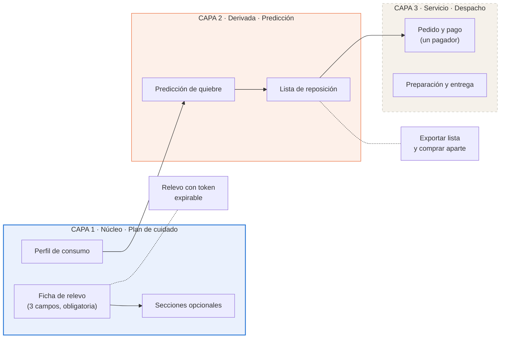

**La capa 1 es el producto.** El plan de cuidado convierte el conocimiento del cuidador en algo transferible, que es lo que permite el relevo. Sin ella, MATU es un despacho más. **Su versión mínima obligatoria es la ficha de relevo de tres campos**, y las seis secciones complementarias son ampliación opcional. La ficha de tres campos viene de la refutación de H1 (ADR-023), y las secciones complementarias de ver el producto funcionando en la demo del 30 de octubre (ADR-028).

**La capa 2 es el diferenciador computable.** Del perfil de consumo declarado en la capa 1 se deriva cuándo se acaba cada insumo. Ese cálculo es lo que MATU tiene y un delivery genérico no puede tener, porque requiere conocer a la persona cuidada.

**La capa 3 es un servicio, no la razón de existir.** Con convenio, MATU despacha. Sin convenio, la familia exporta la lista y compra donde quiera. El sistema sigue entregando su valor central.

**Consecuencia arquitectónica principal:** las dependencias apuntan hacia abajo y nunca hacia arriba. `care_plan` no sabe que existe `fulfillment`. Eso es lo que permite construir y demostrar el producto sin haber cerrado un solo convenio.

---

## 5. Vista de contexto (C4 nivel 1)

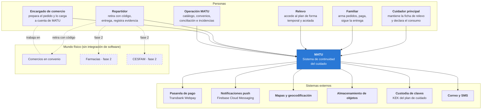

**El cuidador principal es el usuario central**, no el familiar que paga. Es quien alimenta la capa 1, de la cual depende todo lo demás. La validación reforzó esa decisión por una vía inesperada: ocho de diez entrevistadas declararon que la suscripción la pagaría la propia cuidadora, no un tercero.

**MATU no se integra por software con el punto de venta de ningún comercio.** La integración es humana: el comercio recibe el pedido en una pantalla, lo prepara, lo carga a cuenta y lo entrega contra un código. Una de las entrevistadas describió un arreglo idéntico ya operando entre su familia y una farmacia de barrio, con boleta a nombre de la familia, lo que confirma que el modelo existe en terreno.

**La persona cuidada no es usuaria del sistema.** Es sujeto de los datos y destinataria de la entrega, pero no tiene cuenta. Esa distinción tiene consecuencias legales tratadas en la sección 11.

**MATU es soporte logístico y de continuidad del cuidado, no un prestador de salud.** Esa frase delimita el alcance del sistema y explica por qué el modelo de datos no contiene diagnósticos.

---

## 6. Vista de contenedores y módulos

### 6.1 Contenedores (C4 nivel 2)

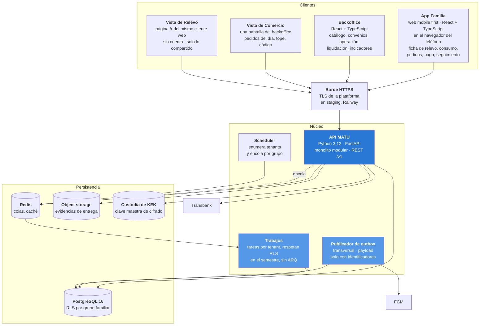

**Los cuatro clientes son un solo cliente web** (`web/` de MATU_PROYECTO), con componentes, tokens y cliente HTTP compartidos (ADR-026). **La API sirve la aplicación desde el mismo origen**, sin CORS, y el cliente HTTP se tipa desde el contrato OpenAPI (`docs/api/openapi.json`). En el semestre están construidas la app de la familia y la vista de relevo. El backoffice y la vista de comercio son del sprint 4 en adelante.

**La App Repartidor sale del diagrama de contenedores comprometido.** RF-27 a RF-30 quedaron en *Debería* desde el primer recorte, y en el piloto el retiro y la entrega se marcan desde la vista de comercio. **La app nativa, de familia o de repartidor, se decide después del semestre** con los datos del piloto (ADR-026). El paquete Flutter compartido del ADR-005 ya no se mantiene.

### 6.2 Responsabilidad de cada contenedor

| Contenedor | Responsabilidad | Lo que explícitamente no hace |
|---|---|---|
| **App Familia** | Ficha de relevo, secciones complementarias, perfil de consumo, lista de insumos, catálogo, pedido, seguimiento. Aplicación web mobile first, diseñada primero para 360 px de ancho | No calcula totales finales. No decide sustituciones. No guarda nada de la ficha, del consentimiento ni de la persona cuidada en el navegador |
| **Backoffice** | Catálogo, convenios, monitoreo, incidencias, conciliación, liquidación, indicadores | No accede al plan de cuidado. No es canal de soporte al cliente final |
| **Vista de Comercio** | Stock apartado, sus líneas de los pedidos del día, preparación, validación de código, marcado de retiro y entrega | No ve la dirección de entrega ni ningún nombre: solo la referencia del pedido y el código de retiro (ADR-027) |
| **Vista de Relevo** | Lectura de las secciones habilitadas del plan de cuidado | No permite edición. No expone otras secciones. No crea sesión persistente |
| **API MATU** | Toda la lógica de negocio y toda la autorización | No ejecuta trabajo largo. Nada sobre 2 segundos vive aquí |
| **Worker** | Trabajo por tenant: predicción de quiebre, materialización de alertas | No expone endpoints. No es alcanzable desde internet. **No evade RLS** |
| **Publicador de outbox** | Publicación de eventos de dominio hacia notificaciones | **Transversal a tenants, y por eso su payload contiene solo identificadores, nunca datos** |
| **PostgreSQL** | Fuente única de verdad transaccional | No almacena archivos binarios |
| **Redis** | Colas y caché de catálogo | No es fuente de verdad de nada. Se puede vaciar sin pérdida |
| **Object storage** | Evidencias de entrega | Nunca sirve archivos públicos. Solo URLs firmadas de vida corta. **No guarda exportaciones**: la ficha no se exporta (ADR-029) y la lista sale del teléfono como texto, sin archivos en el servidor (ADR-031). En el semestre todavía no se usa |
| **Custodia de KEK** | Guarda la clave maestra que cifra las claves de datos. En el semestre es el adaptador de variable de entorno, solo con datos sintéticos (11.4) | No guarda datos. Ver ADR-016 |

### 6.3 Módulos del backend (C4 nivel 3)

```
app/
├── core/                 configuración, seguridad, dependencias, errores
├── shared/               eventos de dominio, outbox, auditoría, tipos comunes
├── modules/
│   ├── iam/              usuarios, autenticación, roles, dispositivos
│   ├── care_circle/      grupo familiar, membresías, personas cuidadas, direcciones
│   ├── care_plan/        ficha de relevo, secciones, accesos de relevo      ← CAPA 1
│   ├── consumption/      perfil de consumo, predicción de quiebre, lista    ← CAPA 2
│   ├── catalog/          productos, comercios, convenios, ofertas
│   ├── replenishment/    planes de reposición, ocurrencias        [DEBERÍA]
│   ├── ordering/         carrito, pedido, líneas, reglas de sustitución
│   ├── payments/         cargos, cobro único, devolución, pasarela          ← CAPA 3
│   ├── fulfillment/      preparación, código, evidencia
│   ├── settlement/       consumo por comercio, conciliación, liquidación
│   ├── rx/               recetas, farmacia, CESFAM                  [FASE 2]
│   ├── notifications/    plantillas, push, correo, SMS
│   └── backoffice/       operación, vista de comercio, indicadores
└── main.py
```

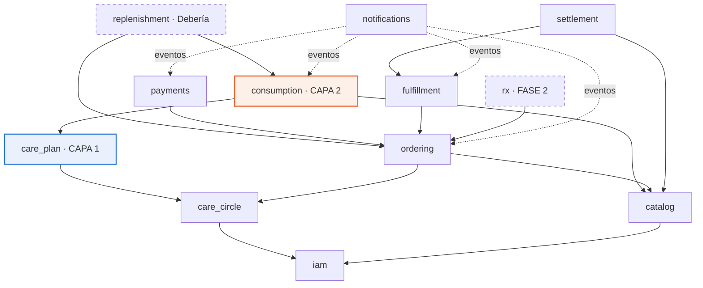

### 6.4 Regla de dependencias

Cuatro reglas, que verificará una prueba automática recorriendo el árbol de importaciones. No dependen de disciplina.

1. **Las flechas no se invierten.** `catalog` no importa `ordering`. Si necesita reaccionar a algo, escucha un evento.
2. **`care_plan` es hoja hacia arriba.** Ningún módulo de la capa 2 o 3 lo importa, salvo `consumption`, y solo para leer el perfil de consumo a través de una interfaz explícita que no expone las secciones sensibles.
3. **`fulfillment`, `settlement` y `payments` no son importados por `care_plan` ni por `consumption`.** Es lo que hace desacoplable el despacho: se puede eliminar la capa 3 completa y el sistema arranca.
4. **`notifications` no se llama directamente.** Solo consume eventos, para que ningún flujo de negocio falle porque una notificación falló.

La prueba vivirá en `tests/test_arquitectura.py`. La regla 3 se verifica además con una prueba de arranque que desactiva los routers de la capa 3 y comprueba que la aplicación levanta y que los flujos de las capas 1 y 2 siguen respondiendo.

---

## 7. Modelo de datos

### 7.1 Diagrama entidad-relación

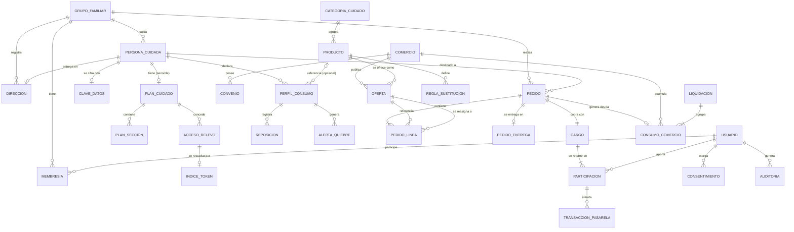

**Desde la v1.2 esta sección describe el esquema que se ejecuta.** El [modelo de datos](modelo-datos.md) es la migración `0001_esquema_inicial` desde el sprint 0. Al escribirlo y probarlo contra PostgreSQL aparecieron 16 diferencias con esta sección (su sección 10) y cinco hallazgos en las políticas (su sección 5.4). La v1.2 los incorpora en 7.2 a 7.7, y la sección 7.8 lista las migraciones que vinieron después. El detalle de cada tabla, con sus restricciones e índices, está en el modelo de datos. **Donde los dos documentos difieran, manda el esquema de las migraciones.**

El diagrama es un resumen: muestra las entidades que esta sección discute. El modelo completo tiene 49 tablas, entre ellas `pedido_entrega`, `pedido_transicion`, `sesion_refresh`, `dispositivo`, `invitacion`, `usuario_comercio`, `medio_pago_inscrito`, `preferencia_notificacion`, `notificacion`, `incidencia` e `indice_credencial`, que esta sección no detallaba y que soportan requisitos que sí estaban (RF-37 a RF-40, ADR-007, sección 11.6 y atributo de calidad 6).

**Las fichas del ADR-023 y del ADR-028 no agregaron tablas.** Los tres campos de la ficha son tres tipos de sección que `plan_seccion` ya tenía, y las seis secciones complementarias suman tres tipos nuevos al mismo `CHECK` (migración 0013). Que el plan B no obligara a migrar el esquema es exactamente la razón por la que se escribió antes de entrevistar.

**La migración 0002 (ADR-027) cambia la capa 3**, sin tablas nuevas: montos exactos en `pedido`, precio fijo y reasignación al mismo producto en `pedido_linea`, y monto cobrado y devuelto en `cargo` y `participacion`. El diagrama agrega la reasignación de una línea a otra oferta. `REGLA_SUSTITUCION` guarda la elección de RF-21 por producto: otro comercio o quitar (7.4).

### 7.2 Capa 1 · Plan de cuidado

| Entidad | Campos relevantes | Notas de diseño |
|---|---|---|
| `plan_cuidado` | id, grupo_id, persona_cuidada_id, modo, completitud_pct, actualizado_por, actualizado_en | `modo` lo agregó el cierre del ADR-023 (`ficha_relevo` o `completo`). **Con el ADR-028 deja de ser necesario**: no hay un "modo completo", solo secciones agregadas. La columna sigue en el esquema con su valor por omisión `ficha_relevo`. `completitud_pct` se calcula sobre los tres campos de la ficha, pero **la interfaz nunca bloquea por completitud** ni muestra la ficha como incompleta por no tener secciones. Ver ADR-018 |
| `plan_seccion` | id, plan_id, tipo, **contenido_cifrado**, **nonce**, **tag_auth**, kek_version, **version**, actualizado_por, actualizado_en, **creado_en** | Cifrado por sección, no por documento, para compartir una parte sin descifrar el resto. **`nonce` de 96 bits aleatorio por cada escritura, nunca un contador**: repetir un nonce en AES-GCM permite recuperar la clave de autenticación y forjar texto cifrado. `version` implementa bloqueo optimista (RF-04) y viaja como `ETag`. `creado_en` (migración 0013) es cuándo nació la sección, fijo en los UPDATE: un relevo ve una sección complementaria solo si nació antes de su acceso. **No hereda por `EXISTS`** del plan (hallazgo 1 del modelo de datos, 5.4): declara su propia condición por eje, o el relevo vería todas las secciones y no solo las habilitadas |
| `acceso_relevo` | id, **grupo_id**, plan_id, otorgado_por, otorgado_a_nombre, otorgado_a_telefono, **nombre_pila_persona**, **nombre_pila_comparte**, **relevo_informado_en**, secciones_permitidas, token_hash, **pin_hash**, pin_intentos_fallidos, creado_en, expira_en, revocado_en, telefono_borrado_en, **motivo**, usos, ultimo_uso_en | El relevo no crea cuenta. **Lleva `grupo_id` propio** en vez de heredarlo del plan, porque `plan_cuidado` y `acceso_relevo` se consultan mutuamente y PostgreSQL rechaza el ciclo de políticas (hallazgo 3). **Los dos nombres de pila se copian al crear el acceso**, para que el relevo nunca lea `persona_cuidada` ni `usuario`. Con ellos la pantalla del PIN dice quién compartió la ficha y de quién es (decisión 28 del contrato de MATU-09, migración 0004). `relevo_informado_en` es cuándo quien comparte declaró que le avisó al relevo que MATU guarda su nombre y su teléfono (decisión 34, migración 0004). **`motivo` es un enumerado sin texto libre**: `salgo_unas_horas`, `fin_de_semana_fuera`, `turno_de_noche` u `otro` (decisión 16). Queda en la auditoría 3 años, y un texto libre podría guardar un dato de salud que no se puede borrar. Cabe en la columna `text` y lo valida la API. **Token de uso múltiple hasta vencer**, no de un solo uso: el relevo consulta el plan durante todo su turno, y el acceso dura como máximo 30 días (`CHECK`). `pin_hash` es el segundo factor de cuatro dígitos, porque un enlace por WhatsApp es una credencial al portador sobre datos de salud, y `pin_intentos_fallidos` lo bloquea al quinto error. **La API no envía el PIN.** Lo muestra una sola vez a quien comparte, que se lo dicta al relevo. El envío por SMS es *Debería* y está fuera del semestre. El teléfono sirve para que quien comparte le envíe el enlace desde su propio teléfono, por WhatsApp o SMS, y para que la familia pueda contactar al relevo (decisión 24 del contrato de MATU-09). Solo lo devuelve la lista de accesos, y solo al administrador y al cuidador (decisión 31). Se vacía 30 días después de que el acceso vence o se corta, o al borrar a la persona, y `telefono_borrado_en` guarda cuándo (MATU-46, migración 0027). El relevo solo puede actualizar `pin_intentos_fallidos`, `usos` y `ultimo_uso_en` (trigger de la migración 0007) |
| `clave_datos` | id, grupo_id, persona_cuidada_id, dek_cifrada_con_kek, kek_version, creada_en, rotada_en, **destruida_en** | Sobre-cifrado. Una clave de datos por persona cuidada, cifrada con la clave maestra. Ver ADR-016. **El borrado criptográfico** deja `dek_cifrada_con_kek` en nulo y fija `destruida_en` en la misma sentencia (`CHECK`). Desde la migración 0003 una clave destruida no se borra ni se vuelve a llenar: no resucita (defecto 5 de la sección 12.8) |

**Tipos de sección, desde el ADR-028 y la migración 0013:**

| Nivel | Tipos | En la interfaz |
|---|---|---|
| **Ficha inicial**, obligatoria | `rutina`, `manejo_situaciones`, `red_apoyo` | Su día · Si se altera · A quién llamar |
| **Secciones complementarias**, opcionales | `quien_es`, `preferencias`, `alimentacion`, `movilidad`, `comunicacion`, `remedios` | Quién es · Lo que le hace bien · Comer y beber · Moverse y descansar · Cómo hablarle · Sus remedios |
| En el `CHECK`, sin uso | `horarios`, `actividades` | La API ya no los escribe. `horarios` repetía Su día y `actividades` quedó dentro de Lo que le hace bien |

**Los tres campos iniciales constituyen la ficha de relevo y son lo único obligatorio.** Al compartir, los tres van siempre y la cuidadora elige de cero a seis secciones complementarias. Sus remedios viene sin marcar y pide confirmación (ADR-028, actualización del 3 de noviembre). La validación mostró que tres de diez entrevistadas pidieron por su cuenta un campo de «qué la calma», que es precisamente el contenido de `manejo_situaciones`, y que tres prefieren no escribir sobre el aseo ni el cuidado del cuerpo con términos clínicos, por dignidad de la persona cuidada. Por eso no hay una sección de aseo: si la familia quiere decir algo, lo escribe con sus palabras en Moverse y descansar o en Si se altera. Las preguntas guía de cada tipo están en la sección 10.4 b.

### 7.3 Capa 2 · Perfil de consumo

| Entidad | Campos relevantes | Notas de diseño |
|---|---|---|
| `perfil_consumo` | id, grupo_id, persona_cuidada_id, producto_id, **nombre_libre**, unidad, **tasa_unidades**, **tasa_dias**, **stock_unidades**, **stock_medido_en**, **fecha_quiebre_estimada**, dias_aviso, **unidades_por_envase**, activo, **version**, actualizado_por | El corazón de la capa 2. **Todo en unidades base**, nunca en envases: la conversión vive en la presentación. **El ancla del cálculo es `stock_medido_en`, no la última reposición**, porque el cuidador declara stock en cualquier momento sin haber comprado nada, y anclar en la reposición produce fechas de quiebre en el pasado. **La tasa es una fracción entera** (`tasa_unidades` cada `tasa_dias`), igual que el dinero: "un suplemento cada cinco días" no necesita decimales. **Admite un insumo fuera del catálogo** con `nombre_libre`, exactamente uno de los dos (`CHECK`), porque la capa 2 funciona sin catálogo ni convenio (ADR-002). `version` es el `ETag` del PATCH y `actualizado_por` permite decir quién cambió el insumo en un 412 (migración 0009). `unidades_por_envase` es opcional y la anota la familia (migración 0015, ADR-031): sirve para sugerir envases enteros en la lista, y nunca se lee del catálogo de la capa 3. Solo admin y cuidador escriben, también en RLS |
| `reposicion` | id, perfil_id, **cantidad_unidades**, origen (`pedido_matu`, `declarada`), **pedido_ref**, ocurrida_en, registrada_por, registrada_en | Registrar una compra hecha fuera de MATU es obligatorio (RF-13): sin eso el cálculo se desalinea y las alertas pierden credibilidad. **`pedido_ref` es una referencia opaca sin clave foránea**, para que la capa 2 no dependa de la 3. Las compras declaradas se borran a los 90 días de registradas (migración 0017) |
| `alerta_quiebre` | id, perfil_id, fecha_prevista, estado (`pendiente`, `notificada`, `resuelta`, `descartada`), creada_en, notificada_en, cerrada_en | Se materializa antes de dispararse, con una restricción única por perfil y fecha, lo que hace idempotente el aviso. Solo el trabajo diario la crea abierta y la notifica, y un trigger fija las transiciones permitidas (migración 0011) |

**El cálculo, completo:**

```
dias_de_cobertura = piso(stock_unidades × tasa_dias / tasa_unidades)   -- división entera
fecha_quiebre     = stock_medido_en + dias_de_cobertura
alerta_si         = (fecha_quiebre - hoy) <= dias_aviso
```

Tres detalles que parecen menores y no lo son. **El piso es deliberado**: es preferible avisar un día antes que un día tarde. **El ancla es `stock_medido_en`**, no la reposición. Y **`unidades_a_envases` redondea hacia arriba**, porque nadie compra un tercio de paquete de pañales.

Vive en `app/modules/consumption/domain/perfil.py` (MATU-36) y su criterio de aceptación eran ocho pruebas de dominio, incluida una de regresión sobre el ancla. Se entregó en el sprint 3 del calendario v1.3, con las alertas de MATU-37 (objetivo específico 4).

Es aritmética de tercero básico, y esa es exactamente la gracia. **El valor no está en el algoritmo, está en tener el dato.** Ningún despacho genérico sabe que la persona usa cuatro pañales al día, porque nunca se lo preguntó a nadie.

**Lo que la validación agregó a esta capa.** Dos de los seis quiebres reportados fueron de un tipo que la predicción no evita: un desabastecimiento de la farmacia y una receta vencida. Eso no invalida el cálculo, pero sí obliga a que la interfaz no prometa evitar todo quiebre. Y el valor que las entrevistadas nombraron no fue la prevención de la urgencia sino la descarga mental: «el problema no es comprar, el problema es que yo tengo la cabeza en mil cosas y esa es una más».

`dias_aviso` tiene un valor por defecto de 7 y es configurable por producto.

### 7.4 Capa 3 · Catálogo, pedido, cumplimiento y pagos

| Entidad | Campos relevantes | Notas de diseño |
|---|---|---|
| `producto` | id, categoria_id, nombre, marca, presentacion, unidad, **unidades_por_envase**, requiere_receta, activo | `unidades_por_envase` conecta el catálogo con el perfil de consumo: 30 pañales por paquete permite traducir tasa de uso a paquetes |
| `oferta` | producto_id, comercio_id, precio, stock, disponible, actualizado_en | Con el ADR-027 el precio de la oferta es el precio exacto con IVA del comercio en convenio. La migración 0019 (MATU-59) renombró `precio_referencia` a `precio` y agregó `stock` |
| `convenio` | comercio_id, vigencia_desde, vigencia_hasta, **comision_pct**, **tarifa_despacho**, prepara_pedidos, cuenta_corriente, estado | `comision_pct` y `tarifa_despacho` son la regla de cálculo de la liquidación |
| `pedido` | id, grupo_id, persona_cuidada_id, comercio_id, direccion_id, estado, modo_cumplimiento, origen (`manual`, `alerta_quiebre`), ventana_entrega, **subtotal_productos**, **costo_envio**, **total**, **total_confirmado_en**, **total_vence_en**, **pagado_en**, codigo_retiro_hash, creado_por | `origen` incorpora `alerta_quiebre`, que es el camino que conecta la capa 2 con la 3. **`total = subtotal_productos + costo_envio`** por `CHECK`, con un envío único por pedido. `total_vence_en` lo fija el dominio 15 minutos después de `total_confirmado_en`; la base exige que los dos existan juntos y que el vencimiento sea posterior. **`pagado_en` marca desde cuándo el precio queda fijo**: nulo en `borrador`, `total_confirmado` y `vencido`, obligatorio desde `pagado` en adelante, y solo con un total confirmado (`CHECK`). Los 17 estados están en 8.1 |
| `pedido_entrega` | pedido_id, calle, numero, depto, comuna, referencia, lat y lng (siempre nulas, con un `CHECK`, C8 de MATU-61), telefono_contacto | **Separada de `pedido`** porque RLS filtra filas, no columnas: es la única forma de que el comercio vea el pedido sin la dirección de entrega (diferencia 9 del modelo de datos). El comercio no tiene política sobre esta tabla |
| `pedido_linea` | id, pedido_id, oferta_id, producto_id, cantidad, **precio_unitario**, estado_linea, **monto_devuelto**, **devuelta_en**, **oferta_reasignada_id**, **precio_reasignado**, **reasignada_en** | **Con el pedido pagado la línea no se edita**: un trigger impide cambiar producto, oferta, cantidad o precio, y agregar o borrar líneas. Lo que no se entrega se devuelve: `monto_devuelto` nunca supera cantidad × `precio_unitario`, y la línea está en `devuelta` si y solo si tiene monto y fecha de devolución. **La reasignación es al mismo producto en otra oferta**, nunca otra marca (trigger), y `precio_reasignado` es lo que MATU paga, con la diferencia a su cargo. Estados: `pendiente`, `sin_stock`, `preparada`, `faltante`, `devuelta`, `eliminada` |
| `regla_sustitucion` | id, pedido_id, producto_id, accion | **RF-21, redefinido el 27-10.** Qué hace MATU si un producto del pedido falta: `otro_comercio` (el mismo producto en otro comercio en convenio) o `quitar` (sale del pedido y se devuelve su precio). **Sin fila, se busca en otro comercio**: es la opción por omisión. Una regla por producto y pedido. Salieron `producto_sustituto_id` y `precio_maximo`: nunca otra marca ni otro producto. El backend propone renombrarla a `regla_faltante`; es una propuesta y no se renombró |
| `cargo` | id, pedido_id, **monto_cobrado**, **monto_devuelto**, estado, respaldo_usuario_id | Uno por pedido. Sin margen, monto autorizado ni capturado. Estados `pendiente`, `pagado`, `rechazado`, `devuelto_parcial` y `anulado`, y un `CHECK` ata cada estado a sus montos: nada cobrado en `pendiente` y `rechazado`, nada devuelto en `pagado`, devolución menor que lo cobrado en `devuelto_parcial` e igual en `anulado`. **Lo devuelto nunca supera lo cobrado** (`CHECK`) |
| `participacion` | id, cargo_id, usuario_id, porcentaje_bp, **monto_cobrado**, **monto_devuelto**, estado, es_respaldo | **Se mantiene en el modelo aunque el MVP use una sola participación al 100%.** Conservarla es lo que permite activar RF-22 a RF-24 en la fase 2. Mismos montos y la misma regla que `cargo`, con los estados en femenino (`pendiente`, `pagada`, `rechazada`, `devuelta_parcial`, `anulada`). [PENDIENTE: la 0002 quitó `monto_comprometido`, que es la base del prorrateo de 8.3; cuando vuelva el pago entre varios familiares, la base del reparto se define con otra migración] |
| `transaccion_pasarela` | id, participacion_id, proveedor, buy_order, token, tipo (`venta`, `anulacion`), monto, estado, payload_respuesta, idempotency_key | La venta normal de Webpay Plus y su anulación, total o parcial. Nunca se borra ni se actualiza destructivamente. Es el registro contable |
| `consumo_comercio` | id, comercio_id, pedido_id, monto_autorizado, monto_boleta, folio_boleta, evidencia_id, estado, desviacion_pct | Contrapartida de `cargo`: lo que MATU debe al comercio. [PENDIENTE: `monto_autorizado` sigue en el esquema] |
| `liquidacion` | id, comercio_id, periodo_desde, periodo_hasta, monto_bruto, **monto_comision**, monto_neto, estado, factura_ref, pagada_en | `monto_comision = Σ(consumo.monto_boleta × convenio.comision_pct)` |

**Lo que el comercio ve, en la base.** Las políticas `pedido_comercio_ver` y `pedido_comercio_actualizar` le muestran un pedido solo si es suyo (`pedido.comercio_id`), tiene `pagado_en` y está en `enviado_a_comercio` o después. Las líneas heredan esa visibilidad desde el pedido. RLS filtra filas, no columnas. En los pedidos que ve, el comercio alcanza todas las columnas de `pedido`, incluidos identificadores estables de la familia (`grupo_id`, `persona_cuidada_id`, `creado_por`) y, por herencia, las transiciones y las elecciones de RF-21. Que no los vea ni los cambie depende hoy de la proyección de la API (9.5). [PENDIENTE: quitar `destinatario_nombre_pila` con una migración nueva; impedir que el comercio escriba `regla_sustitucion` y `monto_devuelto`; decidir si la proyección del comercio también se limita en la base.]

**Lo que la migración 0002 dejó fuera a propósito.** Ninguno de estos puntos tiene diseño todavía, y no se inventa aquí:

- [PENDIENTE: `consumo_comercio.monto_autorizado`, "el tope que vio el comercio", sigue en el esquema aunque el ADR-027 ya no tiene tope autorizado. Se rediseña con la conciliación de 11.7 y el convenio.]
- [PENDIENTE: los tipos `desviacion_monto` y `captura_rechazada` de `incidencia` siguen en su `CHECK`. Con precio exacto y sin captura pierden su sentido original; se revisan junto con la conciliación.]
- Resuelto en la migración 0019 (MATU-59): `oferta.precio_referencia` pasó a `oferta.precio`, sin el comentario de precio referencial del ADR-011.
- [PENDIENTE: el RLS del comercio se resuelve por `pedido.comercio_id`. **El comercio que reemplaza a otro no ve la línea reasignada**, porque la línea hereda la visibilidad del pedido y no de `oferta_reasignada_id`. La reasignación es de la fase 2, y cómo se le da a ese comercio la proyección de 11.2 es una decisión de aislamiento pendiente.]
- [PENDIENTE: por lo mismo, `pedido` conserva un solo `comercio_id`, y el comercio ve todas las líneas del pedido. Cómo se registra un pedido que al confirmar se abastece en dos comercios, con un solo cobro y un solo envío (ADR-027, ajuste del ADR-024), no está en la 0002.]

### 7.5 Transversales

| Entidad | Campos relevantes | Notas |
|---|---|---|
| `consentimiento` | id, grupo_id, usuario_id, persona_cuidada_id, **calidad_otorgante** (`titular`, `representante_legal`, `cuidador_de_hecho`), finalidad, version_politica, evidencia, otorgado_en, revocado_en, revocacion_motivo | Requisito directo de la Ley 21.719. **`calidad_otorgante` es la pieza clave**: el titular de los datos es muchas veces una persona sin capacidad para consentir, y quien opera la aplicación puede no ser su representante legal. Ver la sección 11.5. **Es inalterable** desde la migración 0006: no se actualiza ni se borra, y solo se registra la revocación, una vez. Desde la 0016 la revocación lleva su motivo (`retiro` o `renovacion`) y solo la registran admin o cuidador (MATU-44) |
| `auditoria` | id, grupo_id, actor_tipo, **actor_ref**, accion, entidad, entidad_id, **motivo**, ip (no se llena), request_id, ocurrido_en | Append-only, con una prueba comprometida que lo verifique. **`actor_ref` es polimórfico** porque el relevo no es usuario y es justamente el actor más sensible del sistema. **La IP no se guarda** (decisión 27 del contrato de MATU-09, 27-10). La columna `ip` viene de la migración 0001 y queda siempre vacía. **Quién lee la auditoría** lo fija la migración 0005 (decisión 36): el administrador lee todas las filas de su grupo, cada miembro solo las suyas, y operación no tiene lectura amplia. La 0010 agrega que quien puede ver el plan lee las aperturas de los relevos (RF-08). [PENDIENTE: ninguna migración hasta la 0017 elimina la columna `ip`.] |
| `evento_outbox` | id, grupo_id, tipo, **payload solo con identificadores**, agregado_id, disponible_en, intentos, publicado_en, fallido_en | Tabla de **infraestructura sin RLS**, acotada por permiso de rol. Contrato completo en 8.6 |
| `idempotencia` | clave, **grupo_id**, endpoint, usuario_id, hash_peticion, estado_http, respuesta, creada_en | Soporta el header `Idempotency-Key`. **Lleva `grupo_id` y RLS como cualquier tabla de negocio**: guarda cuerpos de respuesta de pedidos y pagos, de modo que sin tenant sería una excepción no declarada al modelo de aislamiento (sección 12.8) |
| `evento_consumido` | evento_id, consumidor, consumido_en | Clave primaria compuesta. Es lo que hace idempotente al consumidor |

### 7.6 Nueve decisiones de modelado que conviene defender

**a) El dinero es entero, no decimal.** El peso chileno no tiene subunidad en uso. Todo monto es `BIGINT` en pesos. Usar coma flotante para dinero es un error clásico, y `NUMERIC(12,2)` aquí solo invita a redondeos que no existen en el dominio.

**b) La reasignación queda en la misma línea, y siempre es el mismo producto.** Con el ADR-027 no hay sustitución por otra marca. Si al retirar falta un producto, la línea guarda `oferta_reasignada_id`, `precio_reasignado` y `reasignada_en`, y un trigger exige que la nueva oferta sea del mismo producto. La sustitución como línea nueva (`sustituto_de_linea_id`) salió con la migración 0002. La familia ve exactamente qué pidió y qué llegó.

**c) El precio queda fijo al pagar, y lo que no se entrega se devuelve.** `precio_unitario` es el precio exacto que la familia aceptó en el total confirmado. Desde `pedido.pagado_en`, un trigger impide cambiar el producto, la cantidad o el precio de una línea, y agregar o borrar líneas. Lo que no se entrega no se edita: se registra como `monto_devuelto` en la línea y en el cargo, y la base exige que lo devuelto nunca supere lo cobrado. Reemplaza al par `precio_snapshot` y `precio_real` del ADR-011. Es la base de confianza de un servicio de compra por encargo: lo que la familia pagó no cambia después.

**d) La alerta se materializa antes de dispararse.** El scheduler no pregunta "qué toca hoy", crea filas con anticipación. Una corrida doble del job no genera dos avisos, y "descartar" y "resolver" son transiciones auditables y no un borrado.

**e) La fecha de quiebre es un campo materializado, no una consulta.** Se recalcula cuando cambia el perfil o cuando se registra una reposición, y una vez al día por seguridad. Consultarla en línea obligaría a calcular sobre toda la base para responder "qué se está por acabar", que es la consulta más frecuente de la aplicación.

**f) Hay dos flujos de dinero y dos tablas distintas.** `cargo` describe lo que MATU cobra a la familia. `consumo_comercio` y `liquidacion` describen lo que MATU debe al comercio. Son montos parecidos en momentos distintos: se cobra al pagar el total confirmado, antes de preparar (ADR-027), y se paga al comercio a fin de período.

**g) El código de retiro se guarda con hash, no en claro.** Es la credencial que autoriza a llevarse mercadería cargada a la cuenta de MATU. Se trata como contraseña de un solo uso.

**h) El nonce se guarda, no se deriva.** `plan_seccion` lleva `nonce` y `tag_auth` como columnas. Sin nonce almacenado no se puede descifrar, y reutilizarlo entre escrituras rompe AES-GCM por completo.

**i) El plan de cuidado se cifra por sección y con clave por persona.** Cifrar por sección permite compartir rutina y manejo de situaciones con un relevo sin exponer red de apoyo ni preferencias. Una clave de datos por persona cuidada permite revocar el acceso a una persona sin rotar todo el sistema.

### 7.7 Aislamiento multi-tenant sobre tres ejes

Esta sección se reescribió por completo tras la primera ronda de revisión. La versión anterior describía un solo eje de acceso, el de la familia, y con eso **no se podía atender a tres de los ocho roles del sistema**.

#### Los tres hechos que gobiernan el modelo

**1. El rol de la aplicación no es propietario de las tablas, y se aplica `FORCE`.**

En PostgreSQL, **el propietario de una tabla ignora sus propias políticas RLS** salvo que se declare `FORCE ROW LEVEL SECURITY`. Si Alembic corre las migraciones con el mismo usuario que la API, el aislamiento queda desactivado en silencio. Es literalmente el escenario "RLS finge proteger".

```sql
-- migraciones: matu_owner. Ejecución: matu_app, que NO es propietario.
ALTER TABLE pedido ENABLE ROW LEVEL SECURITY;
ALTER TABLE pedido FORCE  ROW LEVEL SECURITY;
```

**2. Hay tres ejes de acceso, y PostgreSQL los combina con OR.**

```sql
CREATE POLICY pedido_familia   ON pedido FOR ALL
  USING (grupo_id    = current_setting('app.grupo_id',    true)::uuid);
CREATE POLICY pedido_comercio  ON pedido FOR ALL
  USING (comercio_id = current_setting('app.comercio_id', true)::uuid);
CREATE POLICY pedido_operacion ON pedido FOR ALL
  USING (current_setting('app.rol', true) = 'operacion');
```

**Y el eje de operación no está en todas partes.** `plan_cuidado` y `perfil_consumo` quedan deliberadamente **fuera** de él, porque la sección 11.2 declara que operación nunca los alcanza.

**3. Las tablas hijas no llevan `grupo_id`: heredan del padre, salvo las de varios ejes.**

```sql
CREATE POLICY plan_seccion_hereda ON plan_seccion FOR ALL
  USING (EXISTS (SELECT 1 FROM plan_cuidado p WHERE p.id = plan_seccion.plan_id));
```

**Este ejemplo es el de la v1.1, y el esquema lo corrigió.** Una hija que hereda por `EXISTS` hereda todas las políticas del padre, no solo la de familia: así el relevo habría visto todas las secciones y el comercio la dirección de entrega. Por eso las hijas de tablas con varios ejes (`plan_seccion`, `acceso_relevo`, `pedido_entrega`, `pedido_linea`) declaran su condición explícita por eje, y `acceso_relevo` y `asignacion` llevan `grupo_id` propio para no formar un ciclo de políticas (hallazgos 1 y 3 del [modelo de datos](modelo-datos.md), 5.4). **El rol de la membresía también se exige en RLS** para el plan de cuidado: un observador recibe cero filas aunque la API olvide revisar su rol.

#### Contexto de sesión

| Variable | Cuándo se fija |
|---|---|
| `app.usuario_id` | **Siempre y primero.** La política de `membresia` depende de él |
| `app.grupo_id` | Cuando el actor es una familia |
| `app.comercio_id` | Cuando el actor es un comercio en convenio |
| `app.repartidor_id` | Cuando el actor es un repartidor (fase 2) |
| `app.acceso_relevo_id` | En la vista de relevo, después de resolver el token y validar el PIN |
| `app.rol` | `operacion` habilita el eje transversal, auditado. `relevo` y `sistema` acotan al relevo y a los trabajos de un grupo. Sin valor, vale `ninguno` |

**Son seis variables y no cuatro** (diferencia 1 del modelo de datos): el repartidor y el relevo no son tenants de familia ni de comercio. **El relevo nunca fija `app.grupo_id`**: si lo fijara, heredaría todas las políticas de la familia y vería pedidos, pagos y direcciones (hallazgo 2). Sus políticas se resuelven solo por `app.acceso_relevo_id`.

```python
@asynccontextmanager
async def sesion_tenant(maker, *, usuario_id=None, grupo_id=None,
                        comercio_id=None, rol=None, verificar_membresia=True):
    async with maker() as sesion:
        async with sesion.begin():
            # el orden importa: primero identidad, después tenant
            await _fijar(sesion, "app.usuario_id",  usuario_id)
            await _fijar(sesion, "app.grupo_id",    grupo_id)
            await _fijar(sesion, "app.comercio_id", comercio_id)
            await _fijar(sesion, "app.rol",         rol)
            if verificar_membresia and usuario_id and grupo_id and rol != "operacion":
                ...  # la consulta de membresía corre DENTRO del contexto
            yield sesion
```

El `true` de `set_config(clave, valor, true)` hace el ajuste **local a la transacción**, de modo que el pool de conexiones no arrastre el contexto de una petición a la siguiente. Ese detalle es la diferencia entre que RLS proteja y que RLS finja proteger.

**Y el orden importa.** La verificación de membresía consulta una tabla con RLS, cuya política es por `app.usuario_id`. Fijar el contexto **después** de verificar habría devuelto cero filas y toda petición autenticada habría fallado.

#### Los trabajos asíncronos

1. El scheduler enumera los grupos activos y **encola un job por grupo**, no un job global.
2. Cada job abre su transacción y fija `app.grupo_id` con el mismo helper que usa la API.
3. **El worker corre con el mismo rol que la API.** No existe un rol de aplicación que evada RLS.

**Cómo quedó en el semestre.** No hay ARQ ni un worker en escucha todavía. Los trabajos son tareas de línea de comando que se invocan a mano o desde un cron, con la conexión de `matu_app` (MATU-37, MATU-41 y MATU-44): el trabajo diario de quiebres, el publicador de avisos y las conservaciones. Cumplen las tres reglas: el trabajo diario enumera los grupos con `app.rol = 'operacion'`, que solo devuelve identificadores, y por cada grupo abre su propia transacción con `app.grupo_id` y `app.rol = 'sistema'`. Si un grupo falla, se deshace solo ese grupo. **Las conservaciones borran con funciones `SECURITY DEFINER`** (dueño `matu_owner`, `search_path` fijo, `EXECUTE` solo para `matu_app`) que exigen `app.rol = 'operacion'`, solo borran filas vencidas y devuelven contadores, nunca columnas. [PENDIENTE: el programador de tareas del despliegue llega con MATU-74.]

#### Las excepciones, reconocidas y acotadas

**a) El publicador de outbox.** Es transversal por definición. `evento_outbox` se declara **tabla de infraestructura sin RLS**, justificado porque su payload contiene solo identificadores (un `CHECK` solo admite UUID). El diseño le da un rol propio con permiso **únicamente** sobre esa tabla:

```sql
REVOKE ALL ON ALL TABLES IN SCHEMA public FROM matu_publisher;
GRANT SELECT, UPDATE ON evento_outbox   TO matu_publisher;
GRANT SELECT, INSERT ON evento_consumido TO matu_publisher;
```

**En el semestre `matu_publisher` no tiene credenciales en la infraestructura.** El publicador de MATU-41 usa cuatro funciones `SECURITY DEFINER` de la migración 0014, con `EXECUTE` solo para `matu_app` y que exigen `app.rol = 'operacion'`. Así `matu_app` sigue sin leer ni actualizar `evento_outbox` directamente, y no aparece un rol que se salte RLS.

**b) Los endpoints públicos.** La vista de relevo y el retorno de pasarela deben resolver un token **antes** de saber a qué grupo pertenece. Se resuelve con `indice_token`, una tabla sin RLS y sin dato sensible que solo traduce `token_hash → grupo_id`. **`indice_token` guarda también `revocado_en`** (decisión 23 del contrato de MATU-09, migración 0007). Revocar un acceso la fija en la misma transacción que `acceso_relevo.revocado_en`. Así el canje y la sesión de relevo distinguen revocado de vencido con una sola lectura, sin el rol `sistema`. `indice_token` cubre cuatro tipos de token y no dos: relevo, invitación, retorno de pago y refresh.

**c) El login.** Buscar el email de quien entra ocurre antes de tener contexto, igual que la vista de relevo, y con RLS forzado devolvería cero filas. Es la **tercera excepción**, que la v1.1 no contemplaba: `indice_credencial`, sin RLS y sin dato personal en claro, porque guarda un HMAC del email con un secreto que vive fuera de la base (hallazgo 4). Con `evento_consumido` son cuatro tablas de infraestructura sin RLS, todas acotadas por permiso.

**d) El scheduler.** Tiene su propio rol, `matu_scheduler`, con permiso por columna sobre `grupo_familiar`, y su propia política. Una política declarada para todos los roles se evaluaba también para él y le impedía listar grupos (hallazgo 5).

#### Qué hay que demostrar, y no solo afirmar

`tests/test_aislamiento.py` corre contra PostgreSQL real, no contra un doble. Cerró el sprint 0 con 31 pruebas en verde, y cada migración que toca RLS sumó las suyas: al 7 de noviembre, con la 0017, tiene 116 funciones de prueba.

| Prueba | Qué debe demostrar |
|---|---|
| sin contexto, cero filas | Una consulta sin `app.grupo_id` no devuelve todo, devuelve nada |
| worker sin contexto, cero filas | El hueco que tenía el diseño anterior quedó cerrado |
| operación no alcanza el plan | La celda "operación · plan de cuidado · nunca" de la sección 11.2 es cierta |
| `FORCE` activo tabla por tabla | El escenario "RLS finge proteger" no puede ocurrir |

La revisión de este modelo descrita en la sección 12.8 encontró **cinco defectos que la lectura del diseño no dejaba ver**. Los cinco están corregidos en el modelo que esta sección describe.

### 7.8 Migraciones

El esquema solo cambia con migraciones de Alembic revisables y reversibles. **Decisión del 28 de octubre:** los scripts de `backend/db/` (roles, esquema, RLS y permisos) quedan como la migración 0001 y no se tocan. Cada cambio posterior va en una migración nueva, con el SQL de políticas, permisos, triggers y `CHECK` dentro de ella (`op.execute`), y su `downgrade()` deja el esquema exactamente como en la anterior. Lo verifican `tests/test_migraciones.py`, que sube y baja cada una, y `tests/test_cadena_migraciones.py` (MATU-70), que exige una sola cabeza: dos ramas con su migración sobre la misma cabeza se apilan en orden antes de fusionarse.

| # | Migración | Historia | Fecha | Qué cambia |
|---|---|---|---|---|
| 0001 | `esquema_inicial` | Sprint 0 | 13 de octubre | 49 tablas, 94 políticas de RLS y los permisos por rol |
| 0002 | `precios_exactos_un_cobro` | ADR-027 | 27 de octubre | Montos exactos y un solo cobro en `pedido`, `pedido_linea`, `cargo` y `participacion`, triggers del pedido pagado y RLS del comercio (7.4 y 8.1) |
| 0003 | `clave_datos_destruida_fija` | MATU-11 | 28 de octubre | Una clave de datos destruida no se borra ni se vuelve a llenar |
| 0004 | `acceso_relevo_nombre_comparte` | MATU-18 | 28 de octubre | `nombre_pila_comparte` y `relevo_informado_en` en `acceso_relevo` |
| 0005 | `auditoria_lectura_admin` | MATU-14 | 28 de octubre | Quién lee la auditoría |
| 0006 | `consentimiento_inalterable` | MATU-07 | 28 de octubre | El consentimiento no se cambia ni se borra, y solo se registra la revocación |
| 0007 | `relevo_abrir` | MATU-19 | 29 de octubre | `indice_token.revocado_en`, políticas del relevo y la función que verifica la autorización vigente en el relevo |
| 0008 | `sesion_dispositivos` | MATU-38 | 2 de noviembre | Refresh rotativo, dispositivos y su conservación, sin lectura de operación |
| 0009 | `perfil_consumo` | MATU-36 | 3 de noviembre | Versión y autor del perfil, insumo del catálogo o libre, escritura solo de admin y cuidador, y conservación |
| 0010 | `auditoria_aperturas_relevo` | MATU-45 | 3 de noviembre | Quien ve el plan lee las aperturas de los relevos |
| 0011 | `alertas_quiebre` | MATU-37 | 3 de noviembre | Políticas y transiciones de las alertas y las reposiciones, y su conservación |
| 0012 | `celular_verificado` | MATU-57 | 3 de noviembre | Celular verificado y su canal preferido |
| 0013 | `ficha_ampliada` | MATU-50 | 3 de noviembre | Tres tipos de sección nuevos (ADR-028) y `plan_seccion.creado_en` para lo que ve cada relevo |
| 0014 | `avisos_outbox` | MATU-41 | 4 de noviembre | Publicador del outbox con funciones acotadas, avisos por correo y push |
| 0015 | `perfil_unidades_por_envase` | MATU-60 | 6 de noviembre | Unidades por envase, opcionales, para la lista de insumos (ADR-031) |
| 0016 | `retiro_autorizacion` | MATU-44 | 6 de noviembre | Motivo del retiro de una autorización, barrera por rol y destrucción de la ficha a los 90 días |
| 0017 | `conservar_compras` | MATU-51 | 7 de noviembre | Las compras declaradas se borran a los 90 días |

**Los diagramas del modelo de datos siguen en la 0001** para las tablas que cambiaron después. Se regeneran con `backend/db/gen_diagramas.py` contra una base con todas las migraciones (modelo de datos, sección 0).

---

## 8. Máquinas de estado y flujos

### 8.1 Ciclo de vida del pedido

> **Reescrita con el ADR-027.** Reemplaza el ciclo del ADR-006, que autorizaba con margen al confirmar y capturaba el monto real al entregar. Por qué se cambió está en el [ADR-027](adr/ADR-027-precios-exactos.md), resumido en la sección 14. **Alineada con la migración 0002** el 27 de octubre: los nombres son los del `CHECK` de `pedido`.

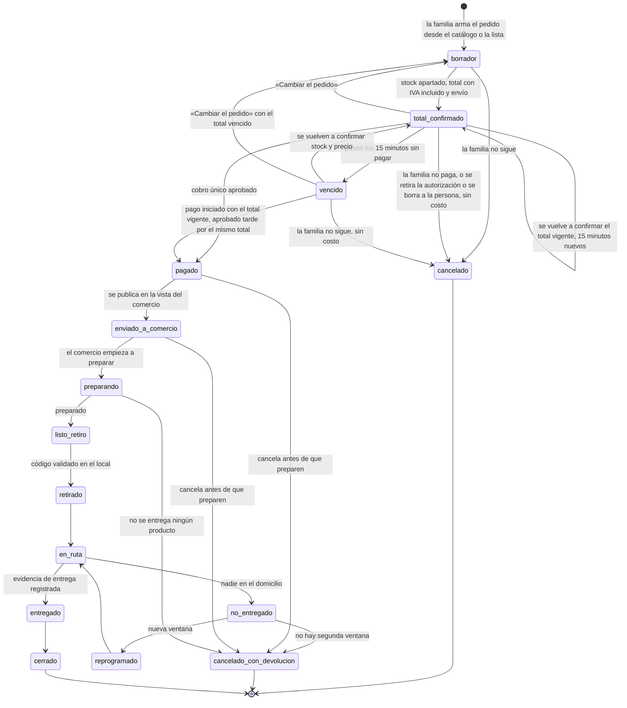

**Las vueltas antes de pagar (MATU-61, decisiones CJ1 y CJ9 de Jorge del 11-11, decisiones 201, 208 y 218 de `api/README.md`).** Se agregan tres transiciones, todas antes del pago:
- `total_confirmado → total_confirmado`: `confirmar` acepta también un total **vigente** y lo reemplaza con 15 minutos nuevos. Sirve para «Volver a confirmar» antes de que venza y para llevar una dirección nueva al pedido, sin cancelar.
- `total_confirmado → borrador` y `vencido → borrador`: «Cambiar el pedido» (`POST /v1/pedidos/{id}/cambiar`). Descarta el total, las partes por comercio y la copia de la entrega, y cada línea vuelve al precio y al comercio del carrito. Las reglas si falta un producto se conservan. Motivo `familia_cambia_carrito`.

Un pedido pagado nunca vuelve a `borrador`: lo impide el trigger `pedido_pagado_fijo`. El retiro de la autorización de pedidos y el borrado de la persona llevan a `cancelado` los pedidos sin pagar, con los motivos `autorizacion_retirada` y `persona_borrada` (D1 y D2 de la revisión previa de MATU-61). El vencimiento lo dice el `Reloj`: un total con `total_vence_en` ya pasado se informa como `vencido` aunque la fila diga `total_confirmado`, y la transición se guarda con actor `sistema` y motivo `total_vencio` en la siguiente escritura del pedido (decisión 204). `pedido_transicion.motivo` es una lista cerrada: `total_vencio`, `familia_cancela`, `familia_cambia_carrito`, `autorizacion_retirada` y `persona_borrada`, o vacío al confirmar (C19). **Un solo pedido sin pagar por persona** (C4).

**El pago (MATU-62, D-62-4 y decisiones 223 a 248 de `api/README.md`).**
- `vencido → pagado` solo para un pago **iniciado con el total vigente** y aprobado después por el mismo total y el mismo `total_confirmado_en` (regla 2). Lo marcan solo `sistema` u `operacion`, con un trigger que exige una venta aprobada y no anulada de ese total.
- Un pago aprobado de un total que ya no es el del pedido (se cambió, se volvió a confirmar o se canceló) **se anula completo el mismo día** y el estado no se mueve (regla 3).
- Mientras hay un pago en curso, `confirmar`, `cambiar`, las líneas, las reglas y el contacto responden 409 `pago-en-curso`. Cancelar, retirar la autorización y borrar a la persona siguen funcionando (regla 1), y si el pago se aprueba después, se anula.
- Manda esta sección sobre la 12.4: con el total vencido, `pagar` no vuelve el pedido a `borrador` (D-62-15).

**El cobro ocurre una sola vez, antes de preparar.** La familia paga el total confirmado y desde ahí el monto no cambia. No hay estado de captura pendiente ni de incobrable, porque no queda nada por cobrar después de pagar.

**El pedido se prepara antes de asignar repartidor**, no después. El comercio confirma `listo_retiro` y recién ahí sale el retiro. Eso baja el tiempo del repartidor por pedido de unos 40 minutos a menos de 10.

**El faltante tardío no es un estado del pedido, es un evento de la línea.** Si al preparar o al retirar un producto apartado ya no está, se aplica la elección de la familia para ese producto (RF-21) con la regla de la sección 8.3: el mismo producto en otro comercio, o la devolución de su precio. Si eligió quitarlo, o ningún comercio lo tiene, se devuelve su precio. El pedido sigue su curso con las demás líneas. Solo si no se entrega ningún producto pasa a `cancelado_con_devolucion`.

**`requiere_decision` sale de la máquina.** Existía para que la familia eligiera un sustituto con el comercio preparando. Con RF-21 redefinido (27-10), la familia decide **antes de pagar**, por cada producto, si un faltante se busca en otro comercio (lo que pasa si no elige) o se quita y se devuelve su precio. No queda nada que decidir después de pagar.

**Los estados de recaudación salen del esquema.** La migración 0002 quitó `pendiente_recaudacion`, que dependía del reparto entre varios pagadores, y convirtió `expirado` en `vencido`. **`asignado` y `sin_repartidor` siguen en el `CHECK`** para la app de repartidor de la fase 2, pero la máquina del MVP no los usa: el pedido pasa de `listo_retiro` a `retirado`.

**`confirmando_stock` no es un estado guardado.** La migración 0002 no lo incluye: mientras MATU consulta el stock, el pedido sigue en `borrador`, y si ningún producto está disponible no sale de ahí. Con el adaptador simulado la consulta dura un instante. [PENDIENTE: si un adaptador real responde de forma asíncrona, se decide si el estado se agrega con otra migración.]

| Estado | Por qué existe |
|---|---|
| `total_confirmado` | El precio y el stock quedan apartados por **15 minutos** (`total_vence_en`). Si vencen sin pago, el pedido pasa a `vencido` |
| `vencido` | El total confirmado pasó sus 15 minutos. No se cobra: `pagar` verifica la vigencia contra el `Reloj`. Para seguir se vuelven a confirmar stock y precio, se vuelve al carrito con «Cambiar el pedido», o la familia no sigue, sin costo |
| `pagado` | El cobro único se aprobó y `pagado_en` fija el precio de las líneas. El comercio todavía no ve el pedido |
| `cancelado_con_devolucion` | Cierra los casos en que ya se cobró y no se entrega nada: cancelación antes de preparar, ningún producto disponible al preparar, o nadie en el domicilio sin segunda ventana. Se devuelve el total, envío incluido |

**Lo que la base garantiza del ciclo.** Las transiciones las controla el dominio, pero la migración 0002 agrega `CHECK` que atan el estado a los datos del cobro:
- antes del pago (`borrador`, `total_confirmado`, `vencido`) no hay `pagado_en`; desde `pagado` en adelante, incluido `cancelado_con_devolucion`, siempre lo hay. `cancelado` admite los dos casos;
- `total_confirmado` y `vencido` exigen `total_confirmado_en`, y un pedido con total confirmado tiene un total mayor que cero;
- el comercio ve el pedido solo con `pagado_en` y desde `enviado_a_comercio`;
- con el pedido pagado, el trigger `pedido_pagado_fijo` deja fijos el total, sus partes, la confirmación y `pagado_en`, y no deja volver a `borrador`, `total_confirmado` ni `vencido`, ni a la familia ni al comercio.

**Estados del cargo.** `pendiente`, `pagado`, `rechazado`, `devuelto_parcial` y `anulado`. La participación usa los mismos en femenino. Un `CHECK` ata cada estado a sus montos (sección 7.4).

Una prueba parametrizada recorre **todas las combinaciones** de estados, los 289 pares de los 17 estados (sección 12.3), y verifica que toda transición no declarada lanza. Dos pruebas adicionales comprueban que ningún estado no terminal queda sin salida y que todos son alcanzables desde `borrador`.

### 8.2 Cobro único del total confirmado

> **Reemplaza a "Autorización y captura" (ADR-006).** Ya no se separan autorizar y capturar. Se cobra una sola vez el total exacto, en venta normal de Webpay Plus.

| Momento | Qué ocurre | Ejemplo |
|---|---|---|
| La familia pide desde la lista | MATU consulta el stock en los comercios en convenio, por el puerto `CatalogoComercio`. Si el comercio elegido no tiene un producto, lo busca en otro. Si ninguno lo tiene, sale del pedido | Tres productos en un comercio, uno en otro, uno sale |
| Se muestra el total confirmado | Productos a precio exacto con IVA más **un envío único por pedido**, aunque el retiro pase por dos comercios. Vale 15 minutos | $53.470 + $3.990 = $57.460 |
| La familia paga | **Venta normal** de Webpay Plus. Crédito y débito funcionan igual | $57.460 cobrados |
| Caso excepcional: falta un producto al retirar | El mismo producto en otro comercio, y MATU asume la diferencia. Si nadie lo tiene, se devuelve su precio por anulación parcial | $8.990 devueltos a la misma tarjeta |

**La consulta de stock no lleva datos de nadie.** Solo productos, cantidades y una referencia opaca para apartar. No lleva datos de la familia, de la persona cuidada ni de la dirección. Una prueba sobre el objeto de la consulta lo verifica.

**El precio queda fijo al pagar el total confirmado**, no al armar la lista. Si un precio o un comercio cambia respecto de lo que la familia vio en la lista, la pantalla lo marca antes de pagar (sección 10.4 a).

**Obligación de interfaz.** Antes de pagar, la familia ve la lista del [ADR-027, punto 4](adr/ADR-027-precios-exactos.md), más lo que agregó la investigación normativa del 27-10: productos con cantidad, precio y subtotal; los que salieron; los que cambiaron de precio o de comercio; qué hace MATU si falta cada producto (RF-21); el envío y el total con IVA; quién vende y emite la boleta, con sus datos de identificación; la ventana de entrega; qué pasa si falta un producto, con el medio y el plazo de la devolución; el aviso de derecho a retracto; un canal de reclamo; y un enlace a las condiciones del pedido. Acepta las condiciones y recibe una confirmación escrita (sección 18.1).

**Quién vende.** MATU vende y emite **una sola boleta por el total**, con el envío incluido. Los comercios le cobran a MATU por cuenta corriente (ADR-008). [PENDIENTE: consulta legal y tributaria sobre MATU como vendedor; requiere persona jurídica con inicio de actividades, después del semestre.]

### 8.3 Regla de cobro y devolución

> **Reemplaza a "Regla de captura" (ADR-006).** No hay tope autorizado ni monto real que capturar.

**El cobro.** El monto cobrado es la suma de los subtotales de las líneas confirmadas más el envío único, en pesos enteros. Es exactamente el total que la familia vio. Si el total confirmado venció, no se inicia el cobro: se vuelve a confirmar.

**La devolución, la única que queda en el sistema.**

| Situación | Qué se devuelve | Cómo |
|---|---|---|
| Un producto apartado falta, la familia no eligió quitarlo (RF-21) y otro comercio en convenio lo tiene | Nada. **MATU asume la diferencia de precio**, y la familia paga lo que aceptó | Reasignación del retiro. **Fase 2**: requiere la aplicación de repartidor y la asignación en cascada. En el semestre se muestra simulada en la demo |
| Un producto falta y la familia eligió quitarlo (RF-21), o ningún comercio lo tiene | El precio pagado de ese producto | Anulación parcial de Webpay Plus, a la misma tarjeta, el mismo día, con aviso a la familia en el momento |
| No se entrega ningún producto | El total, envío incluido | Anulación de Webpay Plus por el total |
| La familia cancela antes de que el comercio empiece a preparar | El total, envío incluido, sin costo | Anulación de Webpay Plus por el total |

**Tres invariantes, con su prueba:**
1. La suma de lo devuelto nunca supera lo cobrado.
2. Una línea se devuelve una sola vez, aunque el evento llegue dos veces.
3. El envío se devuelve solo si no se entrega ningún producto.

**Sin reemplazo por otra marca.** Si falta un producto se busca el mismo en otro comercio o sale del pedido. Nunca se cambia por un equivalente.

[PENDIENTE: plazo legal de la devolución, si existe (consulta legal); plazos máximos de anulación de Transbank con crédito y con débito, que el ambiente de integración no permite medir (supuesto de trabajo: hasta 90 días; se confirman con Transbank antes de salir de integración).] La anulación parcial de una venta normal funciona con crédito y con débito (verificado el 10 de noviembre en el ambiente de integración, [prueba de concepto](pruebas-concepto/transbank.md)).

**La regla de prorrateo por resto mayor se mantiene documentada y con su prueba escrita**, porque es la que se activa cuando RF-22 a RF-24 entren en la fase 2. Con el ADR-027 reparte el total cobrado, no una captura:

```python
def prorratear(total_a_cobrar: int, participaciones) -> dict[str, int]:
    base = sum(p.monto_comprometido for p in participaciones)
    cuota, resto = {}, {}
    for p in participaciones:
        q, r = divmod(total_a_cobrar * p.monto_comprometido, base)   # entero puro
        cuota[p.id], resto[p.id] = q, r
    faltan = total_a_cobrar - sum(cuota.values())
    orden = sorted(participaciones, key=lambda p: (-resto[p.id], not p.es_respaldo, p.id))
    for p in orden[:faltan]:
        cuota[p.id] += 1
    return cuota
```

**Aritmética entera de punta a punta.** Una versión anterior usaba `total * monto / base`, que en Python devuelve coma flotante, y un valor exacto como 17.114,0 puede materializarse como 17.113,999999999996 y truncarse, desplazando un peso y el orden del desempate. Con `divmod` sobre enteros eso no puede ocurrir. Era el error que la decisión 7.6(a) prohíbe, cometido en la propia regla que reparte el dinero.

Con un solo pagador la función devuelve el total completo, de modo que **el MVP la ejecuta igual y su prueba de propiedad sobre 300 casos sigue corriendo**. Es la forma más barata de mantener viva la fase 2.

### 8.4 Flujo de pago con retorno de pasarela

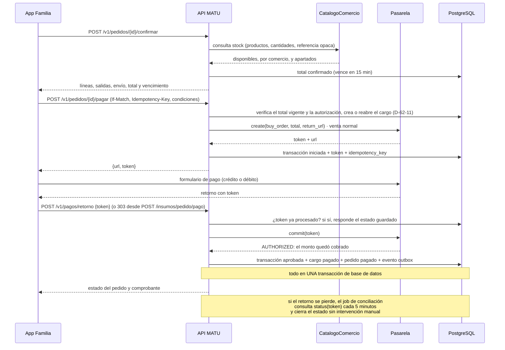

**En venta normal, `commit` aprobado es el cobro.** No hay un segundo paso de captura.

**Cuatro defensas contra el punto más frágil del sistema**, que es el usuario que paga y cierra el navegador antes de volver:

1. **La idempotencia es de MATU, no de la pasarela.** La prueba de concepto del 24 de octubre mostró que un `commit` repetido no falla: Transbank devuelve la misma transacción ya aprobada. El módulo registra el token y el estado del cargo en su propia base, y si el token ya está procesado no paga el pedido otra vez ni crea un segundo cargo.
2. Un job de conciliación consulta el estado de toda transacción iniciada con más de 10 minutos.
3. El resultado se escribe en **una sola transacción** junto con el cambio de estado y el evento del outbox.
4. **El total vencido no se cobra.** `pagar` verifica la vigencia contra el puerto `Reloj` antes de llamar a la pasarela. La venta vive `VIDA_VENTA_WEBPAY_MINUTOS` (10 por omisión), y ese plazo fija cuánto dura `pago-en-curso`. [PENDIENTE: la vida real del token de Webpay Plus, que mide Martín en integración (P-62-6), para que el stock quede apartado al menos los 15 minutos más ese tiempo.]

**El cargo se crea al tocar «Pagar»** (D-62-11), no al confirmar. La conciliación corre cada 5 minutos con `matu_scheduler`, también con la capa 3 apagada (D-62-17), y la vuelta de Transbank resuelve la venta como `sistema`, sin grupo ni cuenta, por funciones `SECURITY DEFINER` que devuelven solo ids. La anulación parcial queda como caso de uso probado, sin ruta, y la dispara MATU-63 (decisión 223).

**La devolución sigue el mismo patrón.** La anulación (`refund`) se registra con su propia clave de idempotencia por línea antes de llamar a la pasarela, y el resultado se escribe junto con el estado de la línea y el evento del outbox.

### 8.5 Predicción de quiebre y lista de reposición

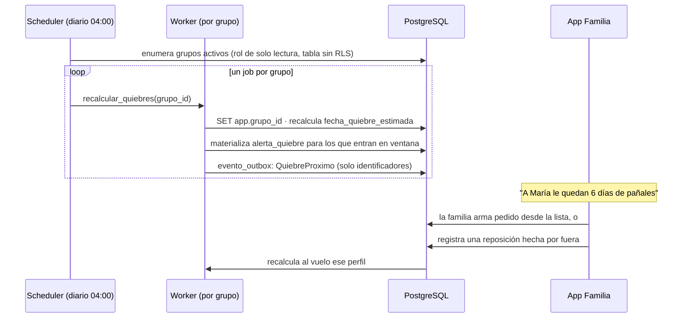

**El aviso es el momento de mayor valor del producto** y la validación lo confirmó de forma literal. Una entrevistada lo describió como el producto entero: «que me diga quedan cuatro días de pañales y yo apreto un botón y llega. Que no tenga que pensarlo yo».

Por eso el aviso se materializa como fila antes de enviarse: para que una corrida doble del job no genere dos notificaciones, y para que descartar y resolver sean transiciones auditables y no un borrado.

### 8.6 Contrato del outbox

| Aspecto | Definición |
|---|---|
| **Escritura** | El evento se inserta en `evento_outbox` **dentro de la misma transacción** que cambia el estado. Nunca fuera |
| **Payload** | Solo identificadores y tipo. **Nunca contenido de negocio ni datos personales**, porque el publicador es transversal a tenants |
| **Toma** | `SELECT ... ORDER BY id LIMIT 100 FOR UPDATE SKIP LOCKED` |
| **Orden** | **No se garantiza orden.** `SKIP LOCKED` con varios publicadores, y el backoff, rompen el FIFO por construcción. Afirmarlo y no cumplirlo es peor que no ofrecerlo |
| **Entrega** | **Al menos una vez.** El consumidor está obligado a ser idempotente |
| **Idempotencia** | Tabla `evento_consumido(evento_id, consumidor)` con clave primaria compuesta |
| **Reintentos** | Backoff exponencial: 1 s, 5 s, 30 s, 2 min, 10 min, 30 min, 1 h, 2 h |
| **Tope** | 8 intentos. Al superarlo pasa a `fallido`, se alerta a operación y **no se reintenta solo** |
| **Observabilidad** | Indicador de eventos con `intentos = 0` pendientes hace más de 5 minutos |

### 8.7 Preparación, retiro y liquidación

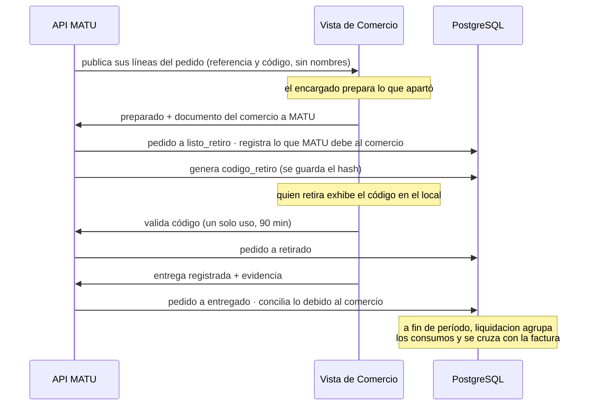

**Con el ADR-027 el comercio ya no informa un monto real.** Confirma el stock, aparta, prepara y emite su documento a MATU por el precio de convenio de sus líneas. [PENDIENTE: qué documento emite el comercio a MATU, en la consulta tributaria sobre quién emite la boleta.]

**El calce de caja sigue a favor de MATU:** se cobra a la familia al pagar el pedido y se paga al comercio a fin de período. Es un argumento de viabilidad que conviene mencionar en la defensa, porque muestra que el modelo de negocio y la arquitectura se sostienen mutuamente.

**En el piloto, el retiro y la entrega se marcan desde la vista de comercio**, porque la app de repartidor quedó fuera del alcance comprometido. El flujo completo se demuestra igual.

---

## 9. Contratos de API

### 9.1 Convenciones transversales

| Aspecto | Definición |
|---|---|
| Base | `/v1` |
| Autenticación | `Authorization: Bearer <access_token>` JWT de 15 minutos, que el cliente guarda solo en memoria. Refresh rotativo en una cookie `HttpOnly` (`__Secure-matu-refresh`), con una ventana deslizante de 30 días por dispositivo y detección de reutilización (MATU-38, decisión de Jorge del 31 de octubre) |
| Contexto de tenant | Header `X-Grupo-Id`. La API verifica membresía en cada petición y nunca confía en el header |
| Errores | RFC 7807 `application/problem+json` con `type`, `title`, `status`, `detail`, `errores[]` |
| Idempotencia | Header `Idempotency-Key` obligatorio en POST de pedidos, pagos y evidencias |
| Concurrencia | `If-Match` con `ETag` en el PUT de cada campo de la ficha. Respuesta 412 con el contenido actual si cambió |
| Paginación | Cursor, no offset |
| Fechas | ISO 8601 con zona. El servidor opera en UTC, la aplicación muestra en America/Santiago |
| Versionado | La v1 no rompe contratos. Un cambio incompatible crea `/api/v2` |

### 9.2 Capa 1 · Plan de cuidado

```
POST   /v1/grupos/{id}/personas-cuidadas
GET    /v1/personas-cuidadas/{id}/plan/ficha        → los tres campos, completitud y un ETag por campo
PUT    /v1/personas-cuidadas/{id}/plan/ficha/{campo}
       headers: If-Match: "v<version>"              → 412 si otro miembro editó
                o If-None-Match: *                  → primera escritura del campo
       body: {texto}                                → 428 sin ninguna de las dos cabeceras
PUT    /v1/personas-cuidadas/{id}/plan/secciones/{seccion}   → igual que un campo (ADR-028)
DELETE /v1/personas-cuidadas/{id}/plan/secciones/{seccion}   → la sección deja de verse en el acto
POST   /v1/personas-cuidadas/{id}/plan/accesos-relevo
       body: {secciones_adicionales:[...], expira_en, motivo, nombre_relevo,
              telefono_relevo, relevo_informado}
                                                    → 201 con el enlace y el PIN, una sola vez
GET    /v1/personas-cuidadas/{id}/plan/accesos-relevo → accesos y su estado
DELETE /v1/accesos-relevo/{id}                      → revocación inmediata
GET    /v1/personas-cuidadas/{id}/plan/aperturas    → lo que hicieron los relevos (RF-08)

Relevo, sin cuenta. Enlace /r#<token>: el token va en el fragmento, nunca en la URL de una petición
POST   /v1/relevo/presentacion  body: {token}       → nombres de pila de quien comparte y de la persona
POST   /v1/relevo/canje         body: {token, pin}  → 204 y cookie de sesión efímera
GET    /v1/relevo/ficha         con la cookie       → los campos compartidos, cada apertura auditada
```

El contrato vigente es `docs/api/openapi.json` de MATU_PROYECTO, generado desde el código. La presentación y el canje del relevo siguen descritos en `docs/api/propuestos/relevo.openapi.yaml`. Esta lista lo resume. Cambios respecto de la v1.1:

- **La ficha se escribe con un PUT por campo**, no con uno para los tres. El `ETag`, el 412 y el 428 son por campo (MATU-13): si dos personas editan campos distintos, ninguna pisa a la otra. El ADR-023 se sostiene igual, porque ningún campo exige el resto del plan.
- **Las secciones complementarias se escriben y se quitan una por una** (ADR-028, MATU-50): `PUT …/plan/secciones/{seccion}` con el mismo `ETag`, 412 y 428 que los campos, y `DELETE …/plan/secciones/{seccion}`. La v1.1 no las exponía porque las ocho secciones eran *Podría*. El llenado asistido (`en_nombre_de`, RF-42) no entra en el contrato. **La ficha no se exporta** ([ADR-029](adr/ADR-029-ficha-no-se-imprime.md)): no hay `GET …/plan/exportar`.
- **El acceso de relevo pide `secciones_adicionales`.** Los tres campos base van siempre, y `campos` queda deprecado. Cada sección adicional tiene que estar agregada, y el relevo no ve las que se agreguen después de crear su enlace.
- **El acceso de relevo pide `campos`, no `secciones`.** La ficha solo admite `rutina`, `manejo_situaciones` y `red_apoyo`. `motivo` es un enumerado sin texto libre (7.2).
- **El relevo ya no usa `GET /v1/relevo/{token}`.** El token nunca viaja en la URL de una petición. La página `/r#<token>` lo lee del fragmento, pide los nombres con `POST /v1/relevo/presentacion` y canjea token y PIN con `POST /v1/relevo/canje`. El canje deja una cookie `__Secure-matu-relevo` que dura 12 horas o hasta que vence el acceso, lo que ocurra primero. La ficha se lee siempre con `GET /v1/relevo/ficha`, que es lo que se audita como apertura.
- **La API no envía el PIN.** Lo entrega una vez en el 201 y quien comparte se lo dicta al relevo (11.6).

### 9.3 Capa 2 · Perfil de consumo

```
Todo cuelga de la persona cuidada, con X-Grupo-Id, igual que la ficha (contrato de MATU-32)
GET    /v1/personas-cuidadas/{id}/consumo                       → insumos con fecha de quiebre
POST   /v1/personas-cuidadas/{id}/consumo
       body: {producto_id o nombre_libre, unidad, tasa_unidades, tasa_dias,
              stock_unidades, dias_aviso, unidades_por_envase?}
GET    /v1/personas-cuidadas/{id}/consumo/{perfil_id}
PATCH  /v1/personas-cuidadas/{id}/consumo/{perfil_id}           → If-Match, 412 si otro lo cambió
DELETE /v1/personas-cuidadas/{id}/consumo/{perfil_id}
POST   /v1/personas-cuidadas/{id}/consumo/{perfil_id}/desactivar · /activar
POST   /v1/personas-cuidadas/{id}/consumo/{perfil_id}/reponer   → «Compré», compra hecha por fuera (RF-13)
POST   /v1/personas-cuidadas/{id}/consumo/{perfil_id}/recontar  → «Me quedan», stock medido hoy
POST   /v1/personas-cuidadas/{id}/consumo/{perfil_id}/resolver  → «Ya lo resolví»
GET    /v1/personas-cuidadas/{id}/consumo/por-acabarse          → qué se acaba pronto
GET    /v1/personas-cuidadas/{id}/consumo/lista                 → lista de insumos, en texto (ADR-031)
GET    /v1/personas-cuidadas/{id}/consumo/alertas
POST   /v1/personas-cuidadas/{id}/consumo/alertas/{alerta_id}/descartar
(reemplazada en MATU-61: el pedido se crea con POST /v1/personas-cuidadas/{persona_id}/pedidos, ver 9.4)
```

**Cambios respecto de la v1.1.** Las rutas cuelgan de la persona y no de `/v1/consumo/{id}` ni de `/v1/alertas` (decisión 54 del contrato de MATU-32). La tasa es una fracción entera (7.3). **No existe `POST …/lista-reposicion/exportar`** ni una ruta pública para la lista (ADR-031): la lista se lee con `GET …/consumo/lista` y el teléfono la imprime, la guarda como PDF o la comparte como texto. Leen la lista los cuatro roles de la familia, y solo admin, cuidador y pagador ven los botones para sacarla del teléfono.

### 9.4 Capa 3 · Catálogo, pedidos y pagos

> **Ajustada al ADR-027.** Los precios son exactos, con IVA, y vienen del puerto `CatalogoComercio`. Mientras el adaptador sea simulado, la respuesta marca los precios como de ejemplo y la interfaz lo rotula.

```
GET    /v1/catalogo                                 → categorías, productos y, por comercio, precio exacto con IVA incluido y si hay (MATU-59)

PUT    /v1/personas-cuidadas/{persona_id}/direccion → guarda o cambia la dirección de entrega de la persona (MATU-61, D4)
DELETE /v1/personas-cuidadas/{persona_id}/direccion → vacía la dirección de entrega (MATU-61, C6)
POST   /v1/personas-cuidadas/{persona_id}/pedidos   → crea el borrador (el carrito)
GET    /v1/personas-cuidadas/{persona_id}/pedido-en-curso → el pedido sin pagar de la persona, uno por persona
GET    /v1/pedidos/{id}                             → el pedido, con el resumen antes de pagar si el total está confirmado
PUT    /v1/pedidos/{id}/lineas                      → reemplaza las líneas, solo en borrador
PUT    /v1/pedidos/{id}/reglas-faltante             → si falta, otro_comercio (por omisión) o quitar, por producto, solo antes de pagar
POST   /v1/pedidos/{id}/confirmar                   → consulta stock, aparta y arma el total confirmado (vale 15 min), también desde un total vigente
PUT    /v1/pedidos/{id}/contacto                    → cambia el teléfono de contacto con el total confirmado o vencido
POST   /v1/pedidos/{id}/cambiar                     → «Cambiar el pedido»: vuelve a borrador desde el total confirmado o vencido
POST   /v1/pedidos/{id}/cancelar                    → sin costo antes de pagar. Si ya se pagó, anulación total mientras no preparen (MATU-62)
GET    /v1/condiciones-pedido                       → las condiciones del pedido vigentes, públicas, con versión y huella
GET    /v1/condiciones-pedido?version=              → una versión publicada de las condiciones, para el comprobante (MATU-62)

POST   /v1/pedidos/{id}/pagar                       → crea o reabre el cargo y la venta normal por el total confirmado (If-Match e Idempotency-Key); 409 si venció o hay un pago en curso (MATU-62)
GET    /v1/pedidos/{id}/pago                        → el estado del pago y el comprobante; el detalle de la tarjeta solo para quien pagó (MATU-62)
GET    /v1/personas-cuidadas/{id}/pedido-pagado     → el último pedido pagado de la persona, para el bloque «Pedido pagado» (MATU-62)
POST   /v1/pagos/retorno                            → commit, público, idempotente por token; con la capa 3 apagada también (MATU-62)
POST   /insumos/pedido/pago                         → la vuelta de Transbank por POST: 303 a la misma ruta de la app, fuera del contrato (MATU-62)
```

**El catálogo es una sola ruta (MATU-59, decisión 158 de `api/README.md`, aprobada por Jorge el 08-11).** Reemplaza a las tres rutas que había aquí. No recibe parámetros: ni texto de búsqueda en la URL ni comuna, porque el catálogo es general y no se cruza con nada de la familia (revisión previa del analista). De cada comercio entrega solo `nombre_fantasia`, el precio con IVA y si hay (`disponible`), nunca la cantidad en stock. Pide la sesión de una cuenta, sin `X-Grupo-Id`, y el relevo no entra (401). Solo existe con la capa 3 encendida (`CAPA3_HABILITADA`).

**Dos series «C» (MATU-94, 74-4):** desde el 11-11, las decisiones de Jorge sobre el contrato de MATU-61 se escriben **CJ1 a CJ10** (en `docs/api/README.md` del repositorio MATU_PROYECTO siguen como C1 a C10), y las condiciones del analista de la revisión previa de MATU-61 siguen como **C1 a C23**. Una «C» sin «J» es siempre del analista.

**Las rutas del pedido (MATU-61, decisiones 188 a 222 de `api/README.md`, con CJ1 a CJ10 de Jorge del 11-11).** Crear y leer el pedido en curso cuelgan de la persona, `/v1/personas-cuidadas/{persona_id}/…`, como el consumo (decisión 54): la persona no viaja en el cuerpo y el 404 por persona se resuelve antes de leerlo. Operar un pedido ya creado va bajo `/v1/pedidos/{id}/…`. Reemplaza el `POST /v1/pedidos` que había aquí. Las rutas del pedido y de las condiciones son capa 3 (`CAPA3_HABILITADA`). La dirección vive en `care_circle`, existe siempre y no pide la autorización de pedidos (CJ8 de Jorge). Crear, ajustar, elegir la regla, confirmar, cambiar el teléfono y «Cambiar el pedido» piden la autorización `despacho` vigente (403). Leer y cancelar no la piden. `POST …/pedidos`, `…/confirmar`, `…/cancelar` y `…/cambiar` llevan `Idempotency-Key` (9.1). Todas las respuestas del pedido y de la dirección llevan `Cache-Control: no-store`. **MATU-61 llega hasta el total confirmado:** el cargo, el pago y el comprobante son de MATU-62.

**Qué devuelve `confirmar`:** las líneas con cantidad, precio y subtotal, el comercio de cada una, las que salieron por no disponibles, las que cambiaron de precio o de comercio respecto del carrito, el envío único, el total con IVA incluido y la hora en que vence. Con la regla `otro_comercio`, un producto que falta pasa al comercio activo de menor precio que lo tenga. Con `quitar`, sale sin buscar (CJ5 de Jorge).

**Salen del contrato:** `POST /v1/pedidos/{id}/reglas-sustitucion` y `POST /v1/pedidos/{id}/decisiones/{lid}`, porque el ADR-027 descarta los equivalentes de otra marca y el estado `requiere_decision` (sección 8.1).

**RF-21, aceptada con el contrato de MATU-61 (decisión 200):** `PUT /v1/pedidos/{id}/reglas-faltante` reemplaza todas las elecciones del pedido con una lista de `{producto_id, accion}`, donde `accion` es `otro_comercio` o `quitar`. Un producto que no está en la lista queda en `otro_comercio`. Se acepta solo antes de pagar. Con el pedido pagado responde 409. La tabla sigue llamándose `regla_sustitucion`. La migración de MATU-61 agrega el trigger que deja fija la regla con el pedido pagado (C12) y las políticas por operación para el admin y el cuidador (C13). `confirmar` devuelve la elección de cada línea, para mostrarla antes de pagar.

### 9.5 Comercio y operación

```
GET    /v1/comercio/pedidos?fecha=
GET    /v1/comercio/pedidos/{id}                    → solo sus líneas, referencia y código de retiro, sin nombres
POST   /v1/comercio/pedidos/{id}/lineas/{lid}/sin-stock → faltante tardío: reasigna (fase 2) o devuelve su precio
POST   /v1/comercio/pedidos/{id}/preparado          → documento del comercio a MATU, sin monto real
POST   /v1/comercio/pedidos/{id}/validar-codigo
POST   /v1/comercio/pedidos/{id}/entregado          → cierra el pedido; ya no dispara un cobro

GET    /v1/backoffice/comercios/{id}/consumos?estado=&periodo=
POST   /v1/backoffice/consumos/{id}/conciliar
GET    /v1/backoffice/indicadores
```

**La consulta de stock no es un endpoint público.** Va de MATU al comercio por el puerto `CatalogoComercio`, con solo productos, cantidades y una referencia opaca.

### 9.6 Ejemplo de respuesta con la capa 2 en acción

`GET /v1/personas-cuidadas/{id}/consumo/lista`, con datos sintéticos:

```json
{
  "fecha": "2026-11-08",
  "items": [
    {
      "perfil_id": "3a...",
      "nombre": "Pañal adulto talla M",
      "unidad": "unidad",
      "dias_restantes": 6,
      "unidades_sugeridas": 96,
      "unidades_por_envase": 30,
      "envases_sugeridos": 4
    }
  ]
}
```

**La lista no lleva el nombre de la persona cuidada, nada de la ficha ni acciones** (ADR-031). La v1.1 traía el nombre de la persona y una acción `compartir_enlace`, que salieron. La cantidad sugerida cubre 30 días y va en envases enteros cuando la familia anotó las unidades por envase. **La lista funciona sin ningún comercio en convenio**: es la decisión 2 de cabecera hecha contrato de API. El texto que sale del teléfono tampoco lleva los días que quedan, para que sea más difícil deducir el consumo diario.

---

## 10. Diseño de interacción y accesibilidad

**Aquí la accesibilidad es un requisito funcional, no un acabado.** Y en la v1.1, además, fue la sección con más cambios de origen empírico: la validación con cuidadoras tocó directamente el diseño del flujo principal.

### 10.1 Perfiles de usuario

| Perfil | Edad aproximada | Contexto de uso | Implicancia de diseño |
|---|---|---|---|
| **Cuidador principal** | Entre 30 y 79 | En casa, con interrupciones constantes, muchas veces cansado o de noche | Todo tiene que poder pausarse y retomarse. Nada de formularios largos sin guardado |
| **Familiar que aporta** | 30 a 65 | A distancia, sin visibilidad de la operación, en dos minutos | El aportante quiere información, no logística. Puede no manejar aplicaciones |
| **Relevo** | 20 a 70 | Primera vez, con urgencia, en casa ajena, muchas veces sin instalar nada | Vista web, sin cuenta, legible en un teléfono prestado |
| **Cuidador remunerado** | 25 a 55 | Con contrato, alta competencia digital, sin relevo propio | Perfil no previsto en la v1.0 y el que mejor entendió el producto. Ver 10.6 |
| **Encargado de comercio** | 20 a 60 | En el local, con computador compartido, apurado | Una pantalla, sin navegación, sin aprendizaje previo |

### 10.2 Cinco principios de diseño

1. **Nada obligatorio de una sola vez.** La ficha de relevo son tres campos. Todo lo demás es opcional y ningún flujo lo exige.
2. **El sistema recuerda, la persona no.** El producto avisa antes del quiebre. El usuario nunca tiene que acordarse de nada.
3. **Un asunto por pantalla.** Sin pestañas, sin acordeones anidados, sin menús de tres niveles.
4. **El dinero se explica siempre.** Cada monto que aparece dice de dónde sale y en qué se puede convertir.
5. **La urgencia manda.** El caso "necesito relevo ahora" tiene que resolverse en dos toques, incluso a costa de configurabilidad.

### 10.3 Criterios de accesibilidad, medibles

| Criterio | Valor obligatorio | Cómo se verifica |
|---|---|---|
| Área táctil mínima | 48 × 48 px, con 8 px de separación | Revisión visual del diseñador y prueba manual en el teléfono |
| Tamaño de texto base | 17 px en `rem`, escalable hasta **200%** sin pérdida de contenido ni de función, y sin desplazamiento horizontal a 320 px de ancho (WCAG 1.4.4 y 1.4.10) | Prueba manual con el ajuste del navegador al máximo |
| Contraste de texto | 4,5:1 mínimo. 3:1 para texto grande y elementos gráficos | Verificación automática en el pipeline sobre los tokens de color |
| Identidad por color | **Nunca solo color.** Todo estado lleva ícono o etiqueta | Revisión de checklist por pantalla |
| Lenguaje | Sin jerga técnica ni clínica. "Se acaban en 6 días", no "stock proyectado" | Revisión por el equipo, con criterio explícito |
| **Lenguaje sobre el cuerpo** | Ningún campo obliga a escribir sobre el aseo ni el cuidado del cuerpo con términos clínicos. Se pregunta por apoyos, no por funciones, y los términos que no se usan están en `lenguaje.md` | **Criterio nuevo.** Tres de diez entrevistadas lo pidieron por dignidad de la persona cuidada |
| Etiquetado para lector de pantalla | Todo control con etiqueta semántica, incluidos íconos. Con HTML el árbol de accesibilidad lo da el navegador (ADR-026) | Pruebas de interfaz con Vitest y Testing Library, y prueba con TalkBack en el flujo principal |
| **Entrada por dictado** | Disponible en todos los campos de texto del plan | Prueba manual |
| **Llenado asistido** | Un tercero puede completar la ficha en nombre del cuidador, con autoría registrada | RF-42, prueba de integración |
| Objetivo de tiempo | **Ficha de relevo completa en menos de 3 minutos** por una persona de 65+ sin ayuda | Prueba con 3 usuarios reales en los sprints 3 y 4 |

### 10.4 Los tres momentos difíciles

**a) Explicar qué se cobra y qué pasa si falta algo.** *Reescrito con el ADR-027.* Antes el problema era explicar una retención mayor que el pedido ($69.000 retenidos para cobrar $51.340). Con el cobro único del total confirmado esa retención desaparece. Lo difícil ahora es que la familia entienda, antes de pagar, que se cobra una sola vez, qué cambió respecto de su lista y qué pasa si al retirar falta un producto.

> **Solución:** antes de pagar, una pantalla de resumen muestra la lista del [ADR-027, punto 4](adr/ADR-027-precios-exactos.md), en este orden: productos con cantidad, precio y subtotal; los que salieron por no disponibles; los que cambiaron de precio o de comercio, marcados con texto y no solo con color; el envío en una línea aparte; el total con IVA; quién emite la boleta; la ventana de entrega; qué eligió la familia para cada producto si falta (RF-21); qué pasa si falta un producto; el aviso *"Derecho a retracto: tienes 10 días desde que lo recibes. No aplica si abres el sello del producto"*, con una letra no menor que la del precio; quién vende, con un canal de reclamo; y el enlace a las condiciones del pedido. Un bloque fijo dice *"Se cobra una sola vez este total, con crédito o con débito. No hay reserva ni cobros después."* y otro *"Si un producto no llega, te devolvemos su precio el mismo día, a la misma tarjeta. Cuándo lo ves en tu cuenta depende de tu banco."* El vencimiento se ve como hora: *"Este total vale hasta las 16:45. Si vence, lo volvemos a confirmar."* Hay una salida visible para no pagar, sin costo.
>
> Si falta un producto después de pagar, la notificación dice qué faltó y cuánto se devolvió, por ejemplo *"No pudimos conseguir el producto X. Te devolvimos $8.990 a la misma tarjeta."* Si se consiguió en otro comercio, no se cobra nada más y no hace falta avisar de la diferencia.
>
> Mientras el adaptador sea simulado, junto a los precios va el rótulo *"Precios de ejemplo. MATU todavía no tiene convenio con comercios, y en esta demo no se cobra dinero real."*, legible con texto al 200%. [PENDIENTE: los textos definitivos los fijan el diseñador y `lenguaje.md`; el plazo de la devolución depende de la consulta legal.]

**b) Llenar el plan de cuidado sin abandonar.** Era el riesgo de producto más grande del diseño y **la validación lo confirmó**: con ocho preguntas, solo tres de diez entrevistadas respondieron tres de ellas en menos de cinco minutos, cuando el criterio fijado exigía siete. Una rechazó responder y una abandonó en la segunda pregunta.

> **Solución, tras el ADR-023:** la versión mínima obligatoria es una ficha de tres campos que se responde en menos de tres minutos. Las secciones complementarias del ADR-028 quedan como ampliación opcional, con dictado por voz en todos los campos y una barra de completitud que celebra el avance sin castigar lo que falta. El acceso de relevo se genera con la ficha sola. Y se agrega el **llenado asistido** (RF-42), porque la entrevistada que abandonó no lo hizo por falta de disposición sino por el teclado del teléfono, y pidió ella misma que se lo leyeran y alguien escribiera.
>
> Dos hallazgos entran directamente a la redacción: el segundo campo se llama **"Si se altera"** y su pregunta guía es **"¿qué la calma?"**, en vez de "manejo de situaciones difíciles", porque es la expresión que usaron tres entrevistadas por su cuenta, y la rutina admite responder por el día bueno o el día malo, porque una entrevistada se trabó exactamente ahí.
>
> **Las preguntas guía** (ADR-023 y ADR-028, actualización del 3 de noviembre). Los nombres y las preguntas no asumen el género de la persona cuidada. Los textos definitivos, con un ejemplo por sección, están en `lenguaje.md`:
>
> | Campo o sección | Pregunta guía |
> |---|---|
> | Su día | ¿Cómo es un día normal, en una o dos líneas? |
> | Si se altera | ¿Qué la calma cuando se angustia o se desorienta? |
> | A quién llamar | ¿A quién se llama si algo pasa? |
> | Quién es | ¿Qué le gustaría que supiera de esta persona alguien que recién la conoce? |
> | Lo que le hace bien | ¿Qué le alegra, le entretiene o le calma? |
> | Comer y beber | ¿Qué le gusta comer y cómo se le sirve? |
> | Moverse y descansar | ¿Cómo se le ayuda a moverse, levantarse y descansar? |
> | Cómo hablarle | ¿Qué ayuda a que se entiendan? |
> | Sus remedios | ¿Qué remedios toma y a qué hora, tal como se los da la familia? |
>
> Bajo cada sección va «No hace falta escribir diagnósticos ni enfermedades. Escribe lo que ayuda a cuidar». Sus remedios es solo texto libre, de hasta 800 caracteres (las demás, 500), con el aviso siempre visible «Esto lo escribe la familia. No reemplaza la indicación del médico». La página del relevo no muestra las preguntas guía ni los ejemplos.

**c) Presentar la auditoría de accesos sin que parezca vigilancia.** Cinco de diez entrevistadas declararon que no mirarían nunca la pantalla de "quién ha visto el plan". Dos la valoran, y por razones opuestas: una como termómetro de involucramiento familiar, la cuidadora remunerada como respaldo laboral.

> **Solución:** la funcionalidad se mantiene, porque la exige la Ley 21.719 y porque para el perfil remunerado es la función principal, pero **deja de ser una pantalla de primer nivel** y se presenta como "quién se está informando", no como un registro de vigilancia.

### 10.5 Prototipo y validación

El prototipo navegable de los flujos críticos está terminado y cubre:

0. Alta de persona cuidada y consentimiento
1. Ficha de relevo, secciones opcionales (las ocho de la v1.1, antes del ADR-028), acceso de relevo, vista del relevo, auditoría y revocación
2. Declaración de consumo, alerta de quiebre y lista de reposición
3. Pedido y pago
4. Vista de comercio
5. Errores y casos borde

En total **32 pantallas en siete recorridos**. Se usó como instrumento en las diez entrevistas de validación, lo que permitió medir lo que las personas hacían y no su opinión: la prueba cronometrada del plan de cuidado se hizo sobre él.

**Validación de usabilidad:** tres usuarios reales, de tres perfiles distintos, por ronda, en los sprints 3 y 4 del calendario v1.3 (estrategia de pruebas, sección 2). La dirige Martín (ADR-030). No es investigación de mercado, es prueba de usabilidad, y con tres personas se detecta la mayoría de los problemas graves.

### 10.6 Un perfil que la validación descubrió

**La cuidadora remunerada no estaba en el diseño y es quien mejor entendió el producto.** Lo describió espontáneamente con el término técnico correcto, "entrega de turno", que trajo del vocabulario clínico. Completó la prueba en 2 minutos 45 segundos, el mejor tiempo del piloto, porque ya lleva un cuaderno de turno desde hace once meses. Y planteó dos cosas que el diseño no resuelve:

- **El registro que escribe una trabajadora tiene consecuencias laborales para ella.** Preguntó de quién es ese registro, si de la familia o suyo. No hay respuesta en la arquitectura y queda como consulta legal abierta en la sección 18.
- **Su cuaderno es de su propiedad y se lo lleva si se va.** La continuidad del cuidado depende hoy de alguien con contrato. Es exactamente el hueco que el producto viene a cerrar, visto desde el lado que la v1.0 no había mirado.

Se documenta como línea de continuidad para la fase 2, no como cambio de alcance del semestre.

---

## 11. Seguridad, privacidad y cumplimiento

### 11.1 Marco legal aplicable

La **Ley 21.719** de protección de datos personales, publicada en diciembre de 2024, entra plenamente en vigencia el **1 de diciembre de 2026**, dentro del horizonte de vida del proyecto. Crea una Agencia con potestad sancionatoria, exige consentimiento verificable y documentado, medidas de seguridad proporcionales al riesgo y notificación de brechas sin dilación indebida.

MATU trata datos que la ley clasifica como sensibles: estado de salud y condición de dependencia. **Con la estructura en tres capas, el plan de cuidado es el núcleo del producto, y por lo tanto el cumplimiento es estructural y no accesorio.**

| Exigencia legal | Traducción técnica |
|---|---|
| Consentimiento explícito, verificable y versionado | Tabla `consentimiento` con finalidad, versión de política y evidencia. Sin consentimiento vigente, `care_plan` devuelve 403 |
| Finalidad limitada y minimización | Proyecciones por rol. El comercio recibe un DTO distinto, no el objeto completo con campos ocultos en la interfaz |
| Medidas proporcionales al riesgo | Sobre-cifrado por sección, MFA para operación, URLs firmadas de vida corta, cifrado de volumen |
| Notificación de brecha **sin dilación indebida** | La ley chilena exige notificar sin dilación indebida a la Agencia y a los titulares. **El plazo de 72 horas proviene del RGPD europeo**, y se adopta como objetivo interno, no como cifra legal chilena. Requiere **detectar**: registro de acceso a datos sensibles con alerta ante patrones anómalos |
| Derechos de acceso, rectificación y supresión | «Mis datos» (MATU-54, sprint 5) entrega a quien corresponde todo lo que MATU guarda de la persona, incluida la ficha, que no se exporta de otra forma (ADR-029). Retirar la autorización (MATU-44) corta los accesos de relevo y destruye la ficha a los 90 días. Borrado lógico que respeta obligaciones contables sobre pagos |
| Encargados de tratamiento | Los proveedores de infraestructura y quien despacha son encargados de MATU, con contrato según el art. 15 bis. El comercio en convenio recibe solo productos, cantidades y una referencia aleatoria por pedido; se puede sostener que no trata datos personales, y aun así MATU lo trata como si fuera encargado y su convenio lleva siempre las cláusulas del art. 15 bis, sea o no la referencia un dato personal para él (decisión de Jorge, 27-10). |

### 11.2 Modelo de autorización

Tres dimensiones, evaluadas siempre en este orden: **quién es** (JWT válido y no revocado), **si pertenece al tenant** (consulta a `membresia` más contexto RLS) y **si su rol permite la acción sobre ese recurso**.

| Rol | Plan de cuidado | Perfil de consumo | Catálogo | Pedidos | Pago | Datos de la persona cuidada |
|---|---|---|---|---|---|---|
| `admin` del grupo | ver, editar, compartir | ver, editar | ver | crear, confirmar, cancelar | pagar | completo |
| `cuidador` | ver, editar, compartir | ver, editar | ver | crear, confirmar, cancelar sin pagar | no | completo |
| `pagador` | según permiso explícito | ver | ver | ver, sin confirmar | pagar | nombre, dirección |
| `observador` | no | ver | ver | ver el carrito, sin la entrega ni el resumen | no | nombre |
| `relevo` (token) | **solo secciones habilitadas, solo lectura** | no | no | no | no | nombre de pila |
| `comercio` | **nunca** | **nunca** | solo su propia oferta, con precio y stock | solo sus líneas de los pedidos del día | no | **ninguno**: solo la referencia del pedido y el código de retiro |
| `operación` | **nunca** | **nunca** | administrar | ver todos, intervenir | ver, devolver por anulación, liquidar | nombre, dirección |

**El grupo (MATU-42).** Solo el `admin` invita, anula invitaciones, cambia roles y el permiso del pagador y saca a alguien. Los demás roles reciben 404, y la RLS por operación de la 0026 lo exige también en la base. Cualquier miembro puede salir. El grupo nunca queda sin `admin` (trigger y 409). Al dejar de compartir la ficha (salir, ser sacado o pasar de `admin` o `cuidador` a `pagador` u `observador`) se cortan los accesos de relevo que la persona compartió. Al dejar de administrar, se anulan sus invitaciones sin usar.

**Los pedidos antes de pagar (MATU-61, decisión CJ3 de Jorge del 11-11, decisión 194 de `api/README.md`).** El admin y el cuidador arman el carrito, eligen qué hacer si falta, cambian la dirección y el teléfono, confirman el total, usan «Cambiar el pedido» y **cancelan sin pagar**: cancelar sin pagar no mueve dinero, y el cuidador ya puede retirar la autorización de pedidos, que cancela lo mismo. La cancelación con devolución, después de pagar (MATU-62 y MATU-63), sigue siendo solo del admin. El pagador ve el carrito, la entrega y el resumen, no confirma y no cancela: si el total vence, lo vuelve a confirmar quien armó el pedido. El observador ve el carrito sin la dirección, el teléfono ni el resumen (`PedidoVistaObservador`). Un rol que no alcanza recibe 404.

**Las celdas "nunca" no se garantizan por permiso, se garantizan por arquitectura.** `fulfillment`, `settlement` y `backoffice` no importan `care_plan` ni `consumption`, y la regla se verifica con la prueba de dependencias de la sección 6.4. Un permiso se puede configurar mal. Una importación que no existe, no.

**Lo que ve un comercio, con el ADR-027.**
- **La consulta de stock no trata datos personales.** Lleva solo productos, cantidades y una referencia opaca para apartar. No lleva datos de la familia, de la persona cuidada ni de la dirección, y una prueba sobre el objeto de la consulta lo verifica.
- **El comercio que prepara ve solo sus líneas**, la referencia del pedido y el código de retiro. Nunca un nombre, la ficha ni la dirección. Como MATU emite la boleta, el comercio no necesita el nombre de quien paga.
- **El comercio que reemplaza a otro** recibe la misma proyección que el original, solo con las líneas que le tocan.
- **Los productos del pedido se tratan como datos sensibles** mientras se consulta, porque junto con un dato que identifica pueden revelar salud o dependencia. [PENDIENTE: consulta legal sobre si lo son según la Ley 21.719 (P2). Los comercios en convenio se tratan como encargados, con las cláusulas del art. 15 bis (decisión de Jorge, 27-10).]

### 11.3 Minimización de datos de salud

**`persona_cuidada` no tiene campo de diagnóstico.** Tiene `nivel_apoyo`, un enumerado operacional (`autovalente_con_supervision`, `apoyo_parcial`, `apoyo_total`), que es lo que el servicio realmente necesita.

Guardar "demencia tipo Alzheimer, etapa moderada" no cambiaría ni un pañal del catálogo, pero convertiría la base de datos en un repositorio clínico con las obligaciones correspondientes. **El diagnóstico es del sistema de salud, no de una plataforma de continuidad del cuidado.**

Lo mismo aplica al plan de cuidado: sus secciones describen **cómo se cuida y qué ayuda**, no patología. "Se altera cuando hay ruido fuerte, ayuda bajar las persianas" es información de cuidado. "Demencia frontotemporal con desinhibición" es información clínica y no entra al sistema.

**El mismo criterio gobernó el protocolo de entrevistas**, que prohibió anotar diagnósticos y datos identificatorios de la persona cuidada. Que la investigación y el producto compartan la regla de minimización no es casualidad: es la misma decisión aplicada dos veces.

### 11.4 Sobre-cifrado del plan de cuidado

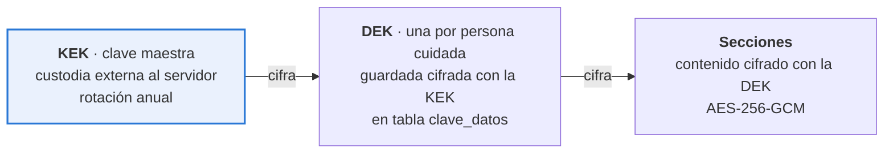

**Por qué dos niveles.** Rotar la clave maestra no obliga a redescifrar y recifrar todo el contenido, solo las claves de datos, que son pocas y pequeñas. Y borrar los datos de una persona cuidada se reduce a destruir su clave de datos, lo cual es borrado criptográfico inmediato y verificable.

**Dónde vive la clave maestra.** El ADR-016 lo cierra: en el servicio de custodia de secretos del proveedor de nube, no en el servidor de aplicación. Si el despliegue del piloto termina siendo un servidor sin ese servicio disponible, **la limitación se declara explícitamente** en el informe: la clave estaría en variable de entorno en el mismo servidor, quien accede al servidor accede a todo, y el piloto no debe operar con datos reales de terceros hasta migrar.

**Decisión del 28 de octubre (Jorge Espinoza, MATU-12): en el semestre se toma ese camino, declarado.** Mientras se usen solo datos sintéticos, la clave maestra se lee de una variable de entorno, con un adaptador del puerto `CustodiaClaves` que se enciende de forma explícita y solo se construye en los entornos `local` y `pruebas`. Con `produccion` la API no arranca, y sin la custodia configurada las rutas de la ficha responden 503 y fallan cerradas: nunca se genera una clave al arrancar. La clave no aparece en los errores, en los logs ni en el repositorio, y al arrancar la API registra un aviso fijo de que solo admite datos sintéticos. Las claves de datos se envuelven con AES Key Wrap (RFC 3394). **Antes de operar con datos reales se reemplaza por el servicio de custodia, sin tocar el cifrado**, porque está detrás del puerto. Las condiciones completas, que fijó el analista normativo, están en la decisión 32 de `docs/api/README.md` de MATU_PROYECTO.

### 11.5 Quién consiente por una persona con demencia

Esta es la pregunta jurídica central del proyecto.

**El problema.** La Ley 21.719 exige el consentimiento del titular o de su representante legal para tratar datos sensibles. En MATU el titular es, con frecuencia, una persona con demencia moderada o avanzada, es decir sin capacidad para consentir. Y quien opera la aplicación suele ser un hijo o hija que **no tiene interdicción declarada ni curatela**: es un cuidador de hecho. Esa es la situación mayoritaria en Chile, no la excepción, y las diez entrevistas la confirmaron sin excepción.

| Calidad del otorgante | Qué habilita | Qué exige |
|---|---|---|
| `titular` | Todo, incluido el plan de cuidado completo | Declaración del propio titular, registrada con fecha y versión de política |
| `representante_legal` | Todo | Declaración más referencia al documento que acredita la representación. **No se almacena el documento**, solo su referencia |
| `cuidador_de_hecho` | Todo, con **alcance declarado y revisión periódica** | Declaración responsable de la relación de cuidado, aviso explícito de la limitación y recordatorio anual |

**Lo que el diseño reconoce que no resuelve.** El caso `cuidador_de_hecho` es una zona gris. MATU no puede verificar la representación y no pretende hacerlo. Lo que sí hace es **registrar la calidad declarada**, mostrarla en la interfaz, y no tratarla como equivalente a un consentimiento del titular.

**Y la validación agregó una segunda pregunta jurídica que no estaba.** Cuando quien escribe el plan es una **cuidadora remunerada con contrato**, el registro deja de ser solo un dato sensible de la persona cuidada y pasa a ser también un antecedente laboral de quien lo escribe. La entrevistada lo planteó con precisión: si anota que un día la persona estuvo agresiva y eso lo lee un hijo, puede volverse en su contra o en contra de la persona cuidada. **No hay respuesta en la arquitectura** y se incorpora a la consulta legal pendiente de la sección 18.

**Por qué esto importa para la arquitectura y no solo para el informe.** Sin consentimiento vigente, el módulo `care_plan` devuelve 403. Es la única puerta de entrada al dato sensible, y esa puerta depende de una tabla que distingue quién otorgó y con qué calidad.

### 11.6 Controles técnicos

| Capa | Control |
|---|---|
| Transporte | TLS 1.3 y HSTS. **Sin certificate pinning en el piloto**: con renovación automática de certificados, fijar el certificado hoja inhabilita todas las instalaciones publicadas cada 60 días |
| Autenticación | Argon2id, access token de 15 min, refresh rotativo con detección de reutilización, MFA obligatorio para operación. **La revocación de un access token es efectiva en 15 minutos por caducidad**, no de forma inmediata: un JWT autocontenido no se revoca. Se acepta y se declara |
| API | Rate limiting por IP y por usuario, validación estricta con Pydantic, CORS restringido, proyecciones por rol. **La IP no se guarda.** El contador de intentos del relevo (MATU-25) vive en Redis. Su clave es una huella HMAC de la IP, con un secreto de `.env`, y vence a la hora. La IP en claro no llega a la base, a la auditoría ni a los logs |
| Base de datos | RLS forzado en toda tabla de negocio, con las excepciones de la sección 7.7 acotadas por permiso, usuario de aplicación sin `SUPERUSER`, `auditoria` sin UPDATE ni DELETE, cifrado de volumen |
| Datos sensibles | Sobre-cifrado por sección, borrado criptográfico, sin plan de cuidado en ningún registro de log |
| Archivos | Bucket privado, URL firmada de 5 minutos para lectura y 15 para subida, sin CDN público, hash SHA-256 de cada evidencia |
| Acceso de relevo | Token de **uso múltiple hasta vencer** más **PIN de cuatro dígitos**, alcance por campo, revocación inmediata, cada apertura auditada. **La API no envía el PIN**: lo muestra una sola vez a quien comparte, que se lo dicta al relevo. El envío por SMS es *Debería* y está fuera del semestre. El enlace es `/r#<token>`, con el token en el fragmento, y se canjea con el PIN por una cookie de sesión efímera en un paso, para que el token no quede en el historial de un teléfono prestado. La página limpia el fragmento con `history.replaceState` después del canje |
| Secretos | Variables inyectadas, nunca en el repositorio, escaneo de secretos en el pipeline |
| Aplicación web | Nada de la ficha, del consentimiento ni de la persona cuidada en `localStorage`, `sessionStorage` ni en la URL. El access token vive solo en memoria y el refresh en una cookie `HttpOnly`, `Secure` y `SameSite=Strict`. Sin scripts de terceros ni analítica. En la página del relevo, el token viaja en el fragmento y se limpia después del canje. **El navegador no permite bloquear la captura de pantalla**, que la v1.1 preveía para la app nativa: se acepta y lo dice el aviso a quien comparte |
| Registro | Logs estructurados en JSON, sin datos personales en el mensaje y sin IP, correlación por `request_id` |

### 11.7 Control de fraude sobre la cuenta del comercio

> **Cambia de sentido con el ADR-027.** Antes, el monto de la boleta del comercio contra el precio pagado medía si el comercio se desviaba del tope autorizado. Con precio exacto y reasignación a otro comercio, esa comparación ya no mide al comercio: la familia pagó un precio fijo, y si MATU retiró en otro comercio a otro precio, la diferencia es un costo de MATU, no una desviación. [PENDIENTE: el tope y la conciliación se rediseñan con el convenio. La migración 0002 no los tocó (7.4).]

| Control | Implementación |
|---|---|
| Código de retiro de un solo uso | Generado al preparar, guardado con hash, vence en 90 minutos, se invalida al primer uso |
| Precio de convenio por línea, como control **detectivo** | El comercio cobra a MATU el precio de convenio de las líneas que preparó, no el que pagó la familia. **No es un control técnico**: sin integración con el punto de venta, es un número que el encargado puede ignorar. Si el documento del comercio excede el precio de convenio de sus líneas, la conciliación marca la desviación y la diferencia se disputa con el comercio. Nunca se convierte en un cobro a la familia |
| Conciliación del documento del comercio contra sus líneas | Se compara lo que cobra cada comercio contra el precio de convenio de sus líneas. Sobre un umbral abre incidencia sin bloquear la entrega |
| Costo de reasignación, aparte | Cuando el retiro pasa a otro comercio, la diferencia de precio que MATU asume se registra como costo propio, separada de la desviación del comercio. Así no se imputa al comercio un precio que no fijó |
| Evidencia de entrega | Foto del documento con hash que impide alteración posterior |
| Bloqueo automático **del comercio** | Dos desviaciones contra el precio de convenio en 30 días abren revisión del convenio |

Que la incidencia **no bloquee la entrega** es deliberado: la familia está esperando insumos que no admiten quiebre.

### 11.8 Retención

| Dato | Retención | Fundamento |
|---|---|---|
| Registro de pagos y boletas | 6 años | Obligación tributaria |
| **Pagos sin dinero** (intentos rechazados, abandonados o vencidos en Webpay), con su cargo y sus transacciones | 30 días, con su pedido | Nada se cobró (D-62-13 c de MATU-62). Un cobro anulado completo, en cambio, se guarda 6 años con el pedido sin entrega, sin las líneas ni la dirección. [PENDIENTE: CL-64] |
| Pedidos pagados y evidencias de entrega | 2 años | Resolución de disputas |
| **Pedidos no pagados** (`borrador`, total vencido y `cancelado` sin pago), con su `pedido_transicion` | 30 días. La copia de la entrega (`pedido_entrega`) se borra al cancelar | Nada justifica guardar lo que nunca se pagó (D5 de la revisión previa de MATU-61). Lo borra una tarea del programador de MATU-74. [PENDIENTE: CL-28 ampliada] |
| `idempotencia` de los POST del pedido | 24 horas, solo el estado HTTP y el id del pedido, sin el cuerpo | D5 de la revisión previa de MATU-61 |
| Dirección de entrega de la persona | Mientras la persona esté registrada, hasta que se vacía o se borra a la persona. Retirar la autorización de pedidos no la borra | Se pide con el primer pedido y se guarda para los próximos (D4 y CJ6 de Jorge) |
| **Plan de cuidado** | Mientras exista consentimiento vigente, más 90 días | Dato sensible. Se minimiza |
| Perfil de consumo | Igual que el plan de cuidado | Deriva de él |
| Auditoría de acceso | 3 años | Capacidad de acreditar cumplimiento |
| **Auditoría de la cuenta** (`sesion.*`, `dispositivo.*`, `cuenta.*` y `avisos.preferencia`, sin grupo) | 3 años. En «Dónde entraste» la titular ve los últimos 90 días, hasta 20 líneas | Seguridad de la cuenta y derecho de acceso de la titular (MATU-55, RF-37). Sin IP desde la 0025, que borró la columna (D7). Todavía no se borra sola: el borrado lo construye MATU-89. [PENDIENTE: CL-53] |
| Acceso de relevo: nombre del relevo, motivo y fechas | 3 años desde que el acceso vence o se revoca, igual que la auditoría | Identifica a quién se entregó la ficha (decisión 25 del contrato de MATU-09). Todavía no se borra solo: el borrado lo construye MATU-89. [PENDIENTE: CL-34] |
| Teléfono del relevo | 30 días desde que el acceso vence o se revoca, lo que ocurra primero. Si se borra a la persona cuidada, en ese momento | Solo sirve mientras el acceso está vigente (decisión 25). La migración 0027 quita el `NOT NULL` de `acceso_relevo.otorgado_a_telefono` y agrega `telefono_borrado_en`. Lo borra la tarea diaria `conservacion_relevo` con `relevo_conservar`, solo para `matu_scheduler` (MATU-46, decisiones 332 a 336). [PENDIENTE: CL-29, copias de respaldo] |
| Invitación al grupo, con su `indice_token` | 30 días desde que se acepta, se anula, se bloquea o vence | No guarda contacto (D-42-1 a). Solo sirve hasta cerrarse. Los 30 días permiten responder dudas de soporte (D-42-6, MATU-42) |
| Membresía retirada (rol y fechas de quien salió) | Mientras la auditoría la nombre | Permite interpretar la auditoría de 3 años. [PENDIENTE: CL-59] |
| Contadores de la invitación (huella HMAC de la IP. Tope de creación por cuenta y grupo) | 1 hora. Tope, 24 horas | MATU-42, decisiones 301 y 324 |

**Si se borra a la persona cuidada**, en todos los accesos de su plan su nombre de pila copiado en `acceso_relevo.nombre_pila_persona` se anonimiza (decisión 26) y el teléfono del relevo se vacía. Lo hace MATU-72, y el teléfono, desde MATU-46 (decisión 336). [PENDIENTE: CL-60, si es anonimización o seudonimización]

**Si alguien sale del grupo**, `acceso_relevo.nombre_pila_comparte` e `invitacion.nombre_pila_invita` dejan de mostrarse a la familia (`autor_activo: false`, MATU-42), y sus accesos y sus invitaciones se cortan. La copia del nombre en el acceso se anonimiza al eliminar la cuenta y en la purga de MATU-89 (D-46-7).

---

## 12. Estrategia de calidad y pruebas

**Un sistema cuyo atributo de calidad número uno es la integridad del pago no puede tener como plan de pruebas una meta de cobertura.**

### 12.1 Principio: la testabilidad es una decisión de arquitectura

Toda dependencia externa entra por un **puerto** definido en `application/ports.py` de su módulo, con al menos dos implementaciones.

| Puerto | Real | Doble |
|---|---|---|
| `PasarelaPago` | `TransbankAdapter` | `PasarelaFalsa` con respuestas programables, incluidas las de falla |
| `AlmacenObjetos` | `S3Adapter` | `AlmacenEnMemoria` |
| `Notificador` | `FcmAdapter` | `NotificadorRegistrador` que solo acumula |
| `Reloj` | `RelojSistema` | `RelojFijo`, indispensable para probar vencimientos y predicciones |
| `CustodiaClaves` | `KmsAdapter` | `CustodiaEnMemoria` |

**El `Reloj` como puerto no es purismo.** Sin él no se puede probar la expiración del token de relevo ni la predicción de quiebre, que son dos de las piezas más importantes del sistema.

### 12.2 Niveles de prueba

| Nivel | Qué cubre | Herramienta | Dónde corre | Objetivo |
|---|---|---|---|---|
| **Unitarias de dominio** | Reglas puras: cálculo de quiebre, prorrateo, transiciones de estado | pytest, sin base de datos | Cada push, < 10 s | **85% en `app/modules/*/domain` y `app/shared`** |
| **Integración** | Repositorios, RLS, migraciones, transacciones | pytest + PostgreSQL en contenedor | Cada push, < 3 min | 70% en `application/` |
| **Contrato de API** | Que el esquema generado por el código **no rompa** el contrato versionado en `docs/api/openapi.json` | comparación del generado contra el versionado, más schemathesis | Cada push | 100% de endpoints |
| **Extremo a extremo** | Los seis recorridos críticos del objetivo específico 7, que se fijan en MATU-64 | pytest + cliente HTTP + dobles | Cada push | Los 6, siempre verdes |
| **Interfaz web** | Componentes críticos: semántica, foco, errores de campo y textos de `lenguaje.md` (ADR-026) | Vitest y Testing Library sobre jsdom, en `web/` | Cada push, en el trabajo `web` del CI | Cada corrección de pantalla deja una prueba que falla sin ella |
| **Manual con pasarela real** | Venta normal con crédito y con débito, anulación parcial con los dos, retorno duplicado (ADR-027) | Guion escrito, ambiente de integración | Antes del sprint 4 y en el sprint 4 | 4 casos |
| **Usabilidad** | 3 usuarios reales, de tres perfiles distintos | Guion de tareas | Sprints 3 y 4 | 3 sesiones por ronda |

**La estrategia de pruebas v1.2 manda en el detalle** ([`estrategia-pruebas.md`](estrategia-pruebas.md), 5 de noviembre). Esta tabla la resume, y desde la v1.2 coinciden en el nivel de interfaz: Vitest y Testing Library sobre la aplicación web, en vez de `flutter test`.

**Sobre la cobertura.** La meta es 85% en `domain/` y 70% en `application/`, y **ninguna meta en `infrastructure/`**. Una meta global de 70% se cumple probando adaptadores triviales y dejando sin probar la regla de cálculo de quiebre.

### 12.3 Cómo se prueban las máquinas de estado

Las transiciones válidas se declaran una vez, como dato, y la prueba las recorre todas:

```python
TRANSICIONES_VALIDAS = {
    ("borrador", "total_confirmado"),
    ("borrador", "cancelado"),
    ("total_confirmado", "pagado"),
    ("total_confirmado", "vencido"),             # pasan los 15 minutos
    ("vencido", "total_confirmado"),             # se vuelve a confirmar
    ("total_confirmado", "total_confirmado"),    # se reemplaza un total vigente (C1)
    ("total_confirmado", "borrador"),            # «Cambiar el pedido» (C1)
    ("vencido", "borrador"),                     # «Cambiar el pedido» con el total vencido (C9)
    ("pagado", "cancelado_con_devolucion"),
    # ... el conjunto completo
}

@pytest.mark.parametrize("desde", ESTADOS)
@pytest.mark.parametrize("hacia", ESTADOS)
def test_transiciones(desde, hacia):
    pedido = pedido_en(desde)
    if (desde, hacia) in TRANSICIONES_VALIDAS:
        pedido.transicionar_a(hacia)
        assert pedido.estado == hacia
    else:
        with pytest.raises(TransicionInvalida):
            pedido.transicionar_a(hacia)
```

**Cuántas combinaciones son.** Con la migración 0002 el `CHECK` de `pedido` tiene 17 estados y el de `cargo` 5: **289 pares para el pedido**, no 225, y 25 para el cargo. La máquina de dominio de MATU-61 declara los 17 estados, también `asignado` y `sin_repartidor`, que siguen en el `CHECK` para la fase 2 sin transiciones, y 24 transiciones válidas, con las tres vueltas antes de pagar de la sección 8.1 (decisión 208 de `api/README.md`). La prueba de que todo estado es alcanzable desde `borrador` excluye por nombre a `asignado` y `sin_repartidor`.

**Es la mejor relación entre esfuerzo y confianza de todo el plan**, y cubre el error más frecuente en sistemas de estados, que es la transición que nadie previó.

### 12.4 Pruebas obligatorias del flujo de pago

> **Reescrita con el ADR-027.** Los casos de autorizar, capturar por menos y capturar más que lo autorizado salen, porque ya no hay captura. Entran la venta normal con los dos medios, la anulación parcial y el total vencido.

Nueve casos que tienen que estar verdes antes de considerar terminado el módulo de pagos.

| # | Caso | Resultado esperado |
|---|---|---|
| 1 | Venta normal con **crédito** por el total confirmado | Cargo pagado por el total exacto, pedido `pagado` |
| 2 | Venta normal con **débito** por el total confirmado | Igual que con crédito. Ninguna rama del código distingue el medio |
| 3 | **Anulación parcial** de una línea no entregada, con crédito y con débito | Se devuelve solo el precio de esa línea, a la misma tarjeta. Lo cobrado menos lo devuelto calza al peso |
| 4 | No se entrega ningún producto, o la familia cancela antes de que preparen | Se devuelve el total, envío incluido. Pedido `cancelado_con_devolucion` |
| 5 | Retorno de pasarela recibido dos veces | Un solo cobro y un solo cargo. **El segundo `commit` no falla en Transbank**, así que la idempotencia se verifica en la base de MATU, con la `PasarelaFalsa` respondiendo como Transbank |
| 6 | Retorno nunca recibido | El job de conciliación cierra el estado en menos de 15 min |
| 7 | Pasarela no responde durante 20 minutos | Reintentos con backoff, sin doble cobro, alerta a operación |
| 8 | **Total vencido a los 15 minutos** | Con el `Reloj` adelantado, `pagar` responde 409 `estado-pedido` con `vencido`, no se llama a la pasarela, no se crea la venta y el pedido se informa como `vencido` (en la base sigue `total_confirmado` hasta la siguiente escritura, decisiones 204 y 225). Para seguir, quien armó el pedido vuelve a confirmar o usa «Cambiar el pedido» (manda la 8.1, D-62-15) |
| 9 | Devolución repetida o mayor que lo cobrado | Una línea se devuelve una sola vez. La suma de lo devuelto nunca supera lo cobrado |

**Los casos 1, 2, 3 y 5 se ejecutan además manualmente contra el ambiente de integración de Transbank antes del sprint 4** (en la estrategia de pruebas, sección 10.2, son los casos 1 a 4). La prueba de concepto del sprint 0 verificó la captura diferida, no la venta normal. **El 10 de noviembre se corrieron y cumplen:** el comercio de integración ofrece débito, crédito y débito cobran igual, la anulación parcial funciona con los dos y el retorno duplicado deja un solo cobro ([prueba de concepto](pruebas-concepto/transbank.md)). [PENDIENTE: plazos máximos de anulación con crédito y con débito, que no se miden en integración. Supuesto de trabajo: hasta 90 días, por confirmar con Transbank.]

**Una prueba más, de privacidad, sobre la consulta de stock:** el objeto que sale por `CatalogoComercio` contiene solo productos, cantidades y la referencia opaca, y ningún dato de la familia, de la persona cuidada ni de la dirección. Es una prueba de dominio del módulo `catalog`, y se suma a las diez de aislamiento de la sección 12.5 sin cambiar su numeración.

**Los cinco casos de recaudación multi-pagador quedan escritos y marcados como `skip`**, para que se activen junto con RF-22 a RF-24 en la fase 2 sin volver a diseñarlos.

### 12.5 Pruebas obligatorias de aislamiento y privacidad

| # | Caso | Resultado esperado |
|---|---|---|
| 1 | Usuario del grupo A consulta un pedido del grupo B por identificador | 404, nunca 403, para no confirmar existencia |
| 2 | Consulta SQL directa sin fijar `app.grupo_id` | Cero filas |
| 3 | Job de worker sin fijar el contexto | Cero filas, y la prueba falla si el job asumió lo contrario |
| 4 | Comercio consulta el endpoint del plan de cuidado | 404. El router ni siquiera está montado para su rol |
| 5 | Respuesta de pedido al comercio | El esquema no contiene ningún campo del plan de cuidado ni del perfil de consumo |
| 6 | Token de relevo vencido | 410, y la apertura queda auditada como intento. **Criterio de códigos:** 404 cuando el solicitante no tiene relación alguna con el recurso. 403 o 410 cuando la relación ya está acreditada |
| 7 | Token de relevo con alcance de dos secciones | La respuesta contiene exactamente esas dos |
| 8 | Acceso al plan sin consentimiento vigente | 403 con motivo explícito |
| 9 | Lectura de `idempotencia` desde otro grupo | Cero filas. Regresión del defecto 4 de la sección 12.8 |
| 10 | Escritura sobre el plan después del borrado criptográfico | Error de dominio explícito, **nunca una clave nueva en silencio**. Regresión del defecto 5 |

### 12.6 Criterio de terminado

Una historia está terminada cuando, y solo cuando:

1. Tiene pruebas de dominio de sus reglas nuevas.
2. Tiene al menos una prueba de integración del camino feliz y una del principal camino de error.
3. El pipeline pasa completo, incluidas las pruebas de arquitectura y de aislamiento.
4. Si toca una pantalla, cumple los criterios de accesibilidad de la sección 10.3.
5. Si toca dinero o datos sensibles, la revisa la otra persona del equipo. **Sin excepción.** Con el ADR-030, esa persona es Martín.
6. Si corrige un defecto, deja una prueba que falla sin la corrección (estrategia de pruebas v1.2, sección 12).

### 12.7 Integración continua

```yaml
# .github/workflows/ci.yml de MATU_PROYECTO, tal como corre al 7 de noviembre
on: [push, pull_request]
jobs:
  backend:                      # con PostgreSQL 16 y Redis 7 como servicios
    - ruff check .
    - mypy .
    - detect-secrets-hook --baseline .secrets.baseline
    - roles y base con infra/postgres/init/10_matu.sh
    - alembic upgrade head, downgrade -1 y upgrade head   # reversibilidad
    - pytest      # incluye test_arquitectura, test_aislamiento, test_capa3_desacoplable,
                  # test_conexion_app, test_migraciones y test_cadena_migraciones
  web:
    - npm run typecheck
    - npm test                  # Vitest y Testing Library
    - npm run build
    - el contrato tipado de web/ coincide con docs/api/openapi.json
```

**Lo que el esquema de la v1.1 tenía y todavía no corre.** Las metas de cobertura con `--cov-fail-under`, la comparación del contrato con openapi-diff y schemathesis. Tampoco corre `pip-audit`, que pide la estrategia de pruebas. En su lugar, cada módulo tiene pruebas de contrato que fallan si una ruta cambia sin volver a exportar `openapi.json`. El despliegue no lo hace el CI: Railway construye la imagen y corre `alembic upgrade head` antes de cada despliegue, con la revisión de salud en `/v1/salud` (sección 13). [PENDIENTE: las puertas de cobertura, openapi-diff, schemathesis y pip-audit de la estrategia de pruebas, sección 8.]

La prueba `test_capa3_desacoplable.py` merece mención aparte: debe **arrancar la aplicación con los routers de la capa 3 desactivados y verificar que los flujos de las capas 1 y 2 responden.** Es la garantía ejecutable de la decisión 2 de cabecera. El backlog la movió del sprint en que la pedía la v1.1 al sprint 3 del calendario v1.3, por capacidad, y se entregó ahí (MATU-40).

### 12.8 Cinco defectos que el modelo de aislamiento tenía y no se veían

El modelo de la sección 7.7 no se dio por bueno al escribirlo. Se revisó escribiendo las políticas una por una y siguiendo, para cada rol, qué filas alcanzaría realmente en PostgreSQL. Ese ejercicio encontró **cinco defectos que la lectura del diseño no dejaba ver**:

1. El rol de operación alcanzaba el plan de cuidado por herencia de política.
2. `clave_datos` heredaba de `persona_cuidada` y quedaba al alcance de ese mismo rol.
3. `usuario` y `grupo_familiar` habían quedado sin política alguna.
4. **`idempotencia` guardaba cuerpos de respuesta de pedidos y pagos sin columna de tenant y sin RLS.** Era una tercera excepción no declarada al modelo de aislamiento.
5. **Tras el borrado criptográfico el servicio generaba una clave nueva en silencio**, dejando filas cifradas huérfanas y una falsa sensación de que el dato seguía ahí.

Los cinco están corregidos y cada uno queda comprometido como prueba de regresión en la sección 12.5. **Es el argumento más fuerte que este documento puede ofrecer sobre su propio modelo de aislamiento: no se afirma correcto, se afirma revisado hasta encontrarle cinco errores, y corregido en los cinco.**

---

## 13. Despliegue e infraestructura

### 13.1 Topología

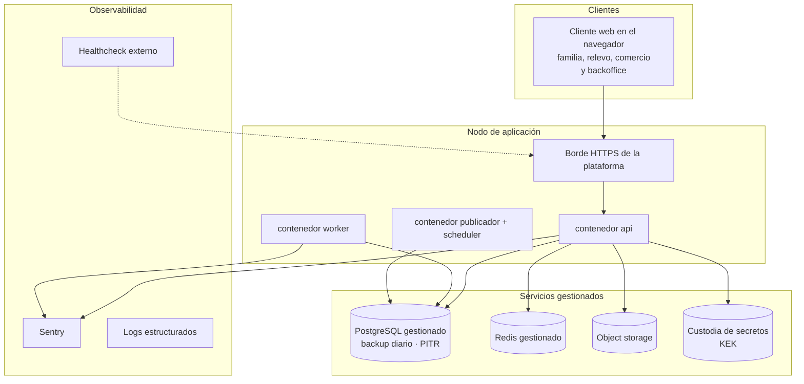

**Recomendación (ADR-019): una instancia de cómputo persistente en un proveedor con base de datos gestionada y servicio de secretos.** No una plataforma de escalado a cero, que no sostiene un worker en escucha permanente ni un bucle de publicador de outbox.

Las razones son **acumuladas**: respaldos gestionados con recuperación a un punto en el tiempo, restauración probada, y custodia de secretos separada del cómputo. Sobre esta última conviene ser preciso: **un servicio de custodia impide extraer la clave maestra, no impide usarla.** Una API comprometida puede invocar el descifrado tantas veces como quiera. El beneficio real es contra robo de respaldos y de disco, y el control complementario es el registro de uso de la clave con alerta por volumen anómalo.

Kubernetes queda descartado: consume sprints y no agrega puntos en la defensa.

### 13.2 Entornos

| Entorno | Propósito | Datos |
|---|---|---|
| Local | `docker compose up` levanta todo | Semillas sintéticas, jamás datos reales |
| Staging | Integración, demostración al profesor guía, pasarela en modo integración | Sintéticos |
| **Demostración** | **Entorno dedicado con catálogo semilla, comercio simulado y guion de recorrido** | Sintéticos verosímiles |
| Producción | Fuera del alcance del semestre. Requiere persona jurídica. Ver 16.6 | — |

**El staging con HTTPS se construyó en el sprint 3 (MATU-25)** en Railway, la plataforma gestionada que eligió Martín (ADR-019), y es donde se hace la prueba en el teléfono. **El entorno de demostración es entregable del sprint 5 del calendario v1.3**, con el guion listo el 16 de noviembre. En un proyecto cuyo mayor riesgo externo es no conseguir convenio, el entorno de demostración es también el plan de contingencia de la defensa.

**El catálogo semilla se arma con los productos que reportaron las entrevistadas**, y no con una lista inventada: pañales de adulto, toallitas húmedas, protectores diarios, crema para escaras, suplemento nutricional y bolsas de ostomía. Los seis salieron de quiebres reales relatados en el piloto.

### 13.3 Observabilidad mínima viable

- Logs estructurados en JSON con `request_id`, `usuario_id`, `grupo_id`, nunca datos personales en el mensaje.
- Sentry para excepciones no controladas, con `release` atado al SHA del despliegue.
- `/health` que verifica base de datos, Redis, almacenamiento y custodia de claves, consultado por un monitor externo.
- **Cuatro indicadores de negocio** en el backoffice, que son los que se muestran en la defensa: pedidos por estado, **alertas de quiebre generadas y convertidas en pedido**, tiempo medio de entrega y **completitud media de la ficha de relevo**.

Los dos indicadores en negrita son los que miden si el producto funciona como producto y no solo como software. El segundo cambió de métrica en la v1.1: mide la ficha, que es lo obligatorio, y no el plan completo.

---

## 14. Decisiones de arquitectura (ADR)

### ADR-001 · MATU es un sistema de continuidad del cuidado en tres capas

**Contexto.** Los dos diseños anteriores concibieron MATU como plataforma de despacho con una bitácora de cuidados anexa en fase 2. Dos evaluaciones independientes llegaron al mismo hallazgo: el activo diferenciador estaba relegado y el componente replicable estaba al centro.

**Decisión.** Reestructurar en tres capas con dependencia estrictamente descendente. Capa 1, el plan de cuidado, es el núcleo. Capa 2, el perfil de consumo y la predicción de quiebre, deriva de la capa 1. Capa 3, el despacho, deriva de la capa 2 y es desacoplable.

**Consecuencias.**
- El diferenciador se construye desde el sprint 2 y queda demostrable de punta a punta en el sprint 3 de la v1.1. Con el calendario v1.3, la ficha y el relevo quedaron de punta a punta en el sprint 2, al 29 de octubre (objetivo específico 3).
- La pregunta "¿esto no lo hace Cornershop?" tiene respuesta estructural: un despacho genérico no sabe cuánto consume la persona cuidada.
- El cumplimiento de la Ley 21.719 pasa de importante a estructural, porque el núcleo del producto es dato sensible.
- El cuidador principal reemplaza al familiar pagador como usuario central.

**Qué dijo la validación.** La reforzó y la corrigió a la vez. La reforzó porque H2 quedó validada con margen y porque cuatro de diez entrevistadas ya llevan un registro propio, una de ellas una hoja de traspaso manuscrita que es el producto en papel. La corrigió porque H1 cayó: el problema es real, el formato de ocho preguntas no. Ver ADR-023.

**Alternativas descartadas.** Mantener el despacho al centro: deja el proyecto expuesto a la dependencia del convenio. Pivotar a venta institucional: correcto como destino, inviable como punto de partida.

---

### ADR-002 · El despacho es desacoplable

**Contexto.** El MVP del diseño anterior no se podía construir sin al menos un comercio dispuesto a convenio. Era el único punto de falla externo y no estaba bajo control del equipo.

**Decisión.** Las capas 1 y 2 no dependen de la capa 3. Si no hay convenio, la familia **exporta su lista de reposición** y compra donde quiera.

**Consecuencias.** La exportación de lista es un requisito de primer orden (RF-15), no un extra. Una prueba automática lo verifica arrancando la aplicación sin la capa 3. El riesgo del convenio baja de crítico a medio.

**Qué dijo la validación.** Que el sustituto está instalado: tres de diez ya compran por aplicación y están conformes, y una rechaza el despacho por especificidad del producto. MATU no compite contra la nada, lo que hace del desacoplamiento una decisión más valiosa, no menos.

**Costo.** Se pierde parte del atractivo inmediato de "delivery para el cuidado". Se gana un producto que existe sin permiso de terceros.

**Regla de operación (MATU-94, 11-11).** Apagar la capa 3 (`CAPA3_HABILITADA=false`) es reversible: el retiro y el borrado de la persona siguen cancelando los pedidos sin pagar y la tarea de conservación sigue corriendo (decisión 250). **Quitarla** (desplegar sin el paquete `ordering`) solo se hace sobre una base sin pedidos, porque sin el paquete nada cancela ni borra a los 30 días los pedidos que hubiera, y la política §10 lo promete.

---

### ADR-003 · El perfil de consumo lo declara el cuidador

**Contexto.** El sistema necesita saber a qué ritmo se consume cada insumo. Hay dos caminos: inferirlo del historial de pedidos o preguntárselo a quien cuida.

**Decisión.** Lo declara el cuidador. Tasa de uso, unidad y stock estimado, en un formulario de tres campos por producto.

**Por qué.** Al inicio no existe historial del cual inferir, y el problema del arranque en frío haría inútil la funcionalidad justo cuando más importa. Además, quien cuida **sabe** cuántos pañales al día se usan.

**Qué dijo la validación.** Que el dato existe y es preciso. Cuatro de diez llevan cuenta propia, con umbrales explícitos: una cuenta sus bolsas cada domingo y compra cuando bajan de ocho. **Ese umbral es exactamente `dias_aviso` puesto por la usuaria.** Pero también mostró el límite: dos de los seis quiebres no eran de previsión sino de mercado y de receta, y la capa 2 no los evita.

**Evolución.** La inferencia desde el historial queda como RF-35 de fase 2, para **corregir** la declaración, nunca para reemplazarla.

---

### ADR-004 · Monolito modular en lugar de microservicios

**Decisión.** Un solo despliegue de FastAPI con módulos de límite explícito, comunicación por interfaces de aplicación y eventos de dominio vía outbox.

**Consecuencias.** Una transacción de base de datos cubre operaciones que en microservicios exigirían saga distribuida. Un pipeline, un despliegue, depuración local trivial. A cambio, todo escala junto, lo cual es irrelevante con decenas de pedidos diarios.

**Salida futura.** Los límites de módulo y el outbox son exactamente lo que permitiría extraer un servicio si hiciera falta.

---

### ADR-005 · Flutter con un repositorio y dos aplicaciones

> **Reemplazado durante el semestre por el [ADR-026](adr/ADR-026-aplicacion-web.md)** (la aplicación de la familia es web, mobile first), decidido el 14 de octubre de 2026. Se conserva como registro.

**Decisión.** Flutter, monorepo con un paquete `core` compartido. En el MVP se publica solo `app_familia`.

**Por qué Flutter y no React Native. Una sola razón, y es honesta.** La aplicación de repartidor necesita **ubicación en segundo plano y cámara con buen rendimiento**, y el soporte para ese par está más consolidado en un solo paquete.

**Se elimina la segunda razón que el diseño anterior alegaba**, porque se invierte con su propia premisa: el equipo **ya** construye un backoffice en React con TypeScript, luego ya carga npm. React Native no agregaría ningún lenguaje nuevo, mientras Dart sí agrega un tercer lenguaje. **Un ADR con una razón sólida es más defendible que uno con una sólida y una falsa.**

**Sobre accesibilidad, con corrección respecto del diseño anterior.** Renderizar canvas propio significa que la aplicación **no hereda** el árbol de accesibilidad nativo y debe reconstruirlo mediante una capa de semántica. Flutter lo resuelve bien, pero es trabajo explícito, no una ventaja gratuita. Los criterios de la sección 10.3 hay que implementarlos y probarlos a mano.

**Nota de alcance (histórica, anterior al ADR-026).** Con la app de repartidor fuera del alcance comprometido, la razón principal de este ADR queda sin ejercitarse en el semestre. En ese momento se mantuvo la decisión porque el `core` compartido ya está diseñado y porque cambiar de stack ahora costaría más que sostenerlo, pero se declara: **si el proyecto continuara sin app de repartidor, React Native sería la elección correcta.**

---

### ADR-006 · Autorización con margen y captura por monto real

> **Reemplazado por el ADR-027** (precios exactos y cobro del total confirmado), aprobado el 26 de octubre de 2026. Se conserva como registro.

**Contexto.** El precio no se conoce hasta que el comercio prepara. Cobrar el estimado obliga a reembolsar en casi todos los pedidos, y reembolsar es lento, caro y genera desconfianza.

**Decisión.** Webpay Plus en modalidad diferida. Al confirmar se autoriza `total_estimado × 1,15`. Al registrar la entrega se captura el `total_real`. La diferencia se libera automáticamente.

**Consecuencias.** El cliente ve una retención mayor durante algunas horas, lo que exige la comunicación de la sección 10.4. Se elimina el reembolso como operación rutinaria. Si el monto real excede lo autorizado, **se captura solo hasta el tope**.

**Riesgo declarado.** Depende de que la captura parcial y la reversa se comporten como documenta el proveedor, y de que operen sobre el medio de pago del segmento. Se verifica en el **sprint 0, semana 7**. Si el débito no lo admite, el plan B es cobrar el estimado y emitir nota de crédito. El riesgo se materializó: la captura diferida no admite débito (sección 18.1), y por eso el ADR-027 reemplaza a este ADR.

---

### ADR-007 · El pago del MVP es de un solo pagador

**Contexto.** El documento conceptual pide dividir el gasto entre familiares. **Ninguna pasarela chilena divide un cobro entre pagadores distintos**, de modo que había que orquestarlo: autorizaciones independientes, plazo de recaudación, redistribución sobre un respaldo y captura prorrateada por resto mayor. El diseño completo está en la sección 8.3 y es correcto.

**Decisión, revisada en la v1.1: el reparto multi-pagador sale del alcance comprometido del semestre y pasa a la fase 2.** RF-22, RF-23 y RF-24 bajan a *Podría*. RF-25 se mantiene sin prorrateo.

**Por qué cambió, y son dos razones que se refuerzan.**

**Primera, la evidencia.** H5 preguntaba si el gasto se reparte y genera fricción. Cuatro de diez reparten, cuando el criterio de validación exigía cinco y el de refutación tres: zona intermedia. H6 preguntaba si quien paga no es quien cuida. Ocho de diez respondieron que pagaría la propia cuidadora. La orquestación multi-pagador resuelve un problema que la mayoría de la muestra no tiene.

**Segunda, la capacidad.** Las 110 horas de RF-22 a RF-25 representaban el 29% del alcance comprometido. Con la ventana de construcción reducida a nueve semanas y 270 horas, construirlas habría consumido más de un tercio del semestre en la parte de mayor riesgo técnico, sobre la hipótesis peor sostenida.

**Lo que se conserva, y es lo que hace barata la vuelta atrás.** La tabla `participacion` se mantiene en el modelo, con una sola fila al 100%. La función `prorratear` se implementa igual y su prueba de propiedad sobre 300 casos corre en cada push. Los cinco casos de prueba de recaudación quedan escritos y marcados como `skip`. **Activar RF-22 a RF-24 en la fase 2 no exige migrar el esquema ni rediseñar nada.** **Estado al 11-11 (MATU-62):** `prorratear` todavía no está construida. Su prueba de propiedad y los cinco casos de varios pagadores quedan escritos y en `skip` (`test_varios_pagadores.py`) hasta la fase 2, donde el reparto del pago es la prioridad 1 (decisión de Jorge del 11-11).

**Lo que se pierde.** El diferenciador comercial más vistoso frente a un delivery genérico. Se acepta porque el diferenciador real, según la validación, es la ficha de relevo y el aviso de quiebre, no el reparto del pago.

**Cómo se cierra.** Las cuatro entrevistas de ampliación resuelven H5 y H6 en la semana 9. Su resultado no cambia el semestre, orienta la hoja de ruta.

**Alternativas descartadas.** Pagador ancla con deuda intrafamiliar: da visibilidad pero no resuelve que nadie quiere adelantar $60.000 todos los meses. Billetera interna con saldo: convierte a MATU en emisor de dinero electrónico.

---

### ADR-008 · El repartidor no maneja dinero

**Contexto.** Hay tres modelos en la industria. **Instacart** entrega al shopper una tarjeta prepagada. **Cornershop** opera de forma equivalente. **Rappi**, en pedidos donde el repartidor compra, hace que adelante dinero propio, lo que genera un flujo documentado de reclamos.

**La restricción específica de MATU.** Los repartidores de Santiago operan varias aplicaciones simultáneamente y no tendrán exclusividad. Una tarjeta prepago exige entregarla, controlarla y recuperarla.

**Decisión.** Cuenta corriente de MATU en el comercio en convenio. El comercio carga el pedido a esa cuenta y MATU liquida por período.

**Qué dijo la validación, y es el hallazgo más útil de todo el piloto para esta decisión.** Una de las entrevistadas describió un arreglo **idéntico ya operando**: la familia tiene cuenta abierta en una farmacia de barrio, la cuidadora firma, y se factura a los hijos a fin de mes con boleta a nombre de ellos. El modelo no es hipotético. Y agregó un requisito que el diseño no tenía: **la boleta debe emitirse a nombre de quien paga**, lo que es la razón por la que esa familia no usa aplicaciones de despacho.

**Consecuencias.** Aparece el módulo `settlement`. El calce de caja queda a favor. El fraude se mueve del anticipo a la cuenta y se controla con la sección 11.7. **Ese comercio es el primer candidato para la carta de intención.**

---

### ADR-009 · Solo el modo de cumplimiento `preparado` en el MVP

**Decisión.** El MVP implementa solo `preparado`: el comercio prepara y se retira con un código. `picking` queda en el enumerado y sin implementar.

**Consecuencias.** El estado `requiere_decision` deja de ser cuello de botella. El monto real se conoce antes del retiro. El tiempo del repartidor por pedido baja de unos 40 minutos a menos de 10.

**A cambio, el comercio tiene que aceptar preparar pedidos.** Con el ADR-002, ese riesgo dejó de ser existencial, y con el hallazgo del ADR-008 se sabe que al menos un comercio ya lo hace.

---

### ADR-010 · Asignación en cascada con plazo de aceptación

**Decisión.** El pedido se ofrece, no se adjudica. Candidatos ordenados por cercanía y tasa histórica de aceptación, 60 segundos por oferta, cascada al siguiente.

**Estado.** Diseñado y **fuera del alcance comprometido** junto con RF-27 a RF-30. En el piloto el retiro se marca desde la vista de comercio.

---

### ADR-011 · El precio de catálogo es referencial

> **Reemplazado por el ADR-027**, aprobado el 26 de octubre de 2026: el catálogo muestra precios exactos de comercios en convenio. Se conserva como registro.

**Decisión.** El catálogo muestra `precio_referencia` con fecha de actualización visible. El pedido congela `precio_snapshot`. El comercio informa `precio_real`. La aplicación muestra las tres cifras cuando difieren.

**Consecuencias.** Transparencia total, que es la base de confianza de un servicio de compra por encargo.

---

### ADR-012 · Alertas materializadas

**Decisión.** El scheduler materializa filas de `alerta_quiebre` al entrar en la ventana de aviso, con restricción única. Disparar es una transición de estado sobre una fila existente.

**Consecuencias.** Reintentar es idempotente por construcción. Descartar y resolver son transiciones auditables y no un borrado.

---

### ADR-013 · Aislamiento con Row Level Security, incluidos los trabajos asíncronos

**Decisión.** RLS de PostgreSQL sobre **tres ejes** de acceso implementados como políticas permisivas separadas, con `FORCE ROW LEVEL SECURITY` en toda tabla de negocio y **rol de aplicación distinto del rol propietario**. El worker usa el mismo rol que la API.

**Tres correcciones respecto del diseño anterior:**

1. **Faltaba `FORCE`.** En PostgreSQL el propietario de una tabla ignora sus políticas.
2. **Faltaban los ejes de comercio y operación.** Con un solo eje, tres de los ocho roles no podían operar.
3. **El orden de la verificación de membresía estaba invertido.** Consultar `membresia` antes de fijar `app.usuario_id` devuelve cero filas.

**Alternativas descartadas.** Esquema por tenant: inmanejable con cientos de grupos. Solo filtro de ORM: un olvido equivale a una filtración de datos de salud.

---

### ADR-014 · Sobre-cifrado del plan de cuidado con clave por persona

**Decisión.** Cifrado en dos niveles. Una clave de datos por persona cuidada, guardada cifrada con una clave maestra en custodia externa. El contenido de cada sección se cifra con AES-256-GCM.

**Consecuencias.**
- Rotar la clave maestra no obliga a recifrar contenido, solo claves de datos.
- El derecho de supresión se cumple con **borrado criptográfico**.
- Compartir con un relevo descifra solo las secciones habilitadas.
- El cifrado por sección hace imposible buscar dentro del plan, lo cual es aceptable.

**Qué dijo la validación.** Que el cifrado por sección era la decisión correcta por una razón que el diseño no había anticipado: hay contenido que las cuidadoras **no digitalizarían nunca**, no por desconfianza técnica sino por dignidad de la persona cuidada y por conflictos familiares. Que el modelo permita compartir tres secciones y no ocho es lo que hace usable el relevo en ese contexto.

---

### ADR-015 · Concurrencia del plan de cuidado por bloqueo optimista

**Decisión.** Bloqueo optimista por sección. `plan_seccion.version` viaja como `ETag`, el PUT exige `If-Match`, y una versión desactualizada devuelve **412 con el contenido actual**.

**No hay fusión automática.** Fusionar texto libre de forma automática produce resultados peores que mostrar ambas versiones.

**Relevancia nueva.** Con RF-42, el llenado asistido, dos personas editando la misma ficha deja de ser hipotético: es el caso de uso previsto cuando un familiar completa por el cuidador principal.

---

### ADR-016 · La clave maestra vive fuera del servidor de aplicación

**Decisión.** La clave maestra se guarda en el servicio de custodia de secretos del proveedor, con acceso por identidad de servicio y registro de uso.

**Con una limitación que conviene declarar:** un servicio de custodia **impide extraer** la clave, no impide **usarla**. Una API comprometida puede invocar el descifrado tantas veces como quiera. El beneficio real es contra robo de respaldos y de disco. El control complementario es el **registro de uso de la clave maestra con alerta por volumen anómalo**.

**Si el piloto termina en un servidor único sin ese servicio**, la limitación se declara explícitamente en el informe de título. **Declarar la limitación es preferible a fingir que no existe.**

> **Desvío aprobado para el semestre (Jorge Espinoza, 28 de octubre de 2026, MATU-12).** Mientras se usen solo datos sintéticos, la clave maestra se lee de una variable de entorno del mismo servidor, con un adaptador de `CustodiaClaves` que solo se construye en los entornos `local` y `pruebas`: con `produccion` la API no arranca. Es exactamente la limitación que declara la sección 11.4. Antes de operar con datos reales se reemplaza por el servicio de custodia, sin tocar el cifrado, porque está detrás del puerto. Las condiciones del adaptador están en `docs/api/README.md` de MATU_PROYECTO.

---

### ADR-017 · Seguimiento por sondeo con cadencias alineadas

**Decisión.** Los cambios de estado viajan por notificación push. La posición, cuando exista app de repartidor, se publica y se consulta **cada 20 segundos**, con `If-None-Match` para que la respuesta sin cambios sea 304.

**Estado.** Fuera del alcance comprometido junto con RF-30.

**Alternativas descartadas.** WebSocket: complejidad que no se paga a esta escala. SSE: mejor para este caso y queda como evolución natural.

---

### ADR-018 · Completitud progresiva del plan de cuidado

**Contexto.** El mayor riesgo de producto no es técnico: es que un cuidador agotado no se siente a llenar información.

**Decisión.** El plan se completa de forma incremental y **nunca se exige completo**. Dictado por voz en todos los campos. Un indicador de completitud que celebra el avance. **El acceso de relevo se puede generar con el plan incompleto.**

**Cómo se validó, y con qué resultado. Quedó refutada la premisa cuantitativa.** El criterio fijado antes de entrevistar exigía que siete de diez respondieran tres preguntas en menos de cinco minutos sin abandonar. Respondieron tres, o cuatro contando a una entrevistada que llegó exactamente al límite. Una rechazó responder y una abandonó en la segunda pregunta.

**Un matiz que se deja anotado sin usarlo a favor.** Dos de las que excedieron el tiempo lo hicieron por exhaustividad y no por dificultad. Una dijo «si lo voy a escribir, lo escribo bien». El criterio mide minutos y no causa, y **no alcanza para sostener la hipótesis**: se registra la distinción y se aplica la consecuencia igual.

**Consecuencia aplicada:** se activa el ADR-023. El principio de completitud progresiva se mantiene, pero deja de descansar sobre ocho preguntas iniciales.

---

### ADR-019 · Despliegue gestionado en lugar de servidor único

**Decisión.** Despliegue en plataforma gestionada con base de datos gestionada y servicio de custodia de secretos, dentro de niveles gratuitos o de bajo costo.

**Por qué, concretamente.** No es por moda ni por currículum: es porque la custodia de la clave maestra no se puede resolver bien en un servidor único, y sin esa custodia el ADR-014 pierde la mitad de su valor.

---

### ADR-020 (retirado)

Existía en el diseño anterior sobre la publicación exclusiva en Android. Se reemplazó por el **ADR-025**. **La numeración no se reutiliza**, para que las referencias antiguas no apunten a otra cosa.

---

### ADR-021 · La testabilidad entra por puertos, no por disciplina

**Decisión.** Toda dependencia externa entra por un **puerto** declarado en `application/ports.py`, con dos implementaciones.

**El caso que lo justifica solo.** `Reloj` como puerto no es purismo: sin él no se puede probar la expiración del token de relevo ni la predicción de quiebre. Un `RelojFijo` convierte "esperar dos horas" en una línea de prueba.

---

### ADR-022 · Medicamentos y CESFAM quedan fuera por riesgo regulatorio

**Decisión.** `rx` se diseña en el modelo de datos y **no se implementa**.

**Por qué, en orden de peso.** Primero, **responsabilidad**: un error en la entrega de un medicamento tiene consecuencias que un error con pañales no tiene. Segundo, **el retiro por un tercero exige autorización del titular** y el procedimiento varía por establecimiento, sin API pública. Tercero, **depende de una negociación institucional** que el equipo no controla.

**Qué dijo la validación, y refuerza la decisión y la prioridad de fase 2 a la vez.** Los fármacos fueron la demanda más repetida fuera del alcance. Una entrevistada describió el único quiebre verdaderamente grave del piloto y **era una receta vencida, no un insumo**. Tres de diez dependen del hospital o del consultorio para sus medicamentos. El dolor existe y es mayor que el de los insumos. **Y por eso mismo el riesgo regulatorio hay que resolverlo antes y no evitarlo:** queda como primera prioridad de la fase 2, con evidencia de campo que la respalda.

**Consecuencias.** Para la defensa, **es más sólido presentar un diseño consciente del riesgo regulatorio que una funcionalidad implementada que no puede operar legalmente.**

---

### ADR-023 · Modo ficha de relevo · **ACTIVADO**

> **Cerrado** en [`adr/ADR-023-cierre.md`](adr/ADR-023-cierre.md), con la evidencia por entrevista. **Complementado por el ADR-028** (31 de octubre): la ficha de tres campos sigue siendo lo único obligatorio, y las secciones opcionales vuelven al semestre con otra lista.

**Contexto.** El riesgo de mayor criticidad del proyecto era que un cuidador agotado no completara el plan de cuidado. Este ADR se escribió como plan B **antes** de entrevistar, para no tener que rediseñar bajo presión si la hipótesis caía.

**Estado: activado en septiembre de 2026**, tras la refutación de H1. No es una decisión tomada bajo presión: es la ejecución de una decisión escrita con anticipación, que es exactamente para lo que se escribió.

**Decisión.** La versión mínima obligatoria de la capa 1 es una **ficha de relevo de tres campos**: la rutina en una línea, qué hacer si la persona se altera y a quién llamar. Las ocho secciones pasan a ser ampliación opcional y ningún flujo del sistema exige el plan completo. El peso del producto se traslada a la capa 2, que no depende de texto largo porque el perfil de consumo son dos números por producto.

**Qué NO cambia, y por eso el plan B funciona.** El modelo de datos casi no se toca: la ficha son tres de los ocho tipos de sección que `plan_seccion` ya contempla, y solo se agrega la columna `plan_cuidado.modo`. El cifrado por sección, el acceso de relevo con token y la auditoría operan igual. El ADR-001 y el ADR-002 quedan intactos. **El costo de la activación es menor a un sprint.**

**Qué se agrega.** RF-42, llenado asistido por un tercero, porque el único abandono del piloto fue por manejo del teléfono y por no tener la información, no por falta de disposición. La entrevistada lo pidió ella misma: que se lo leyeran y alguien escribiera.

**Qué se renombra.** El segundo campo se llama **"Si se altera"**, con la pregunta guía **"¿qué la calma?"**, que es la expresión que usaron tres entrevistadas por su cuenta, y no "manejo de situaciones difíciles".

**Lo que la evidencia sostiene a favor del producto.** H2 quedó validada con margen: siete de diez tuvieron un relevo en tres meses, nueve dejaron de salir por falta de relevo o por el costo de explicar, y seis de los nueve relevos relatados fallaron por conocimiento que solo tenía la cuidadora. Cuatro entrevistadas ya llevan un registro propio. **La necesidad está probada. Lo que se refutó es el formato, no el problema.**

---

### ADR-024 · Un pedido por comercio, y las alertas se consolidan

> **Ajustado por el ADR-027** (26 de octubre): un pedido de la familia puede abastecerse en más de un comercio, con un solo cobro y un solo envío. El registro por comercio se mantiene para preparar y liquidar.

**Contexto.** Con un costo de última milla de $3.500 por entrega, un pedido por producto destruye la unidad económica. Y `pedido` tiene un solo `comercio_id`, mientras la lista de reposición puede abarcar productos de dos comercios distintos.

**Decisión.** El endpoint es `POST /v1/pedidos/desde-alertas` con una lista de alertas, no una por alerta. Si las alertas cruzan comercios, **se generan tantos borradores como comercios**, y la interfaz lo explica antes de confirmar.

**Reemplazada en MATU-61 (11-11, decisiones C4 y D7 de Jorge):** el pedido sale de la lista de insumos con «Pedir estos productos», hay un solo pedido sin pagar por persona, y adentro un registro por comercio. La ruta es `POST /v1/personas-cuidadas/{persona_id}/pedidos` (9.4).

**Refuerzo de la validación.** La mediana medida es de **una salida a comprar al mes**, no 1,5. Consolidar no es una optimización, es la forma en que estas familias ya compran.

---

### ADR-025 · La aplicación de repartidor se publica solo en Android

**Decisión.** Publicar solo en Android durante el piloto. El parque de dispositivos de repartidores en Chile es mayoritariamente Android.

**Estado.** Sin efecto en el semestre, porque la app de repartidor quedó fuera del alcance comprometido. Se conserva como decisión vigente para la fase 2.

---

### ADR-026 · La aplicación de la familia es web, mobile first

**Estado.** Aceptado el 14 de octubre de 2026, por sugerencia del profesor guía. **Reemplaza al ADR-005 durante el semestre.** El texto completo está en [`adr/ADR-026-aplicacion-web.md`](adr/ADR-026-aplicacion-web.md). Su tabla de consecuencias se aplicó en la v1.2: secciones 1, 6.1, 6.2, 10.3, 11.6, 12.2, 13.1, 15, 17 y anexo 19.1.

**Decisión.** En el semestre la aplicación de la familia se construye como aplicación web mobile first, en el mismo cliente web que la página del relevo: React 19 con TypeScript sobre Vite, Tailwind CSS v4 con los tokens del sistema de diseño, iconos de `lucide-react`, un cliente HTTP tipado desde el contrato OpenAPI y la API sirviendo la aplicación desde el mismo origen. **MATU sigue siendo una app móvil en su visión**: la web corre en el navegador del teléfono sin instalar nada, y la app nativa se decide después del semestre.

**Consecuencias.** El push web en iPhone exige agregar MATU a la pantalla de inicio, así que el correo es el canal garantizado de los avisos. El dictado lo da el teclado del teléfono. No hay tiendas de aplicaciones ni cuentas de desarrollador.

---

### ADR-027 · Precios exactos de comercios en convenio, y se cobra el total confirmado

**Estado.** **Aprobado** por Jorge Espinoza (Product Owner) el 26 de octubre de 2026, con la revisión previa del analista normativo. **Reemplaza al ADR-006 y al ADR-011.** Texto completo, con sus seis puntos, en [`adr/ADR-027-precios-exactos.md`](adr/ADR-027-precios-exactos.md).

**Decisión.** El catálogo muestra precios exactos con IVA de comercios en convenio, detrás del puerto `CatalogoComercio`, con un adaptador simulado en el semestre. Antes de cobrar se confirma el stock, y el total confirmado vale 15 minutos. Se cobra una sola vez el total exacto, productos más un envío único, en venta normal de Webpay Plus, con crédito y débito iguales. **Antes de pagar la familia ve la lista del punto 4** (productos, los que salieron, envío y total, quién emite la boleta, ventana de entrega y qué pasa si falta un producto). Si un producto apartado falta al retirar, se busca el mismo en otro comercio, con la diferencia a cargo de MATU, o se devuelve su precio por anulación a la misma tarjeta. Nunca otra marca.

**Por qué.** La prueba de concepto de Transbank mostró que la captura diferida del ADR-006 opera solo con crédito, y el débito es el medio mayoritario del segmento. Una retención mayor que el pedido además es difícil de explicar a una familia cansada.

**Consecuencias.** Desaparecen la captura diferida, la reserva del 15% y el plan B del débito. El esquema cambió con la migración 0002 (7.4 y 8.1). La sección 11.7 cambia de sentido y el ADR-024 se ajusta. La reasignación del retiro después de pagar queda en la fase 2. Antes de cobrar dinero real faltan los casos de venta normal en el ambiente de integración y la consulta legal (18.1).

---

### ADR-028 · La ficha de relevo crece con secciones complementarias

**Estado.** Aceptado el 31 de octubre de 2026, con la actualización del 3 de noviembre (MATU-49). **Complementa el ADR-023 y reabre RF-03.** Texto completo en [`adr/ADR-028-ficha-ampliada.md`](adr/ADR-028-ficha-ampliada.md).

**Decisión.** La ficha tiene dos niveles. La ficha inicial de tres campos no cambia: es lo único obligatorio, se llena en menos de 3 minutos y basta para compartir. Encima, seis secciones complementarias y opcionales (sección 7.2), que la cuidadora agrega cuando quiere. Al compartir, los tres campos van siempre y elige de cero a seis secciones. Sus remedios viene sin marcar.

**Por qué.** Tres campos bastan para que un relevo no cometa errores graves, pero no para que conozca a la persona. La lista sigue el cuidado centrado en la persona y no repite lo que ya dicen los tres campos.

**Consecuencias.** Sin tablas nuevas: tres tipos de sección más en el `CHECK` (migración 0013), cifrados y auditados igual que los campos. `plan_cuidado.modo` deja de ser necesario. Construido en MATU-50.

---

### ADR-029 · La ficha de relevo no se imprime ni se exporta

**Estado.** Aceptado el 3 de noviembre de 2026. **Reemplaza a RF-09** tal como estaba en la v1.1 y a la historia de la ficha imprimible. Texto completo en [`adr/ADR-029-ficha-no-se-imprime.md`](adr/ADR-029-ficha-no-se-imprime.md).

**Decisión.** Ni los tres campos ni las secciones se imprimen ni se exportan. La ficha se comparte solo con el acceso de relevo, que vence y se puede cortar. Lo que se exporta y se imprime es la lista de reposición.

**Por qué.** Una hoja en papel no vence, no se corta y la lee cualquiera que entre a la casa, y retirar la autorización no alcanza a las hojas impresas.

**Consecuencias.** Se pierde el plan B sin internet del relevo, y se acepta. No es una excepción a los derechos del titular: «Mis datos» (MATU-54) entrega todo lo que MATU guarda de la persona, incluida la ficha.

---

### ADR-030 · Roles del equipo: Jorge desarrolla, Martín despliega, prueba y revisa

**Estado.** Aceptado el 5 de noviembre de 2026, en la revisión del sprint 3. **Reemplaza la nota del reparto en prueba** del 4 de noviembre y **ajusta el reparto por eje vertical** de la sección 15.5. Texto completo en [`adr/ADR-030-roles-del-equipo.md`](adr/ADR-030-roles-del-equipo.md).

**Decisión.** Jorge es Product Owner y desarrolla todas las tarjetas con los seis agentes. Martín es Scrum Master, dueño del despliegue y de las pruebas en el teléfono y con usuarios, y revisa y fusiona los PR de Jorge. Las políticas innegociables, la definición de terminado y la regla de que nadie fusiona su propio trabajo no cambian.

**Consecuencias.** La capacidad de desarrollo depende de una persona. Es el riesgo principal y se mide con el factor de vibecoding de cada retrospectiva.

---

### ADR-031 · La lista de insumos se comparte como texto, sin enlace

**Estado.** Aceptado el 6 de noviembre de 2026. **Ajusta RF-15**, las secciones 9.3 y 9.6 y el almacenamiento de objetos. Texto completo en [`adr/ADR-031-lista-insumos-solo-texto.md`](adr/ADR-031-lista-insumos-solo-texto.md).

**Decisión.** En el semestre la lista se comparte como texto, sin enlace: se imprime o se guarda como PDF desde el navegador, y se comparte con la hoja de compartir del teléfono o con «Copiar la lista». MATU no genera archivos, no guarda exportaciones y no crea un acceso público. La lista no lleva el nombre de la persona cuidada.

**Por qué.** La lista muestra qué insumos usa la persona, y el diseño trata el consumo como un dato de salud. Un enlace abierto lo abre cualquiera que lo reciba, y un PDF hecho en el servidor obliga a guardar archivos con datos de consumo.

**Consecuencias.** Si después hace falta un enlace, va con un ADR nuevo, una revisión normativa y su propio acceso con token, vencimiento y corte, como el del relevo. Construido en MATU-60 (migración 0015).

---

## 15. Alcance por fases y plan de sprints

### 15.1 Alcance

| Componente | MVP (8 sprints) | Fase 2 |
|---|---|---|
| **Plan de cuidado** | **Completo**: ficha de relevo de tres campos como mínimo obligatorio, seis secciones complementarias (ADR-028), llenado asistido, cifrado, concurrencia, acceso de relevo y retiro de la autorización. **Sin versión imprimible** (ADR-029) | Plantillas por tipo de dependencia, adjuntos, historial de cambios, recordatorios de remedios |
| **Perfil de consumo y predicción** | **Completo**: declaración, cálculo, alertas, lista y su salida como texto (ADR-031) | Corrección por historial real, sugerencia de cantidad óptima, enlace compartible con su propio acceso |
| Registro, grupo familiar, persona cuidada | Completo | Invitaciones por enlace profundo |
| Catálogo y convenios | Completo, con precios exactos y stock detrás del puerto `CatalogoComercio`, con adaptador simulado (ADR-027) | Adaptador real de un comercio en convenio |
| Reposición programada | **Fuera del alcance comprometido** | Envíos periódicos con calendario |
| Pedido y pago | Completo **con un solo pagador**: stock confirmado y cobro único del total confirmado (ADR-027) | Reparto entre varios pagadores, recaudación, respaldo, cobro prorrateado, reasignación del retiro después de pagar |
| Vista de comercio | Completo, incluidos retiro y entrega | Integración con punto de venta |
| Aplicación de repartidor | **Fuera del alcance comprometido** | Ofertas en cascada, código, evidencia geolocalizada |
| Despacho y liquidación | Conciliación manual, **demostrable simulado si no hay convenio** | Liquidación automática, optimización de ruta |
| Medicamentos y CESFAM | **Fuera**, diseñados en el modelo | **Primera prioridad de fase 2**, con evidencia de campo |

### 15.2 Capacidad declarada

**Esta subsección cambió por completo en la v1.1.** La v1.0 planificaba trece semanas de construcción. Al cerrar la Fase 1 en la semana 6, la ventana real quedó en nueve.

| Parámetro | v1.0 | **v1.1** |
|---|---|---|
| Ventana de construcción | 13 semanas | **9 semanas, de la 7 a la 15** |
| Sprints | 0 más doce | **0 más ocho** |
| Duración del sprint | 1 semana | 1 semana |
| Personas | 2 | 2 |
| Horas semanales por persona | 15 | 15 |
| **Capacidad total** | 390 h | **270 h** |

**Equivalencia entre sprints y semanas en la v1.1:** el sprint 0 ocupaba la semana 7, y desde ahí el sprint N correspondía a la semana N más 7. El semestre cierra con informe final y defensa entre las semanas 16 y 18.

**El calendario v1.3 reemplazó esa equivalencia** ([`sprints/calendario-sprints.md`](sprints/calendario-sprints.md), vigente desde el 13 de octubre). El sprint 0 se extendió hasta la semana 10, los sprints van de viernes a jueves, y el alcance de los ocho sprints de la v1.1 se agrupó en cinco, más dos de reserva. La capacidad real sigue en 23 horas por sprint, y el supuesto es que en ellas caben hasta 41 horas de las estimaciones originales, con un factor de vibecoding de 1,8 que se mide en cada retrospectiva. **El alcance comprometido de la 15.3 y el orden de sacrificio no cambian.** En este documento, un número de sprint sin otra indicación es del calendario v1.3, salvo en las tablas y los textos marcados como de la v1.1.

**No se aplica factor de foco.** Las tallas están estimadas en horas reales, no ideales. La v1.1 incluía en ellas el costo de aprender Flutter. Con el ADR-026 ese costo desaparece, porque el frontend se construye en React con TypeScript, que el equipo ya usaba. Las tallas no se reestimaron: la diferencia queda como holgura.

**Estimación por talla, contrastada contra la capacidad real.**

| Talla | Horas | Total en el catálogo completo |
|---|---|---|
| S | 4 | 44 h |
| M | 10 | 160 h |
| L | 20 | 140 h |
| XL | 35 | 70 h |
| | **Subtotal del catálogo** | **414 h** |
| | Capacidad disponible | **270 h** |

**414 contra 270 no cierra por un margen enorme. El recorte no es opcional, es aritmética.**

### 15.3 Los dos recortes

**Primer recorte, 41 horas, aplicado al cerrar el diseño.**

| Qué se saca | Requisitos | Horas | Cómo se demuestra igual |
|---|---|---|---|
| Aplicación de repartidor | RF-27, RF-28, RF-29 | 24 h | El pedido se marca retirado y entregado desde la vista de comercio |
| Seguimiento de posición | RF-30 | 4 h | Los cambios de estado por push cubren la necesidad real |
| Liquidación automática | mitad de RF-31 | 5 h | Se registra el consumo por pedido y el cierre se hace en planilla |
| Indicadores avanzados | parte de RF-32 | 8 h | Quedan cuatro de los seis indicadores |
| | | **41 h** | |

**Segundo recorte, 160 horas, aplicado al cerrar la Fase 1.** Este es el recorte que la ventana de nueve semanas obliga, y cada línea tiene su justificación de evidencia además de la de capacidad.

| Qué se saca | Requisitos | Horas | Por qué, además de las horas |
|---|---|---|---|
| **Reparto del gasto entre varios pagadores** | RF-22 (L), RF-23 (L), RF-24 (XL) | 75 h | H5 en zona intermedia, cuatro de diez reparten. H6 con tendencia en contra, ocho de diez dicen que pagaría la cuidadora. Ver ADR-007 |
| **Prorrateo de la captura** | RF-25 baja de XL a M | 25 h | Con un solo pagador la captura es directa. La función y su prueba se mantienen para la fase 2 |
| **Reposición programada completa** | RF-16 (L), RF-17 (L), RF-18 (S), RF-19 (L) | 64 h | Ninguna entrevistada pidió envío periódico. Lo que pidieron fue el aviso y el botón para pedir en ese momento, que son RF-14 y RF-20 |
| Se agrega el llenado asistido | RF-42 (S) | −4 h | Requisito nuevo que la validación obliga a incorporar |
| | | **160 h netas** | |

**Alcance resultante: 213 horas contra 270 de capacidad, con 57 horas de holgura, un 21%.**

**Por qué la holgura es tan alta a propósito, y no es sobra.** Nueve semanas no admiten recuperar un atraso: no hay sprint de colchón al final. La v1.1 agregaba que el equipo aprendería Flutter mientras construía, costo que el ADR-026 eliminó. Y la experiencia de la v1.0, que declaraba 4,4% de holgura sobre trece semanas, mostró que una holgura de un dígito es optimismo aritmético. **Un 21% sobre nueve semanas es aproximadamente dos sprints de reserva, que es lo mínimo defendible.**

**Y el recorte se propaga.** RF-22 a RF-24 bajan a *Podría* en la sección 3.3, RF-16 a RF-19 bajan a *Debería* en la 3.2, la sección 8.1 pierde los estados de recaudación, la 8.3 se reescribe y la 12.4 pasa de doce casos obligatorios a siete, que el ADR-027 dejó después en nueve. **Un recorte que no se propaga al catálogo de requisitos, a las máquinas de estado y al plan de pruebas no es un recorte, es una intención.**

**Lo que no se saca bajo ninguna circunstancia:** la ficha de relevo, el acceso de relevo, la predicción de quiebre y la exportación de lista. Son el producto.

### 15.4 Plan de sprints

> **Desde la v1.2 rige el [calendario de sprints v1.3](sprints/calendario-sprints.md).** Reemplaza las fechas y la agrupación de la tabla de la v1.1, que se conserva más abajo como antecedente.

| Sprint | Fechas | Objetivo | Agrupa (v1.1) | Estado al 8 de noviembre |
|---|---|---|---|---|
| 0 | 21 sep – 15 oct | Preparación: repositorios, pipeline, esquema base y prueba de concepto de Transbank | 0 | Cerrado. 31 pruebas de aislamiento en verde (objetivo específico 2) |
| 1 | 16 – 22 oct | Identidad y grupo, y cierre de la prueba de Transbank | 1 | Cerrado |
| 2 | 23 – 29 oct | Ficha de relevo y acceso de relevo: **primer producto de punta a punta** | 2 y 3 | Cerrado (objetivo específico 3) |
| 3 | 30 oct – 5 nov | App de familia, perfil de consumo con predicción, staging y avisos | 4 y 5 | Cerrado con 15 historias en `main` (objetivo específico 4) |
| 4 | 6 – 12 nov | Catálogo, lista de reposición, pedido y pago con un solo pagador, y vista de comercio | 6 y 7 | En curso (objetivos específicos 5 y 6) |
| 5 | 13 – 19 nov | Cierre: endurecimiento, retención, despliegue, backoffice mínimo y guion de demostración. Guion e informe listos el lunes 16 | 8 | Planificado (objetivo específico 7) |
| 6 y 7 | 20 nov – 3 dic | **Reserva**, sin alcance comprometido: ajustes por la retroalimentación y la presentación final | — | — |

**Los objetivos específicos 5, 6 y 7, en su redacción vigente:**

- **5. La lista de reposición, operativa sin convenio comercial.** Se comparte como texto, sin enlace: se imprime o se guarda como PDF desde el navegador y se comparte desde el teléfono ([ADR-031](adr/ADR-031-lista-insumos-solo-texto.md)). La v1.1 y el informe de avance decían "exportable como documento y como enlace compartible".
- **6. El flujo de pedido con un solo cobro del total exacto** (ADR-027), con los nueve casos obligatorios de la sección 12.4 en verde. Sin captura diferida ni autorización con margen.
- **7. El sistema desplegado en un entorno de demostración, con los seis recorridos críticos operativos** y el pipeline en verde. Los seis recorridos se están fijando en MATU-64.

**La tabla de la v1.1, como antecedente.** Sus sprints eran de una semana, desde la semana 7.

| Sprint | Semana | Objetivo | Entregable verificable |
|---|---|---|---|
| 0 | 7 | Preparación | Repositorios, pipeline, esquema base, **prueba de concepto de Transbank** |
| 1 | 8 | Identidad y grupo | Registro, login, grupo familiar, persona cuidada, RLS con **diez pruebas de aislamiento** en API y en worker |
| 2 | 9 | **Ficha de relevo** | Los tres campos obligatorios, cifrado con sobre-cifrado, concurrencia optimista, consentimiento, auditoría de acceso, llenado asistido |
| 3 | 10 | **Acceso de relevo** | Token expirable con PIN, vista de relevo y revocación. **Primer producto demostrable de punta a punta**, en la misma semana de la evaluación de avance |
| 4 | 11 | App familia, núcleo | Navegación, autenticación, ficha de relevo en la aplicación web, criterios de accesibilidad aplicados |
| 5 | 12 | **Perfil de consumo y predicción** | Declaración, cálculo de quiebre con ocho pruebas de dominio, alertas materializadas, notificaciones |
| 6 | 13 | Catálogo y lista | Catálogo semilla, lista de reposición y su salida como texto (ADR-031). **Entorno de demostración operativo.** Pruebas de usabilidad con tres usuarios |
| 7 | 14 | Pedido y pago | Carrito, confirmación de stock, cobro único del total confirmado, devolución por anulación parcial, vista de comercio con código de retiro. Los nueve casos de la sección 12.4 (ADR-027) |
| 8 | 15 | Cierre | Endurecimiento, retención, pruebas de carga, despliegue, backoffice mínimo, guion de demostración |

**Con el calendario v1.3 el producto de punta a punta llegó antes.** La v1.1 lo ubicaba en el sprint 3, la semana de la evaluación de avance de la Fase 2. El sprint 0 se extendió hasta esa misma semana, y la ficha con el relevo quedó de punta a punta en el sprint 2, el 29 de octubre.

**Qué se sacrifica ante atraso, en este orden:** primero los indicadores del backoffice, después la vista de comercio automatizada, que se puede operar a mano en la demostración, después el catálogo curado, que se reduce a diez productos. El calendario v1.3 agrega un cuarto: el staging se reemplaza por un túnel HTTPS temporal para la demostración. **Nunca la ficha de relevo, el acceso de relevo, la predicción de quiebre ni la salida de la lista.**

### 15.5 Reparto del trabajo entre dos personas

> **Reescrita con el ADR-030** (5 de noviembre). La v1.1 repartía el trabajo por eje vertical entre dos desarrolladores. Ese reparto rigió hasta el sprint 3, con la regla de ejes suspendida en una parte. Desde el 5 de noviembre el reparto es por rol.

**El reparto vigente (ADR-030).**

| Persona | Rol | Qué hace |
|---|---|---|
| **Jorge Espinoza** | Product Owner y desarrollo | Todas las tarjetas de arquitectura, backend y frontend, con los seis agentes: el QA previo al PR, el analista normativo antes y al cierre, y el diseñador en la especificación y en la revisión visual. Como PO decide el alcance, las prioridades y los criterios |
| **Martín Henríquez** | Scrum Master, despliegue y pruebas | Dueño del despliegue (staging, HTTPS y el entorno de demostración), de la prueba en el teléfono y de las pruebas con usuarios. Revisa y fusiona los PR de Jorge, con su informe en `TESTER/` (PASS o FAIL, con evidencia), y revisa la redacción de los documentos. No toca código de producto ni cambia decisiones: las evalúa |

**Por qué.** Lo probó el equipo durante una semana, desde el 4 de noviembre: Martín revisó y fusionó toda la fila de PR del sprint 3 y probó en el teléfono seis historias, y el sprint 3 cerró con 15 historias en `main`. El motivo inicial fue de costo: el desarrollo con todos los agentes consume muchos tokens, y solo una de las dos cuentas lo sostiene.

**Lo que no cambia:**

1. **El contrato de API se acuerda antes que la implementación.** Los contratos propuestos viven en `docs/api/propuestos/` hasta que el código los cumple, y desde ahí manda `openapi.json`.
2. **Nadie fusiona su propio trabajo.** Martín fusiona los PR de Jorge, y cuando una historia toca datos sensibles o dinero, su revisión es obligatoria (sección 12.6, punto 5).
3. **Las migraciones se apilan en orden.** Dos historias con migración no salen de la misma cabeza: la segunda se encadena a la primera, y `test_cadena_migraciones.py` exige una sola cabeza (sección 7.8). Los PR apilados se fusionan con merge commit, no con squash, para que el siguiente de la pila no quede en conflicto.
4. **La revisión previa del analista normativo** va antes de implementar todo lo que toque datos personales, consentimiento o dinero.

**El reparto anterior, por eje vertical, hasta el 4 de noviembre.**

| Eje | Módulos | Sprints de la v1.1 |
|---|---|---|
| **A · Cuidado y consumo** (Jorge) | `care_plan`, `consumption`, `catalog` | 2, 3, 5 y 6 |
| **B · Identidad, dinero y operación** (Martín) | `iam`, `care_circle`, `ordering`, `payments`, `settlement`, `backoffice` | 0, 1, 7 y 8 |

Su regla central era que nadie editaba módulos del otro eje. **En los sprints 1 a 3 esa regla se suspendió para `care_circle`, `care_plan` y `shared`**, porque el tramo concentraba el trabajo de la capa 1, y el dueño del módulo revisaba todo PR que lo tocara (backlog, sección "Regla de ejes en este tramo"). Con el ADR-030 la regla deja de aplicarse, porque una sola persona desarrolla. Las etiquetas de eje de Trello siguen diciendo quién lleva cada tarjeta, y cada ítem de sus checklists empieza con «Jorge ·» o «Martín ·».

**Riesgo de capacidad.** Las 23 horas semanales de desarrollo dependen de las 11 horas de Jorge, con el factor de vibecoding del calendario v1.3. Es el riesgo principal del reparto y se mide en cada retrospectiva. Con una ventana de nueve semanas, una ausencia de Jorge obliga a aplicar el orden de sacrificio de inmediato, y una de Martín deja los PR sin fusionar.

---

## 16. Unidad económica y viabilidad

Esta sección ya no descansa en supuestos del equipo. Las tres cifras que gobiernan el cálculo se midieron en las diez entrevistas de la sección 18, y el punto de equilibrio se recalculó con ellas y **se publica como salió**, que era el compromiso del protocolo.

### 16.1 De supuesto a medición

| Parámetro | Supuesto en la v1.0 | Valor medido | Origen |
|---|---|---|---|
| Canasta mensual de cuidado por persona | $50.000 a $70.000 | **Mediana $70.000**, rango $0 a $300.000 (n=9) | Entrevistas. Tres valores con respaldo documental: $43.500, $58.000 y $92.000 |
| **Entregas por familia y mes** | 1,5 | **Mediana 1,0**, rango 1 a 4 (n=8) | Entrevistas, pregunta 25 |
| Gasto ya desembolsado en servicios de cuidado | sin valor | **6 de 10 pagan hoy**, 5 de forma recurrente | Entrevistas, pregunta 30 |
| Consumo de pañales en dependencia moderada | 3 a 5 unidades diarias | sin medir | Sigue siendo supuesto |
| Costo de última milla por entrega en Santiago | $3.500 | sin medir | Sigue siendo supuesto |
| Costo de pasarela | ~3% del monto | — | Transbank |
| Precio de suscripción | $5.990 mensuales | 8 de 10 dijeron que sí, 4 condicionado a que resuelva insumos | Entrevistas, pregunta 31, hipotética |

**Dos advertencias sobre la canasta.** La mediana cae dentro del rango que la v1.0 suponía, pero el rango real es mucho más ancho, y la razón es que **la canasta no la determina la necesidad sino la capacidad de pago de la familia**. Y dos de las diez entrevistadas tienen canasta cercana a cero porque el sistema público les cubre los fármacos y la persona cuidada no usa pañales, lo que significa que **el segmento con canasta baja existe y no es marginal**.

### 16.2 Comparación de modelos, sobre 200 familias activas

Con 200 familias y **1,0 entregas mensuales** cada una son 200 entregas al mes, y el volumen transado por la pasarela es la canasta mensual completa de cada familia, $14.000.000.

| | **Solo despacho** | **Suscripción + despacho** |
|---|---|---|
| Entregas mensuales | 200 | 200 |
| Volumen transado | $14.000.000 | $14.000.000 |
| Ingreso por comisión (10%) | $1.400.000 | $1.400.000 |
| Ingreso por suscripción ($5.990 × 200) | — | $1.198.000 |
| Costo de última milla (200 × $3.500) | −$700.000 | −$700.000 |
| Costo de pasarela (3% del volumen más la suscripción) | −$420.000 | −$455.940 |
| **Margen de contribución** | **$280.000** | **$1.442.060** |
| **Margen por familia y mes** | **$1.400** | **$7.210** |

**Corrección aritmética respecto de la v1.0, y conviene decirla.** La tabla anterior calculaba el ingreso por comisión sobre 300 entregas valoradas cada una en una canasta mensual completa de $60.000, es decir $18.000.000 de volumen, que equivale a $90.000 por familia al mes. Eso contradice el propio supuesto de canasta mensual de $50.000 a $70.000: **si la canasta mensual es $60.000 y hay 1,5 entregas, cada entrega vale $40.000, no $60.000**. Calculado de forma consistente con sus propios supuestos, la v1.0 habría dado $4.760 por familia en el modelo con suscripción y un margen **negativo** de −$1.050 en el de solo despacho.

**Qué sobrevive a la corrección y qué cambia.** La conclusión cualitativa sobrevive intacta y sale reforzada: el despacho por sí solo no sostiene el negocio y la suscripción lo cambia de orden de magnitud. Lo que cambia es que el modelo de solo despacho deja de ser marginalmente positivo por la razón que se creía, y sigue sin resistir una subida del costo de última milla de $3.500 a $4.500, que lo deja en $400 por familia al mes.

### 16.3 Referencia de mercado

Mis Tatas, la empresa chilena más cercana en el espacio, cobra entre $10.000 y $39.000 mensuales por hogar por teleasistencia, opera desde 2019 y supera los 2.500 usuarios.

**Ese dato no valida el precio de MATU**, y ahora hay algo mejor que una comparación: **seis de diez entrevistadas ya pagan por algún servicio de cuidado**, desde $1.900 mensuales por una suscripción de despacho hasta $400.000 mensuales por una cuidadora, pasando por $25.000 mensuales en traslados y $20.000 diarios por relevo puntual. Eso es disposición a pagar demostrada con hechos y no declarada en una hipotética. El techo del segmento está muy por encima de $5.990.

Lo que la validación **no** entrega es que esas mismas personas paguen por *esto*: ocho dijeron que sí a $5.990, pero cuatro condicionaron el sí a que el producto resuelva los insumos, no solo el plan. **El precio se sostiene sobre las capas 1 y 2 juntas, nunca sobre la capa 1 sola.**

### 16.4 Punto de equilibrio del piloto

Con costos fijos austeros de aproximadamente $600.000 mensuales, sin la pasarela, que es costo variable:

| Modelo | Margen por familia al mes | **Punto de equilibrio** |
|---|---|---|
| Suscripción + despacho | $7.210 | **84 familias** |
| Solo despacho | $1.400 | **429 familias** |

**84 familias en una comuna es alcanzable, 429 no.** En una comuna de 100.000 habitantes hay del orden de 7.000 personas mayores de 60 años y varios cientos con algún grado de dependencia.

**Lo que este número sigue sin resolver es la conversión.** 84 familias es el piso de sostenibilidad, no una proyección de captación, y la hipótesis que debía decir cuánto cuesta conseguir cada una, H7, **quedó en zona intermedia**.

### 16.5 Los tres sustitutos, reconocidos

| Sustituto | Por qué no anula a MATU | Qué mostró la validación |
|---|---|---|
| **Cornershop, Rappi y despacho de supermercados** | Despachan lo que se les pide. No saben qué necesita la persona cuidada ni cuándo | **Tres de diez ya compran por aplicación y están conformes.** El sustituto está instalado. Una entrevistada rechaza el despacho por especificidad del producto, no por desconfianza, y otra por un requisito tributario: necesita la boleta a nombre de quien paga |
| **Entrega pública de pañales** vía CESFAM y municipios | Cubre el insumo, no la continuidad del cuidado | **Cuatro de diez están en un padrón público y todas dicen que no alcanza.** Dos más no sabían que el beneficio existe. El canal institucional se confirma como oportunidad y no como competencia |
| **Comercio electrónico especializado en insumos de cuidado** | Vende producto, no gestión | Una entrevistada compra insumos especializados en una casa ortopédica del centro, con media jornada de costo por viaje, y declaró que pagaría el doble por no tener que ir. **Es el caso de mayor disposición a pagar del piloto y es logística especializada, no supermercado** |

### 16.6 Lo que esta sección sigue sin resolver

De los cuatro huecos que la v1.0 declaraba, **uno se cerró y tres siguen abiertos**, y conviene decir cuál es cuál.

1. **Cerrado: la disposición a pagar tiene evidencia.** Seis de diez pagan hoy por algún servicio de cuidado, con pagos demostrados y montos conocidos.
2. **Abierto: no hay costo de adquisición ni tasa de abandono.** Con 84 familias como piso, el costo de conseguir cada una decide si el negocio existe. H7 quedó en zona intermedia porque **ninguna de las diez entrevistadas fue reclutada por un canal concentrado**. Las cuatro entrevistas de ampliación se reclutan solo por canal concentrado precisamente para probar H7 con hechos.
3. **Abierto: no hay figura legal.** Operar Webpay en producción, cobrar a familias reales y abrir cuenta corriente exigen persona jurídica con RUT. **Esto implica que no habrá piloto con dinero real este semestre**, y el entregable es un entorno de demostración. El objetivo del proyecto se formuló en consecuencia.
4. **Abierto: el cobro de la suscripción está fuera del MVP.** RF-41 es *Podría*. El punto de equilibrio es un **ejercicio de viabilidad y no un compromiso de alcance del semestre**.

**Esta sección establece que el proyecto conoce su propia aritmética, corrigió un error propio de un orden de magnitud y reemplazó tres supuestos por mediciones. No establece que el negocio esté validado.**

---

## 17. Riesgos

| Riesgo | Prob. | Impacto | Mitigación |
|---|---|---|---|
| ~~El cuidador no completa el plan de cuidado~~ **MATERIALIZADO Y MITIGADO** | — | — | Era el riesgo número uno. Se validó antes del sprint 2, la hipótesis quedó refutada y **se activó el ADR-023**: ficha de relevo de tres campos, secciones opcionales y llenado asistido. Costo menor a un sprint, sin cambios en el modelo de datos |
| ~~El reclutamiento de diez cuidadores no se logra~~ **CERRADO** | — | — | La meta del protocolo se cumplió íntegra: diez de diez |
| **La ventana de construcción es de nueve semanas**, y el desarrollo empezó tres semanas tarde | Alta | **Alto** | Es el riesgo dominante. Mitigación: segundo recorte de 160 h aplicado antes del primer sprint, orden de sacrificio declarado, calendario v1.3 con cinco sprints y dos de reserva, y el factor de vibecoding medido en cada retrospectiva. El producto de punta a punta llegó en el sprint 2 |
| **Tres hipótesis quedaron en zona intermedia** | Alta | Medio | H5, H6 y H7. Cuatro entrevistas adicionales por canal concentrado en la semana 9, según la regla del propio protocolo. Como el reparto multi-pagador ya salió del alcance, su resultado orienta la fase 2 y no condiciona el semestre |
| ~~La captura diferida no se comporta como documenta el proveedor~~ **CERRADO, Y REEMPLAZADO** | — | — | La prueba de concepto del 24 de octubre la verificó con crédito. El ADR-027 dejó de usarla |
| ~~**La captura diferida no aplica a débito ni prepago**~~ **MATERIALIZADO Y REEMPLAZADO** | — | — | Se confirmó en el sprint 0: el débito no admite captura diferida. Fue la razón principal del ADR-027, que cobra una sola vez el total exacto en venta normal, con crédito y débito iguales |
| **La anulación parcial de una venta normal no se admite con débito**, o sus plazos no calzan con "el mismo día" | Media | Alto | Casos de venta normal y anulación parcial con crédito y con débito en el ambiente de integración, antes del sprint 4. Si no se admite, se define otro medio antes del sprint 4, sin pedir datos bancarios a la familia salvo que se apruebe como tratamiento nuevo. [PENDIENTE: plazos máximos de anulación de Transbank] |
| **Los precios del comercio no están al día** | Media | Medio | El convenio obliga al comercio a mantener precios y stock. Sin convenio, el piloto usa precios de ejemplo detrás del puerto `CatalogoComercio` y lo declara en la interfaz |
| **Un producto apartado falta al retirar** | Baja | Medio | El comercio que confirma el stock lo aparta. Si falta, el mismo producto en otro comercio, con la diferencia a cargo de MATU, o devolución de su precio. La reasignación después de pagar es fase 2 y en el semestre se muestra simulada |
| **La consulta legal del ADR-027 no llega antes de cobrar dinero real** | Media | Alto | En el semestre no se cobra dinero real. La investigación normativa del 27-10 resolvió con el texto de la ley que el retracto aplica y cómo se informa, y que no hay un plazo legal específico para devolver lo no entregado. El 27-10 Jorge resolvió por diseño P3 a P7 con la opción más protectora. Antes de cobrar dinero real quedan P1 y P2 para un abogado y P8 para un contador (sección 18.1). Mientras tanto, los productos se tratan como sensibles. |
| Pérdida de capacidad de una persona | Media | **Crítico en nueve semanas** | Con el ADR-030 el desarrollo depende de Jorge, y la revisión y el despliegue de Martín. Estado documentado en los dos repositorios, informes de revisión en `TESTER/` y PR pequeños. Con la ventana acortada, una ausencia de dos semanas ya no es recuperable y obliga a aplicar el orden de sacrificio de inmediato |
| Curar el catálogo toma más de lo previsto | Media | Bajo | El catálogo semilla son los seis productos que reportaron las entrevistadas, no una lista inventada. Es trabajo humano acotado, en el sprint 4 |
| Ningún comercio acepta convenio | Media | **Medio**, ya no crítico | El ADR-002 lo degradó. Y la validación entregó un candidato concreto: la farmacia de barrio que ya opera con cuenta corriente para una familia entrevistada |
| Filtración entre grupos familiares | Baja | **Crítico** | RLS forzado incluidos los workers, más diez pruebas de aislamiento en el pipeline |
| Rendimiento en dispositivos de gama baja | Media | Medio | Probar en un teléfono real en staging desde el sprint 3, con la prueba en el teléfono de cada historia (ADR-030) |
| Cambio regulatorio con la vigencia de la Ley 21.719 | Media | Medio | El diseño ya cumple lo exigible. Revisar guías de la Agencia cuando se publiquen |
| ~~El equipo no domina Dart~~ **RETIRADO** | — | — | El ADR-026 reemplazó Flutter por una aplicación web en React con TypeScript |
| **El push web en iPhone exige agregar MATU a la pantalla de inicio** | Alta | Medio | El correo es el canal garantizado de los avisos de quiebre (RF-39) y el push es complemento (ADR-026). En Android el push funciona desde el navegador |
| **No existe persona jurídica** | Alta | Medio, ya no alto | Operar Webpay en producción exige RUT. **El objetivo del semestre se formuló sobre un entorno de demostración**, de modo que la ausencia de persona jurídica ya no bloquea el entregable comprometido |
| **Pérdida o rotación fallida de la clave maestra** | Baja | **Crítico** | Deja ilegible todo el plan de cuidado de forma irreversible. `kek_version` registrada por clave de datos, retención de la versión anterior durante una rotación, y procedimiento documentado. **Y el borrado criptográfico se completa cuando expira el último respaldo que contiene la clave** |

---

## 18. Definiciones pendientes

| Pregunta | Qué decisión desbloquea | Plazo |
|---|---|---|
| ~~¿Un cuidador agotado completa ocho preguntas?~~ **RESPONDIDA: no.** Tres de diez bajo cinco minutos | Refutó H1 y activó el ADR-023 | Cerrada en septiembre de 2026 |
| ~~¿Cuánto está dispuesta a pagar una familia?~~ **RESPONDIDA con reserva.** Seis de diez ya pagan por algo del cuidado | El precio de la sección 16 se sostiene, condicionado a que el producto resuelva insumos y no solo el plan | Cerrada, con la condición anotada |
| **¿El gasto se reparte y quién pagaría?** | Decide si RF-22 a RF-24 entran en la fase 2 | Antes del sprint 4 del calendario v1.3 (cierre del ADR-023). [PENDIENTE: resultado de las entrevistas de ampliación] |
| **¿Existe un canal concentrado de captación?** | Decide el costo de adquisición y con él la alcanzabilidad de las 84 familias | Antes del sprint 4 del calendario v1.3. [PENDIENTE: resultado de las entrevistas de ampliación] |
| ¿Cuál es la comuna de partida? | Zonificación, catálogo inicial, volumen esperado | Sprint 4 |
| ¿De quién es el registro cuando lo escribe una cuidadora con contrato? | Alcance del consentimiento y responsabilidad laboral. Pregunta nueva, planteada por una entrevistada | Antes de operar con datos reales |
| ¿Hay un comercio dispuesto a convenio con preparación? | Si sí, la capa 3 se demuestra real. Si no, simulada con el adaptador de `CatalogoComercio` (ADR-027) | Sprint 4 |
| ¿Existe un CESFAM dispuesto a un convenio piloto? | Revisaría el alcance de fase 2 | Sin plazo |

### 18.1 Lo que este documento no puede resolver por sí solo

| Hueco | Estado | Quién lo cierra y cómo |
|---|---|---|
| **Evidencia primaria del problema** | **CERRADO** | Diez entrevistas realizadas, con veredicto por hipótesis en `docs/resultados-entrevistas.md` |
| **Disposición a pagar** | **CERRADO con reserva** | Seis de diez pagan hoy por algún servicio de cuidado. El sí a $5.990 es hipotético y cuatro lo condicionan a los insumos |
| **Comportamiento real de Transbank** | Resuelto en integración, salvo los plazos de anulación | La [prueba de concepto](pruebas-concepto/transbank.md) del 24 de octubre verificó la captura diferida con crédito y mostró que el débito no la admite. Ese resultado llevó al ADR-027, que la reemplazó. **El 10 de noviembre se verificó la venta normal:** crédito y débito cobran igual, la anulación parcial funciona con los dos y el retorno duplicado deja un solo cobro. [PENDIENTE: plazos máximos de anulación, que no se miden en integración. Supuesto de trabajo: hasta 90 días, por confirmar con Transbank antes de salir de integración] |
| **Convenio comercial** | Abierto, con una pista concreta | La farmacia de barrio que ya opera con cuenta corriente y boleta a nombre de una familia entrevistada. Es el primer comercio a contactar. Con el ADR-027, el convenio además fija precios exactos con IVA, stock al día y cómo se aparta. Mientras no exista, el adaptador de `CatalogoComercio` es simulado |
| **Quién paga y por qué canal se llega** | Abierto | Las cuatro entrevistas de ampliación, semana 9 |
| **Consulta legal sobre representación** | Abierto, y con una pregunta nueva | Además de la zona gris del `cuidador_de_hecho`, la cuidadora remunerada planteó de quién es el registro cuando lo escribe una trabajadora. **No hay respuesta en la arquitectura** |
| **Persona jurídica** | Abierto, ya no bloqueante | Sin RUT no hay Webpay en producción. El entregable del semestre se formuló como entorno de demostración. Con el ADR-027 MATU vende y emite la boleta, y para eso necesita inicio de actividades, después del semestre |
| **Consulta legal del ADR-027** | Abierto, con tres preguntas | La investigación normativa del 27-10 (`legal/investigacion-normativa-adr-027.md`) resolvió con el texto de la ley que el retracto aplica y cómo se informa, y que el plazo de la devolución lo fijan los términos del pedido. El 27-10 Jorge resolvió por diseño, con la opción más protectora, P3 a P7: quién consiente se resuelve con MATU-07; el comercio se trata como encargado, con las cláusulas del art. 15 bis; el retracto aplica a todo producto sellado, con envío devuelto y retiro a cargo de MATU; ante la falta de entrega, MATU devuelve el mismo día, responde ante la familia y repite contra el comercio, sin limitar indemnizaciones; y la evaluación de impacto se hace antes de operar con datos reales. Quedan abiertas P1 y P2 (art. 16 bis, inciso 1, y si los pedidos son datos de salud) para un abogado, y P8 (lo tributario) para un contador. Ninguna bloquea el semestre, porque no hay datos ni dinero reales. Ver la sección "Decisiones de Jorge (27-10)" de la investigación |

**Requisitos para el sprint 4 que salen de la investigación normativa** (`legal/investigacion-normativa-adr-027.md`). Por aprobar por Jorge, y todavía sin diseño:

- R1: resumen antes de pagar completo (8.2), con el vendedor identificado como "piloto académico, sin persona jurídica" durante el piloto.
- R2: aviso de derecho a retracto junto al precio, con letra no menor.
- R3: "Arrepentirme de la compra" durante 10 días.
- R4: confirmación escrita al pagar, comprobante y correo.
- R5 (esquema): versión y fecha de las condiciones aceptadas.
- R6: referencia opaca aleatoria por pedido, con prueba sobre el objeto de la consulta.
- R7 (esquema): quitar `pedido.destinatario_nombre_pila` y excluir de la proyección del comercio `grupo_id`, `persona_cuidada_id`, `creado_por` y las transiciones.
- R8 (esquema): cada comercio ve solo sus líneas.
- R9 (esquema): la elección de RF-21 queda fija al pagar, y el comercio no escribe `regla_sustitucion`, `monto_devuelto` ni `estado_linea='devuelta'`.
- R10: un pago aprobado después del vencimiento se respeta al precio confirmado.
- R11: casos de integración de Transbank (venta normal con crédito y con débito, anulación parcial, retorno duplicado, plazos de anulación frente a 10 y 90 días, y tiempo entre `create` y el retorno).
- R12: consentimiento expreso y separado para los pedidos.
- R13: borrador de `docs/legal/condiciones-pedido.md`.
- R14: `payload_respuesta` guarda solo monto, código, tipo de tarjeta y últimos 4.
- R15: cancelar también en `enviado_a_comercio`.

**Estos huecos no se cierran con más documento.** Es la limitación honesta de esta versión, y declararla vale más que disimularla.

---

## 19. Anexos

### 19.1 Los dos repositorios

**La documentación y el código viven en repositorios separados.** La v1.1 preveía uno solo. Al empezar el desarrollo se separaron, para que las entregas del curso y el código no compartan historial ni revisión:

| Repositorio | Qué contiene | Quién lo mantiene |
|---|---|---|
| **MATU** | Este documento, el modelo de datos, la estrategia de pruebas, el backlog, los ADR, `lenguaje.md`, los documentos legales, las entrevistas, el prototipo, las evidencias de las fases del curso y los informes de revisión en `TESTER/` | Los dos. Fuente de verdad del diseño |
| **[MATU_PROYECTO](https://github.com/MartinHenriquez131/MATU_PROYECTO)** | El código: `backend/`, `web/`, `infra/`, la demo del 30 de octubre (`Demo/`, con `DISENO.md`), los contratos de la API (`docs/api/`), las especificaciones de pantalla (`docs/diseno/`) y la prueba de concepto de Transbank (`spikes/`) | Jorge desarrolla y Martín revisa, prueba y despliega (ADR-030) |

**Estructura de MATU_PROYECTO al 7 de noviembre:**

```
MATU_PROYECTO/
├── backend/
│   ├── app/
│   │   ├── core/            configuración, sesión con tenant, errores, logs, límite por IP,
│   │   │                    cabeceras y entrega del cliente web
│   │   ├── shared/          outbox, auditoría, puertos y relojes comunes
│   │   ├── modules/         iam, care_circle, care_plan, consumption, notifications
│   │   │                    (los de la capa 3 se agregan desde el sprint 4)
│   │   ├── main.py
│   │   └── servidor.py
│   ├── alembic/versions/    0001 a 0017 (sección 7.8)
│   ├── db/                  roles, esquema, RLS y permisos de la 0001, y los generadores de diagramas
│   ├── tests/
│   │   ├── modules/                     pruebas por módulo: dominio, aplicación, API y contrato
│   │   ├── dobles/                      implementaciones falsas de los puertos
│   │   ├── fabricas/                    datos sintéticos
│   │   ├── test_arquitectura.py         regla de dependencias entre módulos
│   │   ├── test_aislamiento.py          RLS en API y en trabajos
│   │   ├── test_capa3_desacoplable.py   arranca sin la capa de despacho
│   │   ├── test_conexion_app.py         la API se conecta como matu_app
│   │   ├── test_migraciones.py          cada migración sube y baja
│   │   └── test_cadena_migraciones.py   una sola cabeza de Alembic
│   └── pyproject.toml
├── web/                     cliente web del ADR-026: familia, relevo y, después, comercio y backoffice
│   ├── src/                 familia/, relevo/, compartido/ (cliente de la API, componentes base)
│   └── pruebas/             Vitest y Testing Library
├── infra/                   docker-compose, PostgreSQL, semillas y staging en Railway
├── Demo/                    demo del 30 de octubre y DISENO.md, el sistema de diseño
├── docs/
│   ├── api/                 openapi.json, README con las decisiones y propuestos/
│   └── diseno/              especificación de cada pantalla
├── spikes/transbank/
└── .github/workflows/ci.yml
```

**Sin `mobile/`.** La v1.1 preveía `mobile/packages/core` y `mobile/apps/familia` para Flutter. El ADR-026 los reemplazó por `web/`. Las pruebas no se separan en `unit/`, `integration/` y `e2e/` como preveía la v1.1: se agrupan por módulo, y cada archivo dice en su nombre qué nivel prueba. [PENDIENTE: la carpeta de los recorridos de punta a punta, con los seis recorridos críticos de MATU-64.]

Cada módulo interno sigue la misma estructura, de modo que agregar uno nuevo sea mecánico:

```
modules/consumption/
├── domain/          entidades, objetos de valor, reglas puras
├── application/     casos de uso, puertos
├── infrastructure/  repositorios SQLAlchemy, adaptadores
├── api/             router, esquemas Pydantic
└── events.py        eventos de dominio que publica
```

### 19.2 Glosario

| Término | Significado en MATU |
|---|---|
| **Plan de cuidado** | Conjunto cifrado de secciones que describen cómo se cuida a una persona. Núcleo del producto |
| **Ficha de relevo** | Versión mínima obligatoria del plan: su día en una línea, si se altera (qué la calma) y a quién llamar. Se comparte solo con el acceso de relevo y no se imprime (ADR-029) |
| **Sección complementaria** | Una de las seis secciones opcionales que amplían la ficha: Quién es, Lo que le hace bien, Comer y beber, Moverse y descansar, Cómo hablarle y Sus remedios (ADR-028) |
| **Llenado asistido** | Un miembro del círculo familiar completa la ficha en nombre del cuidador principal, con autoría registrada |
| **Perfil de consumo** | Declaración de a qué ritmo se consume un insumo, base de la predicción de quiebre |
| **Quiebre** | Momento en que se agota un insumo que no admite agotarse |
| **Relevo** | Persona que reemplaza temporalmente al cuidador principal. Accede al plan sin crear cuenta |
| **Grupo familiar** | Unidad de aislamiento de datos. Es el tenant del sistema |
| **Zona intermedia** | Resultado de una hipótesis entre el umbral de validación y el de refutación. El protocolo obliga a ampliar la muestra, no a interpretar a favor |
| **Modo preparado** | Cumplimiento donde el comercio arma el pedido y solo se retira |
| **Código de retiro** | Credencial de un solo uso que autoriza a llevarse un pedido cargado a cuenta de MATU |
| **Consumo de comercio** | Deuda que MATU contrae con un comercio por un pedido cargado a su cuenta |

### 19.3 Bibliografía y fuentes

**Fuentes oficiales**

1. Ministerio de Desarrollo Social y Familia. *Estudio Nacional de la Discapacidad y Dependencia (ENDIDE) 2022 · Resultados: personas dependientes y necesidades de cuidado*. Observatorio Social, 2023.
2. Ministerio de Salud. *Plan Nacional de Demencia 2025-2035*. DIPRECE, marzo de 2026.
3. Biblioteca del Congreso Nacional. *Ley 21.719 sobre protección de datos personales*. Publicada el 13 de diciembre de 2024, plena vigencia el 1 de diciembre de 2026.
4. Ministerio de Salud. *Sistema Nacional de Receta Electrónica*. Lanzamiento, diciembre de 2025.
5. Transbank Developers. *Documentación de Webpay Plus*. Venta normal y anulación, y la modalidad diferida que verificó la prueba de concepto.

**Fuentes de industria**

6. Instacart. *Shopper payment card*. Modelo de tarjeta prepagada por pedido.
7. Municipalidad de Providencia. *Ayuda social en pañales para adultos*. Ejemplo de entrega municipal.
8. Reclamos.cl. Registro público de reclamos por reembolsos en plataformas de compra por encargo en Chile.

**Fuente primaria del propio proyecto**

9. Espinoza, J. y Henríquez, M. *MATU · Resultados de la validación con cuidadoras, versión 1.0*. Septiembre de 2026. Diez entrevistas con veredicto por hipótesis, tres mediciones y recálculo del punto de equilibrio.

**Por qué la sección 16 ya no depende solo de estimaciones del equipo.** En la v1.0, tres de sus valores eran supuestos declarados como tales. En la v1.1 esos tres son mediciones con mediana y rango, tomadas de las diez entrevistas de la sección 18 y documentadas en la fuente 9. Siguen siendo estimaciones del equipo el consumo diario de pañales y el costo de última milla, y se declaran como tales en la tabla 16.1.

---

*Documento de arquitectura MATU · versión 1.2 · 8 de noviembre de 2026 · Jorge Espinoza y Martín Henríquez*
*Línea base de diseño contrastada con diez entrevistas y, desde la v1.2, con el código de MATU_PROYECTO hasta la migración 0017.*
