# MATU — Modelo de datos

**Proyecto:** MATU · Sistema de continuidad del cuidado
**Versión:** 1.0 · septiembre 2026 · sprint 0
**Equipo:** Jorge Espinoza · Martín Henríquez
**Documentos asociados:** Arquitectura v1.0 (secciones 7, 11 y 12) · ADR-023 (cierre) · Estrategia de pruebas
**Estado:** diseño completo, ejecutado y probado contra PostgreSQL 16. Es la migración `0001_esquema_inicial` desde el sprint 0, y la capa 3 se alineó el 27 de octubre de 2026 con la migración `0002_precios_exactos_un_cobro` (ADR-027). Las decisiones que siguen abiertas están en la sección 14.

---

## 0. Qué es este documento

Es el modelo de datos completo de MATU. Desde el sprint 0 es la migración inicial de Alembic (`0001_esquema_inicial`) del repositorio de desarrollo. No es un borrador: el esquema se ejecutó sobre PostgreSQL 16 y una suite de **31 pruebas de aislamiento** pasa en verde contra una base real.

Desarrolla la sección 7 de la arquitectura y la lleva al nivel de detalle que se puede construir. Donde este documento difiere de la arquitectura, lo dice y explica por qué en la **sección 10**. Esas diferencias salieron de escribir el esquema completo y probarlo, y la arquitectura debe actualizarse con ellas.

El código vive en el repositorio de desarrollo, [MATU_PROYECTO](https://github.com/MartinHenriquez131/MATU_PROYECTO). Los diagramas viven aquí.

| Archivo | Qué contiene |
|---|---|
| `backend/db/00_roles.sql` | Los cuatro roles de base de datos |
| `backend/db/01_esquema.sql` | 49 tablas, restricciones, índices y triggers |
| `backend/db/02_rls.sql` | 94 políticas de Row Level Security |
| `backend/db/03_permisos.sql` | Permisos por rol |
| `backend/alembic/versions/0001_esquema_inicial.py` | Migración inicial: aplica los tres scripts del esquema, con vuelta atrás |
| `backend/alembic/versions/0002_precios_exactos_un_cobro.py` | ADR-027: precios exactos y un solo cobro. Cambia `pedido`, `pedido_linea`, `cargo`, `participacion`, `transaccion_pasarela` y dos políticas del comercio, con vuelta atrás exacta a la 0001. Los scripts de `backend/db` no se tocan: siguen siendo la 0001 |
| `backend/tests/test_aislamiento.py` | 31 pruebas contra PostgreSQL real |
| `infra/postgres/init/10_matu.sh` | Crea los roles, la base y `btree_gist` al primer arranque |
| `backend/db/gen_diagramas.py` | Genera los diagramas entidad-relación desde el catálogo de la base |
| `docs/diagramas/modelo-datos/` (en este repositorio) | Los 13 diagramas en `.svg` y `.png`, 12 de ellos con su fuente `.mmd`. La matriz de acceso (10) se genera con `gen_matriz.py` |

**Los diagramas entidad-relación no están dibujados a mano.** Se generan leyendo el catálogo de PostgreSQL, así que no pueden quedar desalineados del esquema: si cambia una tabla, se vuelve a correr el script.

> **Excepción temporal, migración 0002.** Los bloques de las secciones 4.5 y 4.6 y los `.mmd` 01, 06 y 07 se editaron a mano el 27 de octubre, con las columnas nuevas al final de cada tabla, como las deja PostgreSQL. Los `.svg` y `.png` todavía muestran la 0001. [PENDIENTE: regenerarlos con `gen_diagramas.py` contra una base con la 0002 aplicada.]

---

## 1. Resumen en cifras

| Dato | Valor |
|---|---|
| Tablas | **49**, en 13 módulos más `shared` |
| Tablas con RLS forzado | **45** |
| Tablas de infraestructura sin RLS, declaradas y acotadas por permiso | **4**: `evento_outbox`, `evento_consumido`, `indice_token`, `indice_credencial` |
| Políticas de RLS | **94** |
| Roles de base de datos | **4**: `matu_owner`, `matu_app`, `matu_publisher`, `matu_scheduler` |
| Variables de contexto de sesión | **6** |
| Pruebas de aislamiento en verde | **31 de 31** |

---

## 2. Convenciones

| Convención | Regla | Por qué |
|---|---|---|
| Claves primarias | UUID con `gen_random_uuid()`. Las tablas de registro (`auditoria`, `evento_outbox`, `pedido_transicion`) usan `BIGINT` identidad | Un UUID no revela volumen ni permite adivinar identificadores de otra familia. En los registros importa el orden y el tamaño del índice |
| Dinero | `BIGINT` en pesos enteros | Decisión 7.6 a. El peso no tiene subunidad en uso |
| Porcentajes | Enteros en **puntos base**: 1500 bp = 15% | La misma razón que el dinero: nada de coma flotante en reglas que reparten plata |
| Fechas | `timestamptz` para instantes, `date` para días de calendario | El servidor opera en UTC y la app muestra en America/Santiago |
| Enumerados | `TEXT` con `CHECK`, no `CREATE TYPE` | Agregar un valor a un `CHECK` es una migración reversible. Un `ENUM` de PostgreSQL no se puede revertir con Alembic |
| Tenant | Toda raíz de agregado lleva `grupo_id` (o `comercio_id`). Las hijas heredan por `EXISTS`, **salvo las excepciones de la sección 5.4** | Evita que `grupo_id` se desincronice entre padre e hija |
| Nombres | Español, `snake_case`, singular | Coinciden con el lenguaje del dominio y de la arquitectura |
| Borrado | Lógico (`eliminado_en`, `revocado_en`, `activo`) en entidades de negocio. Físico solo por retención (sección 11.8) | Las obligaciones contables y de auditoría exigen conservar historia |

---

## 3. Vista general

### 3.1 Tablas por módulo

Las dependencias entre módulos apuntan siempre hacia abajo, igual que en la sección 6.3 de la arquitectura. La capa 3 completa se puede quitar y las capas 1 y 2 siguen funcionando.

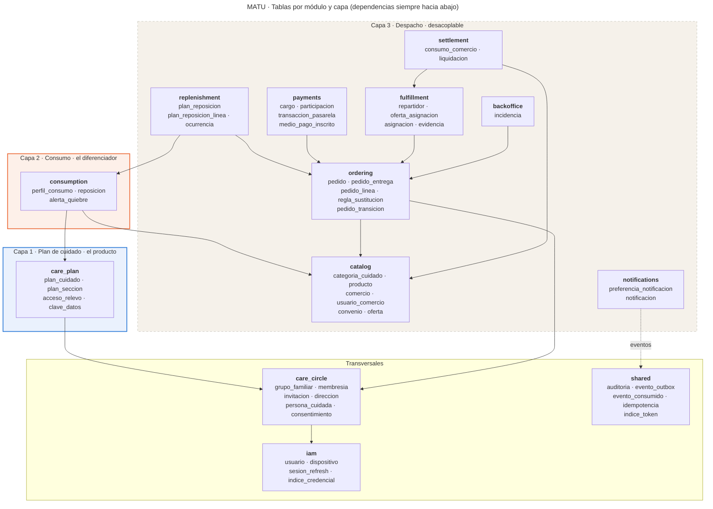

### 3.2 Diagrama entidad-relación completo

Con 49 tablas, el diagrama completo no se lee bien embebido. Está en `docs/diagramas/modelo-datos/01-er-vista-general.svg`, en formato vectorial para hacer zoom. Omite las referencias de autoría (`creado_por`, `actualizado_por` y similares), que son decenas de líneas que no explican la estructura. Las secciones siguientes muestran cada área con todas sus columnas.

---

## 4. El modelo por área

Cada diagrama muestra con detalle las tablas del área y, solo con su clave, las tablas vecinas con las que se relacionan. **"opcional"** marca una columna que admite nulo.

### 4.1 Identidad, grupo familiar y consentimiento

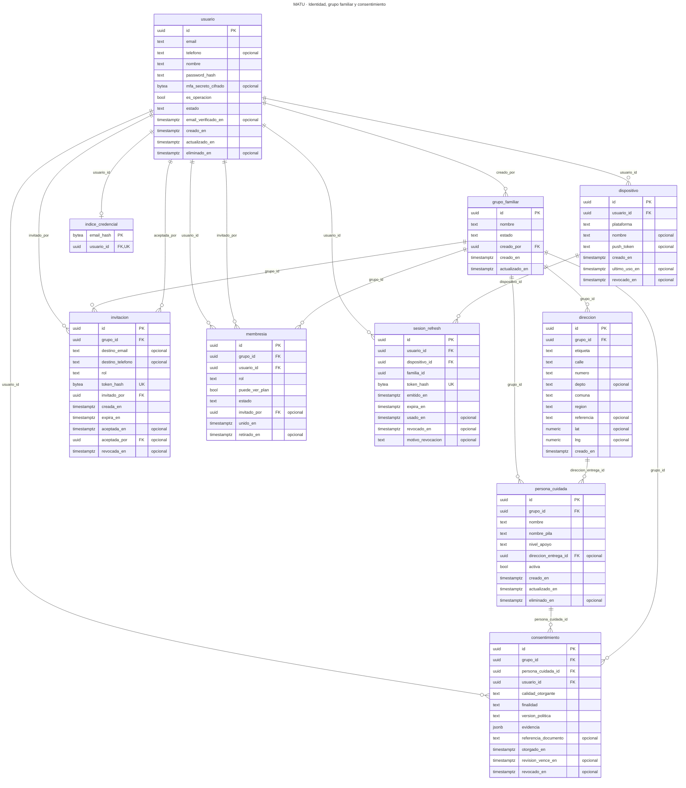

| Tabla | Propósito | Reglas que conviene notar |
|---|---|---|
| `usuario` | Toda persona con cuenta: familiar, encargado de comercio, repartidor u operación | Email único sin distinguir mayúsculas. Un usuario de operación no puede existir sin MFA (`CHECK`) |
| `indice_credencial` | Resuelve email → usuario **antes** de que exista contexto, en el login | Sin RLS. Guarda `HMAC-SHA256(pepper, email normalizado)`, nunca el email. El pepper vive fuera de la base, así que el hash no se revierte con un diccionario de emails |
| `dispositivo` | Dispositivos para notificaciones push y para atar sesiones | Se revoca, no se borra |
| `sesion_refresh` | Refresh token rotativo con detección de reutilización (11.6) | Todos los tokens de una cadena comparten `familia_id`. Si se presenta uno ya usado, se revoca la familia entera. Vigencia máxima de 30 días por `CHECK` |
| `grupo_familiar` | El tenant del sistema | — |
| `membresia` | Quién pertenece a qué grupo y con qué rol | Un usuario, una membresía por grupo. `puede_ver_plan` solo tiene sentido para `pagador` (`CHECK`) |
| `invitacion` | Invitar a un familiar por email o teléfono (RF-38) | Token con hash, vence en máximo 7 días |
| `direccion` | Direcciones del grupo | Coordenadas opcionales, validadas por rango |
| `persona_cuidada` | La persona que recibe el cuidado. Es sujeto de datos, no usuario | **Sin diagnóstico** (11.3). `nivel_apoyo` es operacional |
| `consentimiento` | Consentimiento por persona y finalidad (Ley 21.719, sección 11.5) | Un solo consentimiento vigente por persona y finalidad. `representante_legal` exige referencia al documento. `cuidador_de_hecho` exige fecha de revisión anual |

### 4.2 Capa 1 · Plan de cuidado, cifrado y relevo

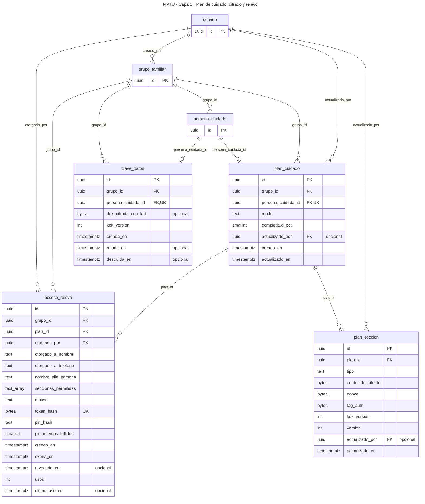

| Tabla | Propósito | Reglas que conviene notar |
|---|---|---|
| `clave_datos` | Una clave de datos (DEK) por persona cuidada, cifrada con la clave maestra (KEK) | `dek_cifrada_con_kek` nula **si y solo si** `destruida_en` tiene valor. El borrado criptográfico no deja estados ambiguos ni se regenera en silencio (defecto 5 de la sección 12.8) |
| `plan_cuidado` | Un plan por persona cuidada | `modo` = `ficha_relevo` por defecto, tras el cierre del ADR-023. `completo` queda disponible sin migración |
| `plan_seccion` | El contenido, cifrado sección por sección | Nonce de exactamente 12 bytes, tag de 16. **El nonce es único en toda la tabla**: repetirlo rompe AES-GCM. `version` implementa el bloqueo optimista (RF-04) |
| `acceso_relevo` | El enlace temporal para el relevo (RF-05 a RF-07) | Solo secciones válidas y al menos una. Vigencia máxima de 30 días. PIN con máximo 5 intentos fallidos. Guarda `nombre_pila_persona` para que el relevo nunca lea `persona_cuidada` |

**La ficha de relevo no necesita tablas nuevas.** Sus tres campos (rutina en una línea, qué hacer si se altera, a quién llamar) son tres tipos de sección que ya existían: `rutina`, `manejo_situaciones` y `red_apoyo`. El ADR-023 decía que el plan B "no toca el modelo de datos", y este diseño lo confirma.

### 4.3 Capa 2 · Perfil de consumo, reposiciones y alertas

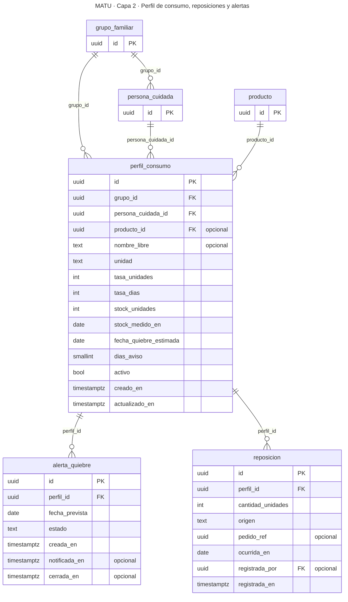

| Tabla | Propósito | Reglas que conviene notar |
|---|---|---|
| `perfil_consumo` | Cuánto se usa de un producto y cuánto queda | La tasa es una **fracción entera** (sección 7). Admite un producto del catálogo **o** un nombre libre, para que la capa 2 funcione sin catálogo ni convenio (ADR-002). Un solo perfil activo por persona y producto. La fecha de quiebre está materializada |
| `reposicion` | Una compra, hecha en MATU o declarada | `pedido_ref` es una referencia opaca **sin clave foránea**: la capa 2 no depende de la 3. Si el origen es `pedido_matu`, la referencia es obligatoria |
| `alerta_quiebre` | El aviso antes de que algo se acabe | Única por perfil y fecha prevista: una corrida doble del job no genera dos avisos (ADR-012) |

### 4.4 Capa 3 · Catálogo, comercios y convenios

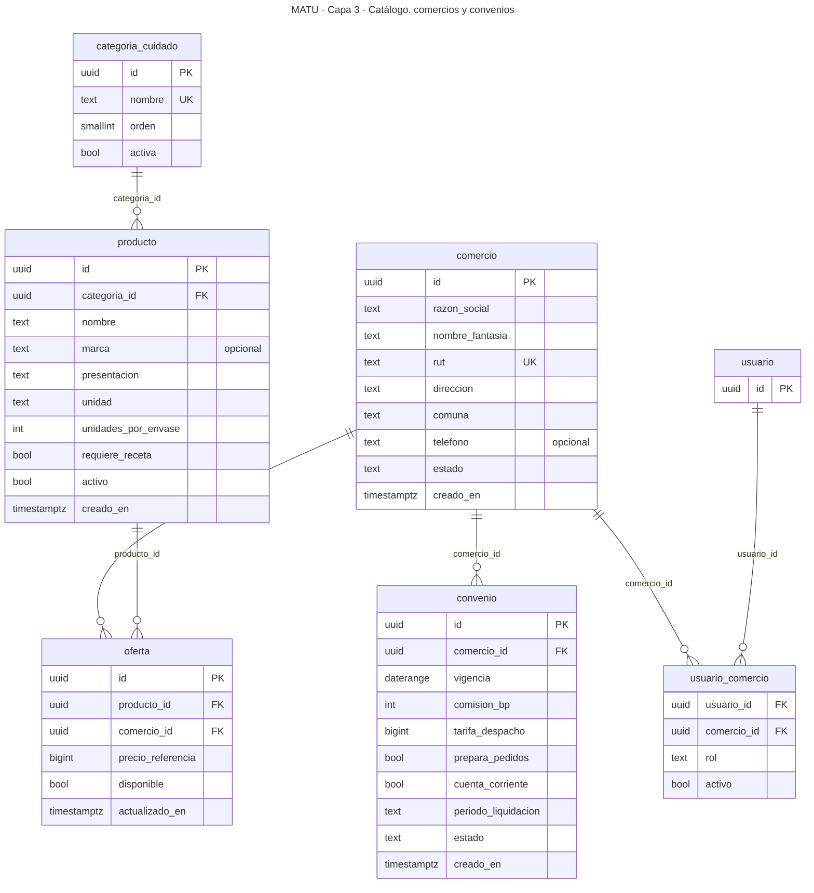

| Tabla | Propósito | Reglas que conviene notar |
|---|---|---|
| `categoria_cuidado`, `producto` | El catálogo curado | Datos de referencia: todos los leen, solo operación los escribe. `unidades_por_envase` conecta el catálogo con el perfil de consumo |
| `comercio` | Comercios en convenio | Todos ven los activos (nombre para armar pedidos) |
| `usuario_comercio` | Qué usuarios operan la vista de un comercio | Resuelve el `app.comercio_id` del encargado al iniciar sesión |
| `convenio` | Condiciones comerciales | `comision_bp` en puntos base. **Un comercio no puede tener dos convenios vigentes que se traslapen** (`EXCLUDE` sobre el rango de vigencia) |
| `oferta` | Precio de un producto en un comercio | El comercio actualiza solo las suyas. Con el ADR-027 es el precio exacto con IVA del comercio en convenio. [PENDIENTE: la migración 0002 no tocó `oferta`; la columna sigue llamándose `precio_referencia` y el esquema la comenta como referencial (ADR-011, ya reemplazado)] |

### 4.5 Capa 3 · Pedido, sustitución y reposición programada

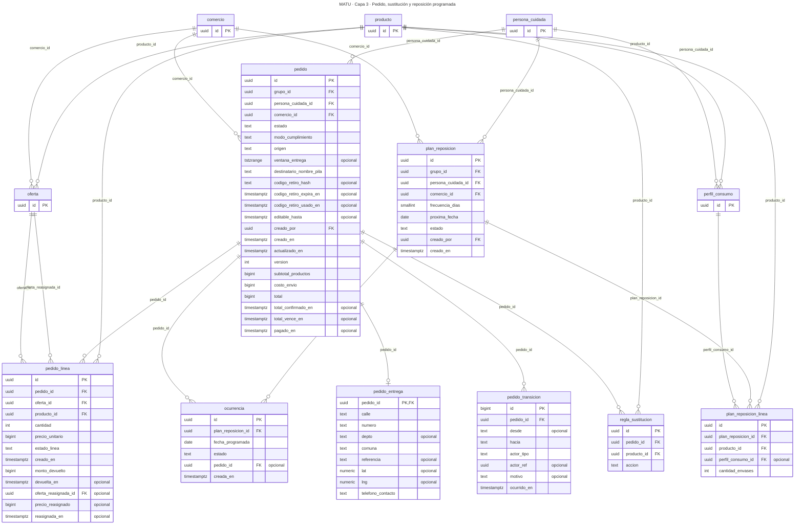

| Tabla | Propósito | Reglas que conviene notar |
|---|---|---|
| `pedido` | El pedido, con sus 17 estados (sección 8.1 de la arquitectura) | Los 17 estados están en un `CHECK`: `borrador`, `total_confirmado`, `vencido`, `pagado`, `enviado_a_comercio`, `preparando`, `listo_retiro`, `asignado`, `sin_repartidor`, `retirado`, `en_ruta`, `entregado`, `no_entregado`, `reprogramado`, `cerrado`, `cancelado` y `cancelado_con_devolucion`. Las transiciones válidas las controla el dominio, no la base. **`total = subtotal_productos + costo_envio`**, con un envío único por pedido. `total_vence_en` (15 minutos, lo fija el dominio) existe si y solo si existe `total_confirmado_en`, y es posterior. **`pagado_en` fija el precio**: nulo antes del pago, obligatorio desde `pagado`, y solo con total confirmado. Desde ahí, el trigger `pedido_pagado_fijo` impide cambiar el total, sus partes, la confirmación y `pagado_en`, y volver a un estado previo al pago. [PENDIENTE: `destinatario_nombre_pila` viene de la 0001 y contradice la decisión del 26 de octubre: el comercio no ve ningún nombre. Sale con una migración nueva. Como RLS filtra filas y no columnas, mientras exista el comercio puede leerla en la base, igual que `grupo_id`, `persona_cuidada_id` y `creado_por`.] |
| `pedido_entrega` | La dirección de entrega congelada al confirmar | **Tabla aparte a propósito**: el comercio ve el pedido y nunca la dirección (11.2), y RLS filtra filas, no columnas |
| `pedido_linea` | Qué se pidió, a qué precio, y qué se devolvió | `precio_unitario` es el precio exacto pagado. **Con el pedido pagado, un trigger impide cambiar producto, oferta, cantidad o precio, y agregar o borrar líneas** (`pedido_linea_pagada_fija`): lo que no se entrega se devuelve, no se edita. `monto_devuelto` nunca supera cantidad × `precio_unitario`, y la línea está en `devuelta` si y solo si tiene monto y fecha de devolución. La reasignación apunta a otra oferta **del mismo producto** (trigger `pedido_linea_mismo_producto`), con sus tres columnas juntas o ninguna; la diferencia de `precio_reasignado` la asume MATU (arquitectura, 7.6 b). Estados: `pendiente`, `sin_stock`, `preparada`, `faltante`, `devuelta`, `eliminada`. [PENDIENTE: el comercio que reemplaza a otro no ve la línea reasignada, porque la línea hereda la visibilidad del pedido y el RLS del comercio usa `pedido.comercio_id`. Es de la fase 2, con una decisión de aislamiento pendiente] |
| `regla_sustitucion` | Qué hace MATU si falta un producto (RF-21, redefinido el 27-10) | Una regla por producto y pedido. `accion` es `otro_comercio` (el mismo producto en otro comercio en convenio) o `quitar` (sale del pedido y se devuelve su precio), por `CHECK`. **Sin fila, se busca en otro comercio**: es la opción por omisión. La migración 0002 quitó `producto_sustituto_id`, `precio_maximo` y `regla_sustitucion_especifico`: nunca otra marca ni otro producto. Mantiene `regla_sustitucion_uq` y la política `regla_hereda`. El backend propone renombrarla a `regla_faltante`; es una propuesta y no se renombró |
| `pedido_transicion` | La línea de tiempo del pedido | Solo inserción. Es lo que permite reconstruir un pedido con incidencia sin tocar la base (atributo de calidad 6) |
| `plan_reposicion` y `plan_reposicion_linea` | Envíos periódicos (RF-17) | Las líneas se proponen desde el perfil de consumo (8.9) |
| `ocurrencia` | Cada envío programado, materializado con 14 días de anticipación | Única por plan y fecha (ADR-012). `generada` si y solo si tiene pedido |

### 4.6 Capa 3 · Cargo, pago dividido y pasarela

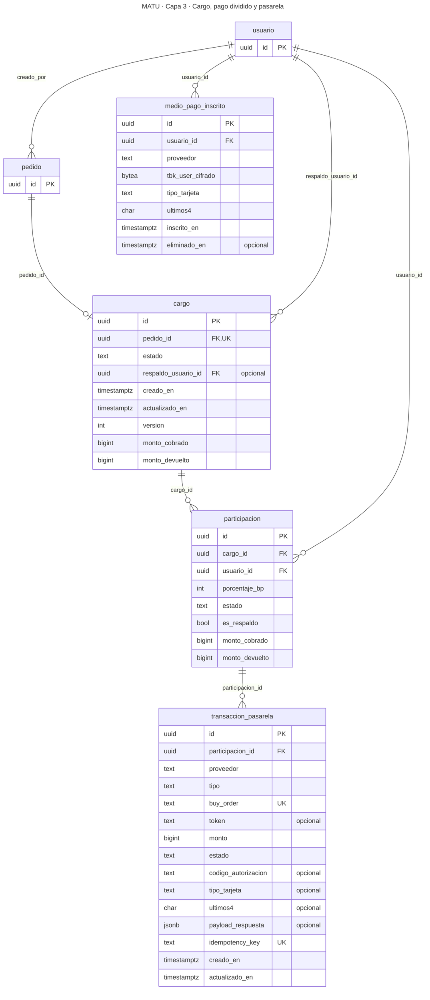

| Tabla | Propósito | Reglas que conviene notar |
|---|---|---|
| `cargo` | Lo que MATU cobra a la familia por un pedido: un solo cobro del total exacto (ADR-027) | Uno por pedido. Sin margen, monto autorizado ni capturado. **Lo devuelto nunca supera lo cobrado** (`CHECK`). Estados `pendiente`, `pagado`, `rechazado`, `devuelto_parcial` y `anulado`, y un `CHECK` ata cada uno a sus montos: nada cobrado en `pendiente` y `rechazado`; cobrado y nada devuelto en `pagado`; devolución menor que lo cobrado en `devuelto_parcial` e igual en `anulado` |
| `participacion` | La parte de cada familiar | Un solo respaldo por cargo (índice único parcial). Mismos montos y la misma regla que `cargo`, con los estados en femenino (`pendiente`, `pagada`, `rechazada`, `devuelta_parcial`, `anulada`). [PENDIENTE: la 0002 quitó `monto_comprometido`, que era la base del prorrateo de la arquitectura 8.3; cuando vuelva el pago entre varios familiares, la base del reparto se define con otra migración.] **En el MVP hay una sola participación por cargo:** el pago entre varios familiares salió del semestre con el segundo recorte de la arquitectura v1.1 (sección 15.3), y la tabla se mantiene para cuando vuelva |
| `transaccion_pasarela` | Cada operación con Transbank: `venta` (venta normal de Webpay Plus) o `anulacion`, total o parcial | **Nunca se borra** (permiso y trigger). `buy_order` limitado a 26 caracteres, que es el límite de Transbank. `tipo_tarjeta` registra crédito, débito o prepago, que es justo lo que deben verificar los casos de venta normal con los dos medios. El estado `autorizando` se mantiene para el retorno pendiente de la pasarela y su índice de conciliación |
| `medio_pago_inscrito` | Tarjeta inscrita con OneClick | Solo la ve su dueño. Entraba al MVP por el respaldo del pago dividido (ADR-007), que salió del semestre con el segundo recorte. Se mantiene en el esquema para la fase 2 del producto |

### 4.7 Capa 3 · Cumplimiento y liquidación al comercio

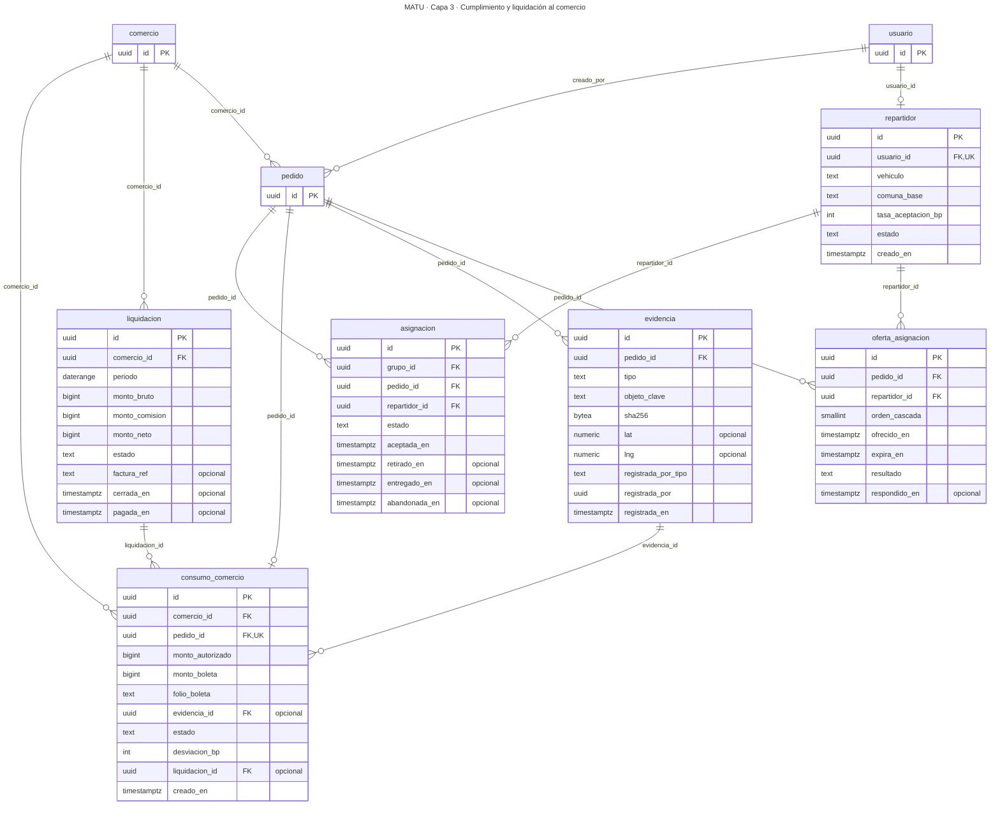

| Tabla | Propósito | Reglas que conviene notar |
|---|---|---|
| `repartidor`, `oferta_asignacion`, `asignacion` | App de repartidor y cascada de ofertas | **Diseñadas y condicionadas**: RF-27 a RF-30 son *Debería* tras el recorte de la sección 15.3. Una sola asignación activa por pedido |
| `evidencia` | Foto de boleta o de entrega, con hash | Se ata al **pedido** y no a la asignación, porque en el MVP la registra el comercio desde su vista |
| `consumo_comercio` | Lo que MATU le debe al comercio por un pedido | Uno por pedido. `liquidado` si y solo si pertenece a una liquidación. [PENDIENTE: `monto_autorizado`, "el tope que vio el comercio", sigue en el esquema aunque el ADR-027 ya no tiene tope autorizado. Se rediseña con la conciliación (arquitectura, 11.7) y el convenio] |
| `liquidacion` | El cierre de un período con un comercio | `neto = bruto − comisión` por `CHECK`. **Dos liquidaciones del mismo comercio no pueden traslapar períodos** (`EXCLUDE`) |

### 4.8 Transversales

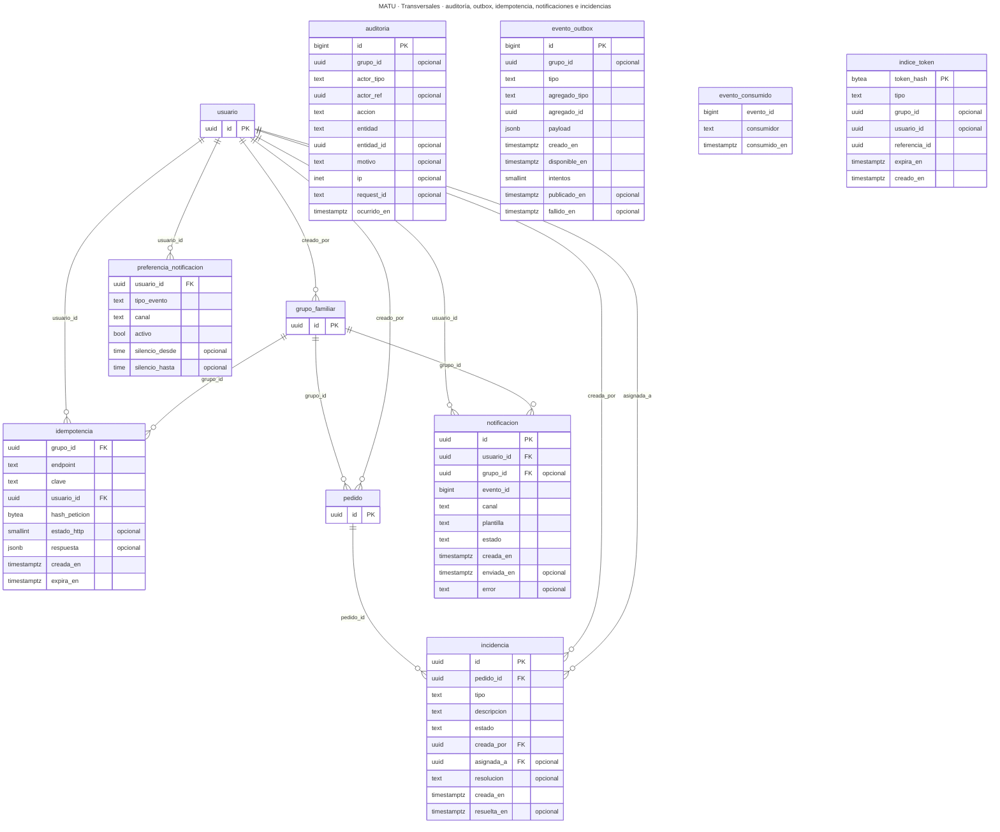

| Tabla | Propósito | Reglas que conviene notar |
|---|---|---|
| `auditoria` | Todo acceso al plan y toda acción sensible | **Solo inserción**, por permiso y por trigger. `actor_ref` es polimórfico porque el relevo no es usuario |
| `evento_outbox` | Eventos de dominio hacia notificaciones (8.6) | Sin RLS. **El payload solo admite UUID**: un `CHECK` rechaza cualquier otro valor, así que un dato personal no puede colarse por error |
| `evento_consumido` | Idempotencia del consumidor | Clave primaria compuesta |
| `idempotencia` | Respuestas guardadas por `Idempotency-Key` | Lleva `grupo_id` y RLS (defecto 4 de la sección 12.8). Guarda el hash de la petición: la misma clave con otro cuerpo es un error 422 |
| `indice_token` | Traduce el hash de un token al tenant, para endpoints públicos | Sin RLS y sin dato sensible. Cubre relevo, invitación, retorno de pasarela y refresh |
| `preferencia_notificacion`, `notificacion` | Canales, horario de silencio y registro de envíos | El registro no guarda el mensaje, solo que se envió. Las plantillas viven en el código |
| `incidencia` | Incidencias de operación sobre un pedido (RF-40) | La familia ve las de sus pedidos. [PENDIENTE: los tipos `desviacion_monto` y `captura_rechazada` siguen en el `CHECK`; con precio exacto y sin captura pierden su sentido original y se revisan junto con la conciliación] |

---

## 5. Aislamiento

### 5.1 Roles de base de datos

| Rol | Quién lo usa | Qué puede |
|---|---|---|
| `matu_owner` | Solo Alembic, para migrar | Es dueño de las tablas. Con `FORCE ROW LEVEL SECURITY`, ni siquiera él evade RLS |
| `matu_app` | La API y el worker | Todo lo de negocio, filtrado por RLS. No es dueño ni tiene `BYPASSRLS`. No puede actualizar ni borrar auditoría, no puede borrar transacciones de pasarela y no puede leer el outbox |
| `matu_publisher` | El publicador del outbox | **Solo** `evento_outbox` y `evento_consumido` |
| `matu_scheduler` | El scheduler | **Solo** las columnas `id` y `estado` de `grupo_familiar`, para encolar un job por grupo |

### 5.2 Contexto de sesión

Toda petición y todo job fija estas variables con `set_config(clave, valor, true)`. El `true` las hace locales a la transacción, así que el pool de conexiones no arrastra el contexto de una petición a la siguiente.

| Variable | Quién la fija | Cuándo |
|---|---|---|
| `app.usuario_id` | API | Siempre y primero, en toda petición autenticada |
| `app.grupo_id` | API y worker | Cuando el actor es una familia, o un job de un grupo. **Nunca en una sesión de relevo** |
| `app.comercio_id` | API | Cuando el actor es un encargado de comercio |
| `app.repartidor_id` | API | Cuando el actor es un repartidor |
| `app.acceso_relevo_id` | API | En la vista de relevo, después de resolver el token y validar el PIN |
| `app.rol` | API y worker | `operacion`, `relevo` o `sistema`. Si no se fija, vale `ninguno` |

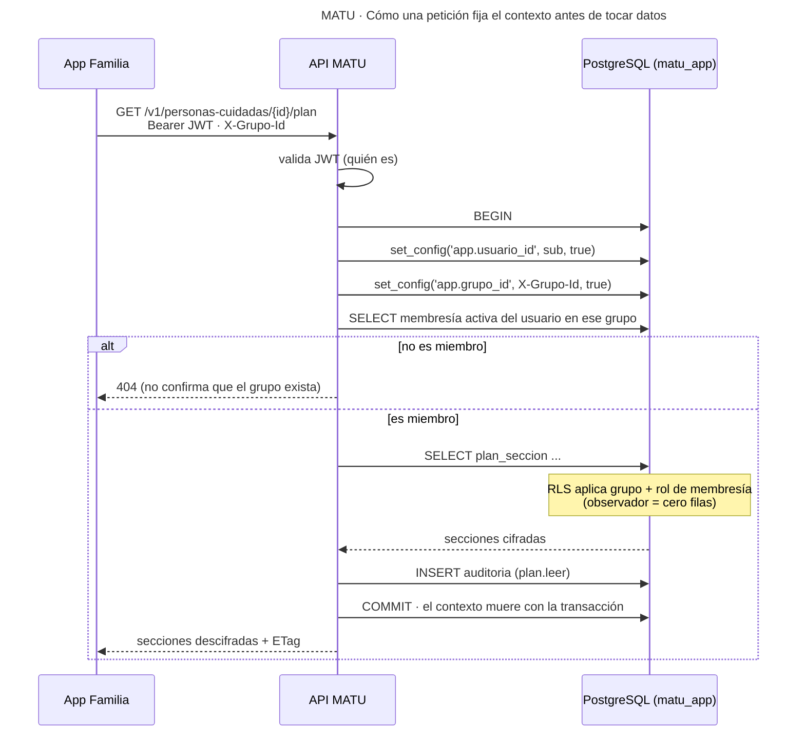

### 5.3 Matriz de acceso

Cada celda de esta matriz está respaldada por una prueba de `test_aislamiento.py`. Versión en imagen: `10-rls-matriz-de-acceso.png`.

| Eje | Plan de cuidado | Perfil de consumo | Pedido | Líneas y precios | Dirección de entrega | Cargo y pagos | Liquidación | Auditoría |
|---|---|---|---|---|---|---|---|---|
| **Familia** | Según rol¹ | Sí | Sí | Sí | Sí | Sí | Nunca | Su grupo |
| **Relevo** | Solo secciones habilitadas y vigente | Nunca | Nunca | Nunca | Nunca | Nunca | Nunca | Inserta la suya |
| **Comercio** | Nunca | Nunca | Pagados y enviados o posteriores² | Sí | **Nunca** | Nunca | Los suyos | Nunca |
| **Repartidor** | Nunca | Nunca | Su asignación activa | **Nunca** | Su asignación activa | Nunca | Nunca | Nunca |
| **Operación** | **Nunca** | **Nunca** | Todos | Todos | Todos | Todos | Todos | Lee todo |
| **Sistema (worker)** | Nunca | Su grupo | Su grupo | Su grupo | Su grupo | Su grupo | Nunca | Inserta |
| **Sin contexto** | Nunca | Nunca | Nunca | Nunca | Nunca | Nunca | Nunca | Nunca |

¹ admin y cuidador siempre, pagador solo con `puede_ver_plan`, observador nunca. **Esta regla vive en RLS**, no solo en la API: si la API olvida revisar el rol, la base igual devuelve cero filas.

² Desde la migración 0002, `pedido_comercio_ver` y `pedido_comercio_actualizar` exigen `pedido.comercio_id` del comercio, `pagado_en` con valor y un estado posterior a `pagado`. Las líneas heredan esa visibilidad. [PENDIENTE: con esa regla, el comercio que reemplaza a otro en la fase 2 no ve la línea reasignada (sección 4.5).]

### 5.4 Cinco hallazgos al escribir las políticas

Escribir las 94 políticas y probarlas contra PostgreSQL encontró cinco problemas que no se veían en la sección 7.7 de la arquitectura. Los cinco están corregidos en este modelo y cubiertos por una prueba.

| # | Hallazgo | Consecuencia si no se corregía | Corrección | Prueba |
|---|---|---|---|---|
| 1 | **Una hija que hereda por `EXISTS` hereda TODAS las políticas del padre**, no solo la de familia | El relevo habría visto todas las secciones del plan, no solo las habilitadas. El comercio habría visto la dirección de entrega. El repartidor, los precios unitarios | Las hijas de tablas con varios ejes (`plan_seccion`, `acceso_relevo`, `pedido_entrega`, `pedido_linea`) declaran su condición explícita en vez de heredar | `test_relevo_ve_exactamente_sus_secciones`, `test_comercio_ve_pedidos_enviados_sin_direccion_ni_pago`, `test_repartidor_sin_precios_unitarios` |
| 2 | **Si la sesión de relevo fija `app.grupo_id`, hereda todas las políticas de familia** | El relevo, que entra con un enlace de WhatsApp y sin cuenta, habría visto pedidos, pagos y direcciones | El relevo nunca fija `app.grupo_id`. Sus políticas se resuelven solo por `app.acceso_relevo_id` | `test_relevo_no_hereda_nada_de_la_familia` |
| 3 | **Dos políticas que se consultan mutuamente forman un ciclo** que PostgreSQL rechaza en tiempo de ejecución | `plan_cuidado → acceso_relevo → plan_cuidado` y `pedido → asignacion → pedido` habrían fallado con "infinite recursion detected in policy" | `acceso_relevo` y `asignacion` llevan `grupo_id` propio en vez de heredar | Toda la suite: cualquier consulta sobre esas tablas fallaría |
| 4 | **El login necesita buscar un usuario antes de tener contexto**, igual que la vista de relevo | Con RLS forzado, buscar el email en el login devuelve cero filas y nadie puede iniciar sesión. La arquitectura solo contemplaba dos excepciones | Tercera excepción declarada: `indice_credencial`, sin RLS y sin dato personal en claro (guarda un HMAC del email con un secreto fuera de la base) | `test_force_activo_tabla_por_tabla` la reconoce como infraestructura |
| 5 | **Una política declarada para todos los roles se evalúa también para el scheduler** | El scheduler no podía listar grupos: evaluaba una política que consulta `membresia`, sobre la que no tiene permiso | Las políticas de `grupo_familiar` se declaran `TO matu_app`, y el scheduler tiene su propia política `TO matu_scheduler` | `test_scheduler_solo_enumera_identificadores` |

**La lección de fondo es la misma de la sección 12.8:** los errores de un modelo de aislamiento son de segundo orden y no se ven leyendo. Se ven escribiendo cada política y probando qué filas alcanza cada rol.

### 5.5 Las excepciones sin RLS

| Tabla | Por qué no tiene RLS | Cómo se acota |
|---|---|---|
| `evento_outbox` | El publicador es transversal a tenants | Solo lo lee `matu_publisher`. La API solo inserta. El payload solo admite UUID (`CHECK`) |
| `evento_consumido` | Lo escribe el consumidor, transversal | Solo identificadores de evento |
| `indice_token` | Los endpoints públicos resuelven el tenant desde el token | Solo hashes e identificadores, sin dato sensible |
| `indice_credencial` | El login resuelve el usuario desde el email | Solo el HMAC del email y el identificador del usuario |

---

## 6. Cifrado del plan de cuidado

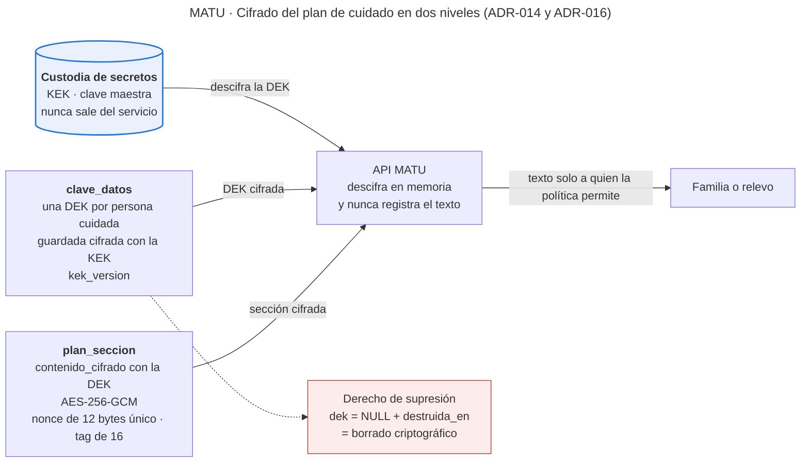

- **KEK:** clave maestra en el servicio de custodia de secretos del proveedor. Nunca sale de ahí (ADR-016).
- **DEK:** una por persona cuidada, guardada cifrada con la KEK en `clave_datos`. `kek_version` permite rotar la KEK sin tocar el contenido.
- **Secciones:** AES-256-GCM con la DEK. Nonce aleatorio de 96 bits por cada escritura, guardado junto al texto cifrado y único en toda la tabla.
- **Datos asociados (AAD):** `plan_id ‖ tipo`. Sin AAD, alguien con escritura en la base podría mover el texto cifrado de una sección a otra de la misma persona y el descifrado pasaría igual. Con AAD, falla.
- **Creación de la DEK:** en la primera escritura del plan, no al dar de alta a la persona. Así "todavía no existe" y "fue destruida" son estados distintos.
- **Borrado criptográfico:** `dek_cifrada_con_kek = NULL` y `destruida_en = now()`, en la misma sentencia. Un `CHECK` impide dejar uno sin el otro. Escribir sobre un plan con clave destruida es un error de dominio explícito, nunca una clave nueva generada en silencio.
- **El relevo** puede leer la DEK solo de la persona de su acceso vigente, y solo las secciones habilitadas.

---

## 7. El cálculo del quiebre con enteros

La arquitectura guardaba `tasa_uso_diaria` como número. Eso obliga a decimales para casos como "un suplemento cada cinco días" (0,2 al día). Este modelo guarda la tasa como **fracción entera**, igual que el dinero:

| Caso | `tasa_unidades` | `tasa_dias` |
|---|---|---|
| 4 pañales al día | 4 | 1 |
| 1 suplemento cada 5 días | 1 | 5 |
| 3 sobres cada 2 días | 3 | 2 |

```
dias_cobertura = piso(stock_unidades × tasa_dias / tasa_unidades)     -- división entera
fecha_quiebre  = stock_medido_en + dias_cobertura
alerta_si      = (fecha_quiebre − hoy) ≤ dias_aviso
```

Ejemplo: 24 pañales, 4 al día → piso(24 × 1 / 4) = 6 días. 3 suplementos, 1 cada 5 días → piso(3 × 5 / 1) = 15 días. Son los dos casos del ejemplo de la sección 9.6 de la arquitectura.

**Registrar una reposición.** Se calcula el stock de hoy (`stock_unidades` menos lo consumido desde `stock_medido_en`, con piso en cero), se le suma lo repuesto, y se guarda como nuevo stock con `stock_medido_en = hoy`. El ancla sigue siendo la última medición, nunca la reposición, como exige la sección 7.3.

---

## 8. Integridad garantizada por la base

Reglas que la base hace cumplir aunque el código se equivoque:

| Regla | Mecanismo |
|---|---|
| Lo devuelto nunca supera lo cobrado, ni en el cargo ni en cada participación, y cada estado calza con sus montos | `CHECK` |
| El total del pedido es productos más un envío único, y el total confirmado tiene un vencimiento posterior | `CHECK` |
| Antes del pago no hay `pagado_en`; desde `pagado`, siempre | `CHECK` |
| Con el pedido pagado, el total, el envío, el subtotal, `pagado_en` y las marcas de la confirmación quedan fijos, y el pedido no vuelve a `borrador`, `total_confirmado` ni `vencido` | Trigger `pedido_pagado_fijo` |
| Con el pedido pagado, sus líneas no cambian de producto, cantidad ni precio, y no se agregan ni se borran | Trigger `pedido_linea_pagada_fija` |
| Si falta un producto, solo se busca en otro comercio o se quita: nunca otro producto | `CHECK` de `regla_sustitucion.accion` |
| Una línea nunca se reasigna a otro producto, y su oferta es de su producto | Trigger `pedido_linea_mismo_producto` |
| Lo devuelto de una línea nunca supera cantidad × precio | `CHECK` |
| El comercio ve un pedido solo si está pagado y enviado | Política de RLS |
| Un solo respaldo por cargo | Índice único parcial |
| Un nonce nunca se repite | Índice único |
| Un solo consentimiento vigente por persona y finalidad | Índice único parcial |
| Un solo perfil activo por persona y producto | Índice único parcial |
| Una sola asignación activa por pedido | Índice único parcial |
| Sin convenios vigentes traslapados, sin liquidaciones traslapadas | `EXCLUDE` con `btree_gist` |
| Liquidación: neto = bruto − comisión | `CHECK` |
| Auditoría y línea de tiempo del pedido: solo inserción | Permiso + trigger |
| Transacciones de pasarela: nunca se borran | Permiso + trigger |
| El outbox no lleva datos | `CHECK` sobre el payload |
| El acceso de relevo vence en máximo 30 días, la invitación en 7, el refresh en 30 | `CHECK` |
| Un usuario de operación tiene MFA | `CHECK` |
| Borrado criptográfico sin estados ambiguos | `CHECK` |

Las transiciones de estado del pedido y del cargo **no** se validan en la base. Son reglas de dominio, viven en `domain/` y las cubre la prueba parametrizada de la sección 12.3 de la arquitectura: con la migración 0002, 289 pares de estados del pedido y 25 del cargo. [PENDIENTE: 225 pares del pedido si la máquina del MVP no declara `asignado` ni `sin_repartidor`.] La base sí ata el estado a los datos del cobro (filas anteriores).

---

## 9. Índices

Además de los índices de claves primarias y únicas, el modelo declara índices para las consultas frecuentes:

| Índice | Consulta que sirve |
|---|---|
| `perfil_consumo (grupo_id, fecha_quiebre_estimada) WHERE activo` | "Qué se está por acabar", la consulta más frecuente de la app |
| `pedido (comercio_id, estado, creado_en)` parcial | Pedidos del día en la vista de comercio |
| `transaccion_pasarela (creado_en) WHERE estado = 'autorizando'` | Job de conciliación de retornos perdidos |
| `evento_outbox (disponible_en)` parcial sobre pendientes | Toma del publicador con `SKIP LOCKED` |
| `alerta_quiebre (perfil_id)` parcial sobre abiertas | Alertas pendientes |
| `auditoria (entidad, entidad_id, ocurrido_en DESC)` | Pantalla "quién ha visto el plan" |
| `consumo_comercio (comercio_id, estado)` parcial | Conciliación y cierre de período |

---

## 10. Diferencias con la arquitectura v1.0

La sección 7 de la arquitectura debe actualizarse con estos cambios. Todos salieron de escribir y probar el esquema completo.

| # | Cambio | Razón |
|---|---|---|
| 1 | Seis variables de contexto en vez de cuatro: se agregan `app.repartidor_id` y `app.acceso_relevo_id` | El repartidor y el relevo no son tenants de familia ni de comercio, y necesitan su propio eje |
| 2 | El relevo nunca fija `app.grupo_id` | Hallazgo 2 de la sección 5.4 |
| 3 | Las hijas de tablas con varios ejes no heredan por `EXISTS` | Hallazgo 1 de la sección 5.4 |
| 4 | `acceso_relevo` y `asignacion` llevan `grupo_id` propio | Hallazgo 3 de la sección 5.4 |
| 5 | Tercera excepción sin RLS: `indice_credencial` | Hallazgo 4 de la sección 5.4 |
| 6 | `indice_token` cubre cuatro tipos de token, no solo relevo y pasarela | Invitaciones y refresh también resuelven el tenant desde un token |
| 7 | El rol de membresía se hace cumplir en RLS para el plan de cuidado | Defensa en profundidad sobre el dato más sensible. La arquitectura lo dejaba solo en la API |
| 8 | Rol `matu_scheduler` con permiso por columna | La arquitectura decía "rol de solo lectura" sin definirlo |
| 9 | `pedido_entrega` separada de `pedido` | RLS filtra filas, no columnas. Es la única forma de que el comercio vea el pedido sin la dirección |
| 10 | Tasa de consumo como fracción entera | Sección 7 de este documento |
| 11 | Comisión, margen y porcentajes en puntos base | Coherencia con la decisión 7.6 a |
| 12 | `perfil_consumo` admite un producto fuera del catálogo | La capa 2 debe funcionar sin catálogo ni convenio (ADR-002) |
| 13 | `plan_cuidado.modo` | Cierre del ADR-023 |
| 14 | `evidencia` se ata al pedido | Recorte de la sección 15.3: el comercio registra la evidencia en el MVP |
| 15 | Tablas que la arquitectura no detallaba: `sesion_refresh`, `dispositivo`, `invitacion`, `usuario_comercio`, `pedido_entrega`, `pedido_transicion`, `medio_pago_inscrito`, `preferencia_notificacion`, `notificacion`, `incidencia`, `indice_credencial` | Requisitos que sí estaban (RF-37 a RF-40, ADR-007, sección 11.6, atributo de calidad 6) pero sin tabla que los soportara |
| 16 | Enumerados como `TEXT + CHECK` | Reversibilidad de las migraciones |

---

## 11. Fase 2 · `rx`, diseñado y no implementado

El ADR-022 pide que `rx` quede en el modelo sin implementarse. Estas tablas **no** van en la migración del MVP.

```sql
CREATE TABLE receta (
    id                 uuid PRIMARY KEY DEFAULT gen_random_uuid(),
    grupo_id           uuid NOT NULL REFERENCES grupo_familiar(id),
    persona_cuidada_id uuid NOT NULL REFERENCES persona_cuidada(id),
    objeto_clave       text NOT NULL,        -- imagen de la receta en el bucket privado
    emitida_en         date NOT NULL,
    vence_en           date NOT NULL,
    estado             text NOT NULL CHECK (estado IN ('vigente', 'vencida', 'anulada'))
);
CREATE TABLE solicitud_rx (
    id                          uuid PRIMARY KEY DEFAULT gen_random_uuid(),
    pedido_id                   uuid NOT NULL REFERENCES pedido(id),
    receta_id                   uuid REFERENCES receta(id),
    canal                       text NOT NULL CHECK (canal IN ('farmacia', 'cesfam')),
    autorizacion_titular_ref    text,          -- retiro por tercero en CESFAM
    estado                      text NOT NULL
);
```

Cuando entre, `receta` será dato de salud: llevará la misma política que el plan de cuidado (familia según rol, operación nunca).

---

## 12. Lo que vive fuera de PostgreSQL

| Dato | Dónde | Por qué |
|---|---|---|
| Sesión efímera del relevo (cookie) | Redis, con vencimiento | Se canjea el enlace por una cookie en un paso (11.6). Es efímera por definición |
| Posición del repartidor | Redis | Retención de 30 días y consulta cada 20 segundos (ADR-017) |
| Caché de catálogo | Redis | Se puede vaciar sin pérdida |
| Fotos de evidencia y exportaciones | Almacenamiento de objetos | La base guarda la ruta y el hash |
| Plantillas de notificación | Código | Se versionan con el código |
| KEK | Custodia de secretos del proveedor | ADR-016 |

**Jobs de retención** (sección 11.8) que el modelo deja preparados: limpiar `indice_token` e `idempotencia` vencidos (diario), purgar pedidos y evidencias de más de 2 años, auditoría de más de 3 y pagos de más de 6.

---

## 13. Cómo se ejecuta

Los pasos completos están en el README de MATU_PROYECTO. En resumen, desde la raíz de ese repositorio:

```bash
# 1. Base con roles, base matu y btree_gist (la primera vez que se crea el volumen)
docker compose --env-file .env -f infra/docker-compose.yml up -d

# 2. Esquema, RLS y permisos
cd backend && alembic upgrade head

# 3. Pruebas de aislamiento
pytest -q

# 4. Regenerar los diagramas después de cualquier cambio de esquema
python db/gen_diagramas.py && python db/gen_matriz.py
```

**Paso a Alembic, hecho en el sprint 0.** `01_esquema.sql`, `02_rls.sql` y `03_permisos.sql` forman la migración `0001_esquema_inicial`, con su vuelta atrás. `00_roles.sql` no es una migración: lo corre una sola vez el script de arranque de cada ambiente, junto con `btree_gist`, porque en PostgreSQL gestionado es una extensión permitida pero no la puede crear un rol sin privilegios. La tabla de versiones de Alembic vive en un esquema aparte (`alembic`), porque en `public` el script de RLS la alcanzaría como a cualquier tabla.

---

## 14. Para la revisión conjunta

El esquema ya está migrado. Estas decisiones siguen abiertas y se confirman entre los dos en la planificación del sprint que las usa:

- Vigencia máxima del acceso de relevo: **30 días**, o más corta (sprint 2)
- Vigencia de la invitación: **7 días** (sprint 3)
- Frecuencias permitidas de reposición: 7, 14, 21, 28 y 30 días (fuera del semestre: la reposición programada salió con el segundo recorte)
- Período de liquidación por defecto: **quincenal** (sprint 4)
- Los hallazgos 1 a 5 de la sección 5.4 y los 16 cambios de la sección 10 se llevan a la arquitectura v1.2
- `02_rls.sql` lo revisa completo la otra persona cada vez que cambie, porque toca datos sensibles (sección 12.6 de la arquitectura)

---

*Modelo de datos MATU · versión 1.0 · septiembre 2026 · Jorge Espinoza y Martín Henríquez*
