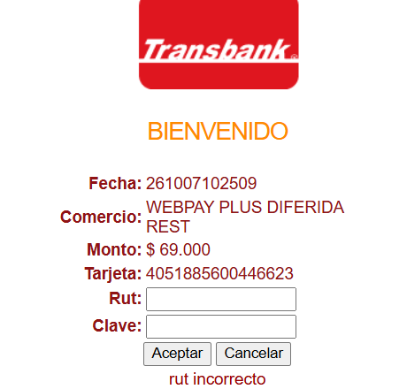
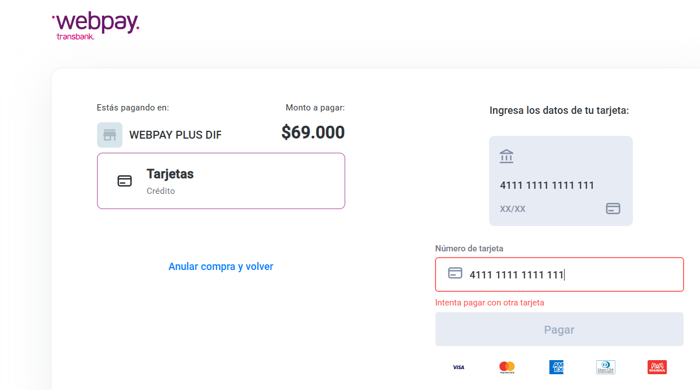

# Prueba de concepto · Transbank Webpay Plus diferido

> **Estado al 13 de octubre de 2026: incompleta, se cierra en el sprint 1.** El débito (caso 4) está respondido. Los casos 1, 2, 3 y 5 están pendientes porque los intentos de pago terminaron anulados. El detalle está en la sección "Intentos".

**Sprint:** 0, se completa en el sprint 1 · **Responsables:** Martín Henríquez y Jorge Espinoza
**Verifica:** ADR-006 (autorización diferida y captura por el monto real) y el riesgo de la sección 17 de la arquitectura sobre el débito
**Guion:** [estrategia de pruebas, sección 10](../estrategia-pruebas.md)
**Código:** [MATU_PROYECTO · spikes/transbank](https://github.com/MartinHenriquez131/MATU_PROYECTO/tree/main/spikes/transbank)

---

## Qué se quería saber

MATU cobra el monto real de un pedido, que puede ser menor al estimado si falta un producto. Para eso el ADR-006 eligió Webpay Plus diferido: se autoriza el monto estimado, se captura el real y, si el pedido se cancela, se revierte. La prueba responde cinco preguntas antes de construir el módulo de pagos.

## Ambiente

- Ambiente de integración de Transbank, con las credenciales públicas de captura diferida (código de comercio 597055555540)
- SDK oficial de Python, `transbank-sdk` 6.1.0
- Tarjeta VISA de crédito de prueba `4051 8856 0044 6623`

## Resultados

| # | Caso | Resultado esperado | Resultado real | Evidencia |
|---|---|---|---|---|
| 1 | Autorizar y capturar el mismo monto | Captura aprobada | **Pendiente** | |
| 2 | Autorizar $69.000 y capturar $51.340 | Se cobra $51.340 y se libera el resto | **Pendiente.** El flujo llega a la autenticación del banco simulado con el comercio "Webpay Plus Diferida" y el monto de este caso, pero esa ejecución se detuvo por RUT incorrecto | [Captura 1](capturas/01-autenticacion-rut-incorrecto.png) |
| 3 | Autorizar y revertir sin capturar | Autorización anulada, nada cobrado | **Pendiente** | |
| 4 | Débito | Registrar qué pasa | **No admite captura diferida.** El formulario del comercio de captura diferida solo ofrece "Tarjetas · Crédito". No hay opción de débito | [Captura 2](capturas/02-formulario-solo-credito.png) |
| 5 | Retorno de la pasarela recibido dos veces | Un solo cobro | **Pendiente** | |

La tarjeta que empieza con `4111` en la captura 2 no es una tarjeta de prueba de Transbank, así que su rechazo no dice nada sobre la captura diferida.

## Qué significa el caso 4

**Se confirma el riesgo declarado en la sección 17 de la arquitectura:** la captura diferida opera solo sobre crédito, y el débito es el medio de pago mayoritario en el segmento. Quien pague con débito no puede pasar por el flujo del ADR-006.

El plan B ya está escrito en el ADR-006: con débito se cobra el monto estimado en el momento y se emite una nota de crédito por la diferencia. Es peor experiencia, pero no bloquea el semestre. **Queda por decidir en el sprint 1** si se aplica tal cual o si el MVP acepta solo crédito.

## Intentos

| Fecha | Quién | Qué pasó |
|---|---|---|
| 7 de octubre | Martín | Pago de $69.000 detenido en la autenticación del banco simulado por RUT incorrecto (captura 1). La captura 2 responde el caso 4 |
| 13 de octubre | Jorge y Martín | Dos pagos nuevos. En los dos, el `commit` respondió `Transaction has an invalid finished state: aborted` (422): Transbank registró el pago como anulado. La causa no se identificó |

**Para el sprint 1:** antes de repetir, consultar el estado de la última transacción con `poc_estado.py TOKEN`, y fijarse en la dirección de retorno. Si dice `TBK_TOKEN` en vez de `token_ws`, el pago se anuló en el navegador. Los pasos de cada caso están en el README del spike.
